# Схема воркфлоу создания скилла

Схема показывает конвейер `skillmaster`: один проход от запроса до готовности, ресёрч не больше чем в два этапа, один проход ревью, без тестирования скилла. Правила шагов записаны в скрипте `.claude/workflows/skillmaster.js` и в файлах `.claude/workflows/sm-assets/`.

Серый пунктир — то, что происходит за границей воркфлоу.

```mermaid
---
config:
  htmlLabels: false
---
flowchart TD
    request(["Пользователь запускает конвейер и наговаривает, какой скилл нужен"]):::step --> questions["`skill-master: вопросы пользователю — первый вызов скрипта
    **Sonnet · medium**`"]:::step
    questions --> hasQuestions{"Вопросы есть"}:::step
    hasQuestions -->|"да"| survey["Сессия показывает вопросы опросником; пользователь отвечает или пропускает"]:::outside
    survey -->|"второй вызов скрипта: ответы или пропуск"| prep
    hasQuestions -->|"нет, тот же вызов"| prep
    prep["`skill-master: рамки и костяк плана скилла, пропущенное решает сам
    **Opus · medium**`"]:::step
    prep --> isRebuild{"Расширение или перестройка скилла"}:::step
    isRebuild -->|"да"| auditFirst["`skill-master: аудит текущего скилла до любого ресёрча
    **Opus · medium**`"]:::step
    auditFirst --> assignment
    isRebuild -->|"нет"| assignment
    assignment["`skill-master: задание исследователям первого этапа, вопрос-карта только по главным темам; темы объединяет по смыслу не больше чем в три задания, расставляет приоритет и пишет, что именно искать
    **Opus · high**`"]:::step
    assignment --> hasResearch{"Все задания покрыты готовыми отчётами"}:::step
    hasResearch -->|"нет"| research
    hasResearch -->|"да"| plan

    subgraph researchStage ["Ресёрч, первый этап: что умеет предмет"]
        research["`Исследователи — не больше трёх, параллельно, по одному на задание без готового отчёта: пустые агенты general-purpose, на задании про Claude или Claude Code — claude-code-guide, чей ответ сохраняет в файл пустой агент. Строго в рамках задания, только фетч; каждый отдаёт один файл
        **Sonnet · medium**`"]:::step
    end
    research --> plan

    subgraph planStage ["План скилла"]
        plan["`skill-master своей ролью: план скилла
        **Opus · high**`"]:::step
        completeness["`skill-master, тот же запуск: полный перечень недостающего и точные рамки для исследователя
        **Opus · high**`"]:::step
        needExtra{"Без ответа нельзя написать файл или шаг скилла по главной теме"}:::step
        plan --> completeness --> needExtra
    end

    subgraph extraStage ["Ресёрч, второй и последний этап"]
        extra["`Один исследователь: пустой агент general-purpose, а claude-code-guide — только когда про Claude или Claude Code каждый вопрос. Строго по перечню и рамкам, только фетч; отдаёт один файл
        **Sonnet · medium**`"]:::step
        revise["`skill-master: приведение плана к ответам
        **Opus · medium**`"]:::step
        leftovers["Найденное сверх перечня и незакрытое откладывается в список на потом"]:::step
        extra --> revise --> leftovers
    end
    needExtra -->|"да"| extra
    needExtra -->|"нет"| writing
    leftovers --> writing

    subgraph writingStage ["Написание скилла"]
        writing["`skill-master: написание или переписывание по плану, данные из ресёрча без повторной сверки, LICENSE только когда необходим
        **Sonnet · medium**`"]:::step
        selfCheck["Самопроверка формата автором в том же запуске, без тестирования скилла"]:::step
        writing --> selfCheck
    end

    subgraph reviewStage ["Ревью, один проход"]
        review["`skill-master в новом запуске читает скилл и план, находки пишет в файл ревью
        **Opus · medium**`"]:::step
        fix["`skill-master в новом запуске исправляет находки один раз, неисправленное и несогласия — в список отложенного
        **Sonnet · medium**`"]:::step
        review --> fix
    end
    selfCheck --> review

    fix --> ready["Скрипт возвращает сессии: путь скилла, список отложенного, при переименовании — старую директорию, ждущую удаления"]:::step
    ready --> finish(["Воркфлоу завершён"]):::step
    finish --> userDecision{"Пользователь: доресёрчить отложенное"}:::outside
    userDecision -->|"да"| newRun["Новый запуск того же конвейера как расширение, в новой папке прогона: что именно доресёрчить и как внести в скилл"]:::outside
    userDecision -->|"нет"| publish["Пользователь: publish.sh, при переименовании — после удаления старой директории; затем git-ops: коммит"]:::outside

    slimSkills["Файлы конвейера в sm-assets: sm-frame.md, sm-research-assignment.md, sm-research.md, sm-pipeline.md, sm-review.md"]:::step
    slimSkills -.-> research
    slimSkills -.-> plan

    classDef step fill:#e8f5e9,stroke:#2e7d32,color:#000
    classDef outside fill:#eeeeee,stroke:#757575,color:#000,stroke-dasharray: 5 5
```

