# Mermaid: круговая, квадрантная, XY-диаграмма, Санки, радар, древовидная карта, Венн

Сверено по Mermaid 12.1.0. Общие правила — встраивание, объявление, комментарии, frontmatter, экранирование, умолчания Mermaid 12, общие ловушки — в [mermaid.md](mermaid.md).

---

## Круговая диаграмма (`pie`)

Документация: https://mermaid.js.org/syntax/pie.html

### Ключевое слово и статус

- `pie`, необязательно `pie showData` — значения выводятся после текста легенды.
- Статус: стабильный.

### Минимальный пример

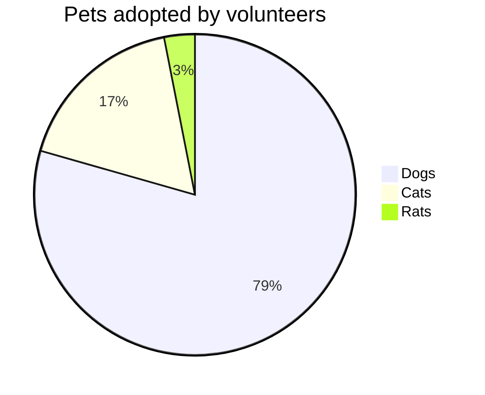

### Синтаксис

Дословно со страницы:

> - Start with `pie` keyword to begin the diagram
>   - `showData` to render the actual data values after the legend text. This is **_OPTIONAL_**
> - Followed by `title` keyword and its value in string to give a title to the pie-chart. This is **_OPTIONAL_**
> - Followed by dataSet. Pie slices will be ordered clockwise in the same order as the labels.
>   - `label` for a section in the pie diagram within `" "` quotes.
>   - Followed by `:` colon as separator
>   - Followed by `positive numeric value` (supported up to two decimal places)

```text
[pie] [showData] (OPTIONAL)
[title] [titlevalue] (OPTIONAL)
"[datakey1]" : [dataValue1]
"[datakey2]" : [dataValue2]
"[datakey3]" : [dataValue3]
.
.
```

Кольцо, положение легенды и выделение сегмента (v11.16.0+) задаются конфигурацией — `donutHole`, `legendPosition`, `highlightSlice`:

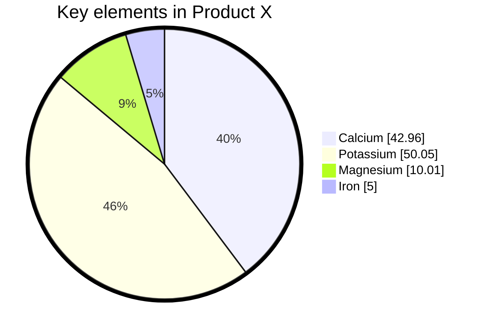

### Стили и классы

`classDef`, `style`, `class` не описаны. Переменные темы круговой диаграммы (`pie1`–`pie12`, `pieOuterStrokeWidth` и другие) — [mermaid-config.md](mermaid-config.md).

### Доступность

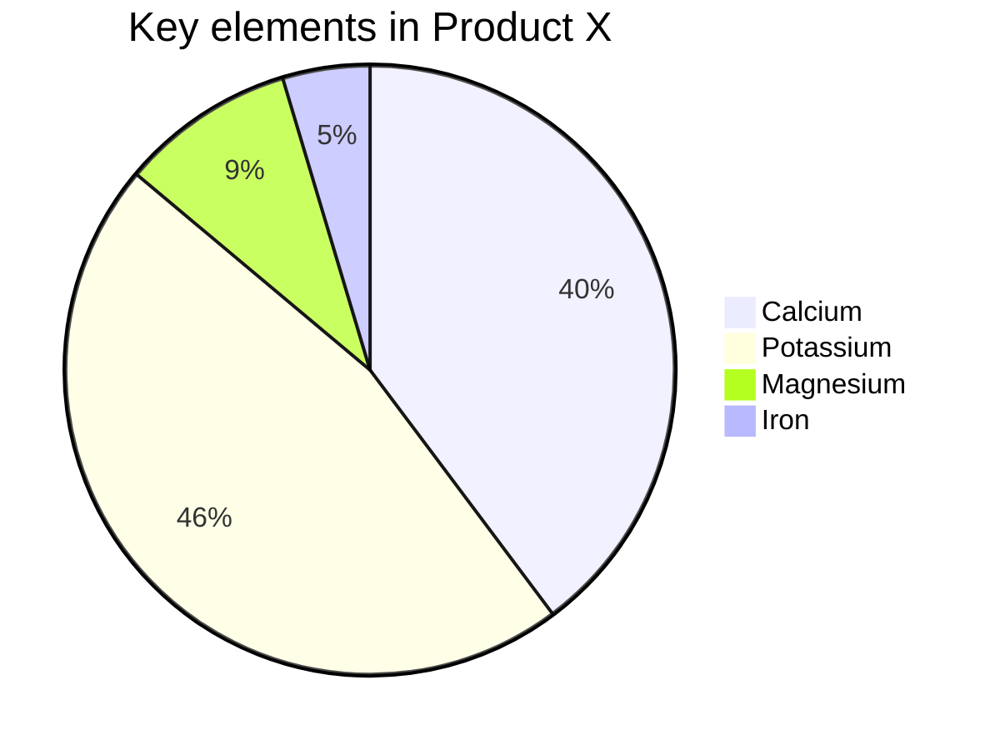

### Ключи `config`, которые задаёт автор

Раздел `pie:` — дословно со страницы:

| Parameter | Description | Default value |
|---|---|---|
| `textPosition` | The axial position of the pie slice labels, from 0.0 at the center to 1.0 at the outside edge of the circle. | `0.75` |
| `donutHole` | Donut hole ratio. Valid values are from `0` to `0.9`. | `0` |
| `legendPosition` | Legend's position relative to the chart. Valid values are `top`, `bottom`, `left`, `right`, and `center`. | `right` |
| `highlightSlice` | Highlight specific slice with matching label. Set to 'hover' to highlight hovered slice. | |

### Ловушки

- «Pie chart values must be **positive numbers greater than zero**. **Negative values are not allowed** and will result in an error.»
- Значения — не больше двух знаков после запятой; метка — обязательно в кавычках.

---

## Квадрантная диаграмма (`quadrantChart`)

Документация: https://mermaid.js.org/syntax/quadrantChart.html

### Ключевое слово и статус

- `quadrantChart`.
- Статус: стабильный. Точки на сетке, разделённой на четыре квадранта.

### Минимальный пример

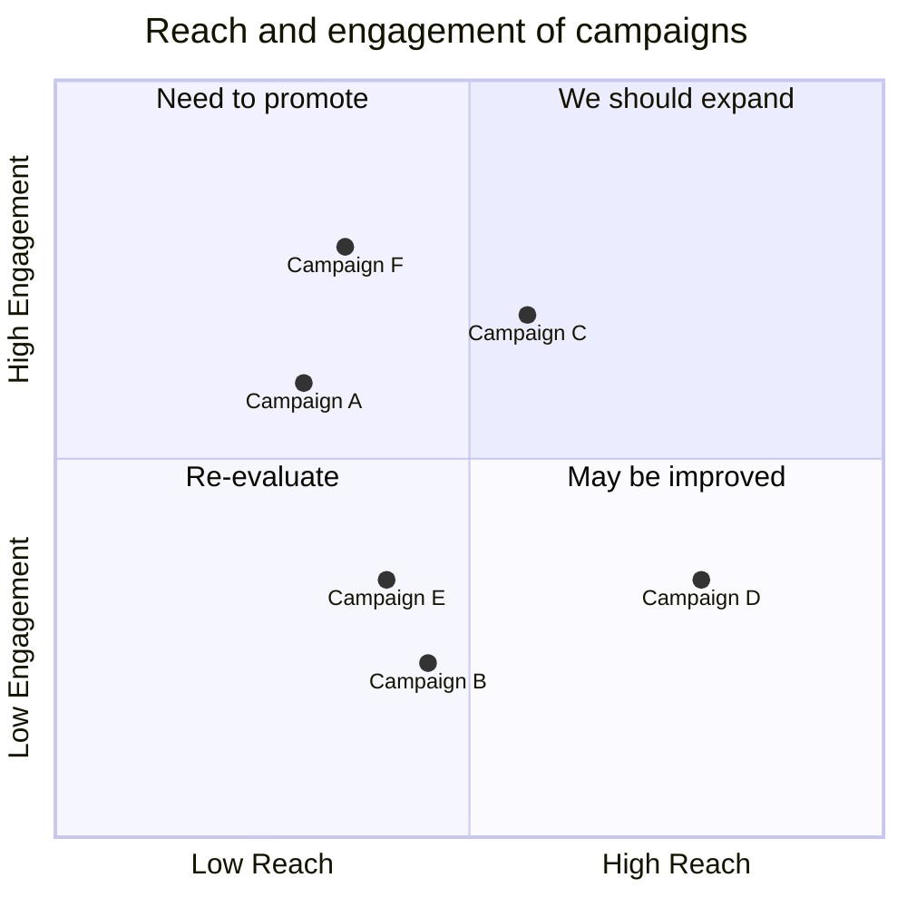

### Синтаксис

- `title` — всегда сверху.
- Ось X — `x-axis <text> --> <text>` (левая и правая подписи) или `x-axis <text>` (только левая).
- Ось Y — `y-axis <text> --> <text>` (нижняя и верхняя) или `y-axis <text>` (только нижняя).
- Тексты квадрантов: `quadrant-1` — правый верхний, `quadrant-2` — левый верхний, `quadrant-3` — левый нижний, `quadrant-4` — правый нижний.
- Точка — `<text>: [x, y]`: «For points x and y value min value is 0 and max value is 1.»

### Стили и классы

«Points can either be styled directly or with defined shared classes»:

```text
Point A: [0.9, 0.0] radius: 12
Point B: [0.8, 0.1] color: #ff3300, radius: 10
Point C: [0.7, 0.2] radius: 25, color: #00ff33, stroke-color: #10f0f0
Point D: [0.6, 0.3] radius: 15, stroke-color: #00ff0f, stroke-width: 5px ,color: #ff33f0
```

```text
Point A:::class1: [0.9, 0.0]
Point B:::class2: [0.8, 0.1]
Point C:::class3: [0.7, 0.2]
Point D:::class3: [0.7, 0.2]
classDef class1 color: #109060
classDef class2 color: #908342, radius : 10, stroke-color: #310085, stroke-width: 10px
classDef class3 color: #f00fff, radius : 10
```

| Parameter | Description |
|---|---|
| color | Fill color of the point |
| radius | Radius of the point |
| stroke-width | Border width of the point |
| stroke-color | Border color of the point (useless when stroke-width is not specified) |

Приоритет: прямые стили, затем классы, затем тема.

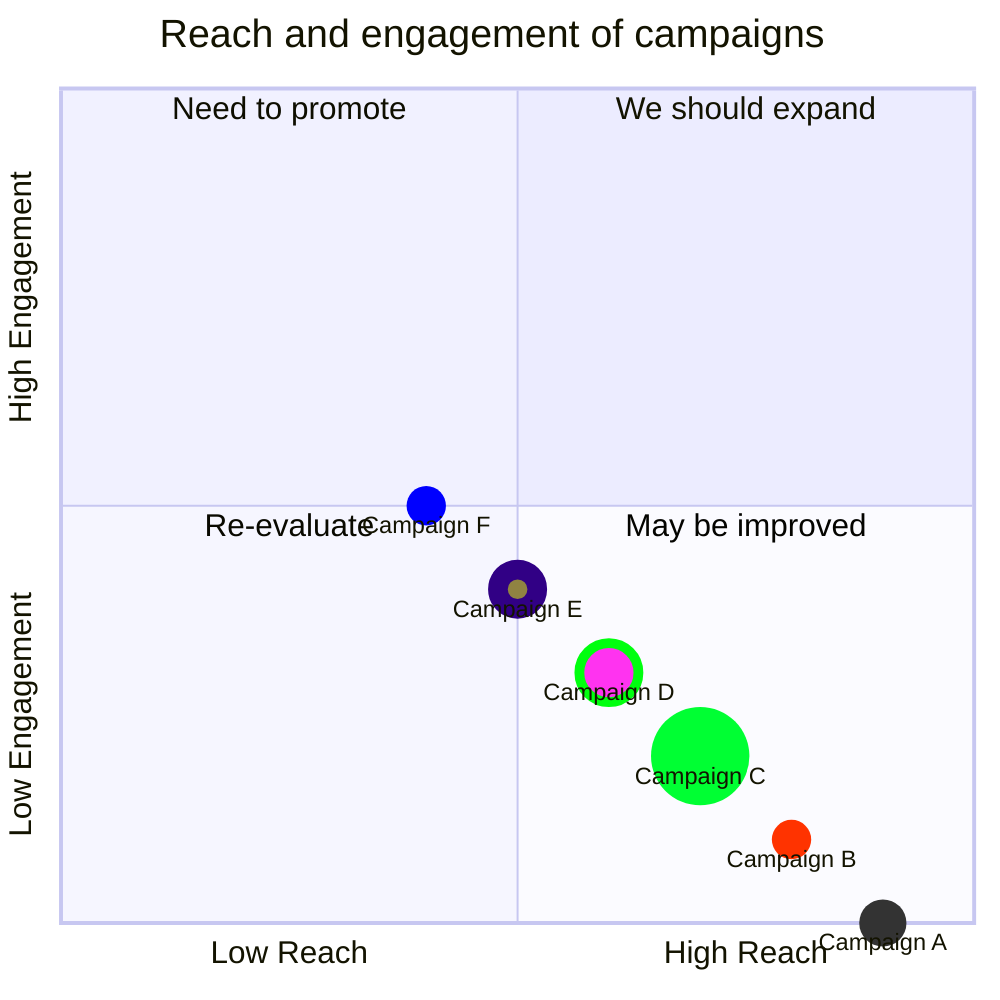

Переменные темы — дословно:

| Parameter | Description |
|---|---|
| quadrant1Fill | Fill color of the top right quadrant |
| quadrant2Fill | Fill color of the top left quadrant |
| quadrant3Fill | Fill color of the bottom left quadrant |
| quadrant4Fill | Fill color of the bottom right quadrant |
| quadrant1TextFill | Text color of the top right quadrant |
| quadrant2TextFill | Text color of the top left quadrant |
| quadrant3TextFill | Text color of the bottom left quadrant |
| quadrant4TextFill | Text color of the bottom right quadrant |
| quadrantPointFill | Points fill color |
| quadrantPointTextFill | Points text color |
| quadrantXAxisTextFill | X-axis text color |
| quadrantYAxisTextFill | Y-axis text color |
| quadrantInternalBorderStrokeFill | Quadrants inner border color |
| quadrantExternalBorderStrokeFill | Quadrants outer border color |
| quadrantTitleFill | Title color |

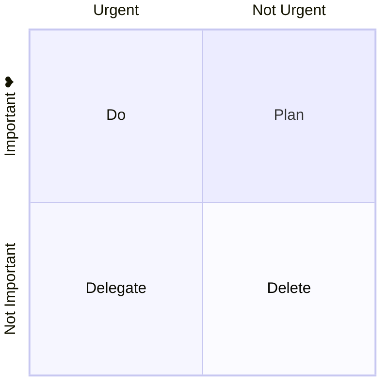

### Ключи `config`, которые задаёт автор

Раздел `quadrantChart:` — дословно со страницы:

| Parameter | Description | Default value |
|---|---|---|
| chartWidth | Width of the chart | 500 |
| chartHeight | Height of the chart | 500 |
| titlePadding | Top and Bottom padding of the title | 10 |
| titleFontSize | Title font size | 20 |
| quadrantPadding | Padding outside all the quadrants | 5 |
| quadrantTextTopPadding | Quadrant text top padding when text is drawn on top ( not data points are there) | 5 |
| quadrantLabelFontSize | Quadrant text font size | 16 |
| quadrantInternalBorderStrokeWidth | Border stroke width inside the quadrants | 1 |
| quadrantExternalBorderStrokeWidth | Quadrant external border stroke width | 2 |
| xAxisLabelPadding | Top and bottom padding of x-axis text | 5 |
| xAxisLabelFontSize | X-axis texts font size | 16 |
| xAxisPosition | Position of x-axis (top , bottom) if there are points the x-axis will always be rendered in bottom | 'top' |
| yAxisLabelPadding | Left and Right padding of y-axis text | 5 |
| yAxisLabelFontSize | Y-axis texts font size | 16 |
| yAxisPosition | Position of y-axis (left , right) | 'left' |
| pointTextPadding | Padding between point and the below text | 5 |
| pointLabelFontSize | Point text font size | 12 |
| pointRadius | Radius of the point to be drawn | 5 |

### Ловушки

- Координаты точек — от 0 до 1.
- При наличии точек ось X всегда внизу.
- `stroke-color` бесполезен без `stroke-width`.

---

## XY-диаграмма (`xychart`)

Документация: https://mermaid.js.org/syntax/xyChart.html

### Ключевое слово и статус

- `xychart`; принимается `xychart-beta`. Ориентация — `xychart horizontal`, по умолчанию вертикальная.
- Статус: стабильный, суффикс `-beta` снят в 11.10.0. Два вида рядов — столбцы `bar` и линии `line`.

### Минимальный пример

«The only two things required are the chart name (`xychart`) and one data set.»

```text
xychart
    line [+1.3, .6, 2.4, -.34]
```

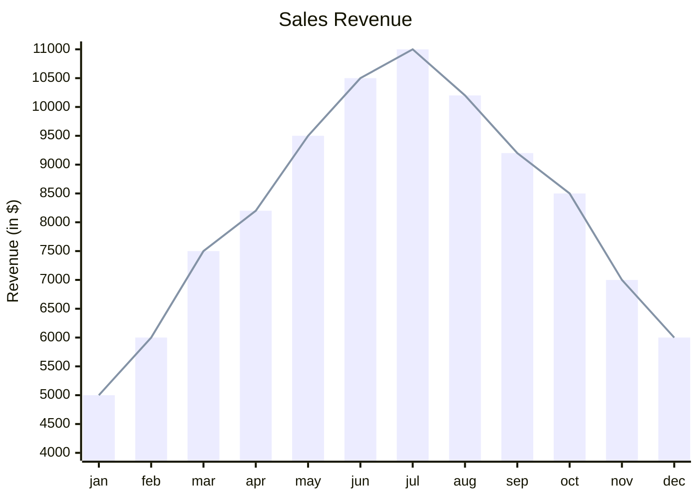

### Синтаксис

«All text values that contain only one word can be written without `"`. If a text value has many words in it, specifically if it contains spaces, enclose the value in `"`»

- Ось X — числовой диапазон `x-axis title min --> max` или категории `x-axis "title with space" [cat1, "cat2 with space", cat3]`.
- Ось Y — только числа: `y-axis title min --> max` или `y-axis title` (диапазон — по данным). «Both x and y axis are optional if not provided we will try to create the range»
- Ряды — `line [2.3, 45, .98, -3.4]` и `bar [2.3, 45, .98, -3.4]`; с именем — `line "series name" […]`, имя попадает в легенду.

**Легенда (v11.17.0+):** «Named line and bar plots are automatically shown in a legend. Unnamed plots are omitted from the legend.»

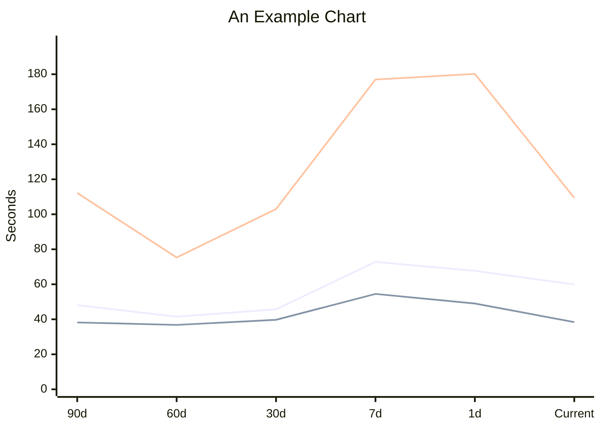

**Значения на столбцах (v11.14.0+)** — `showDataLabel: true`, снаружи столбца — `showDataLabelOutsideBar: true`:

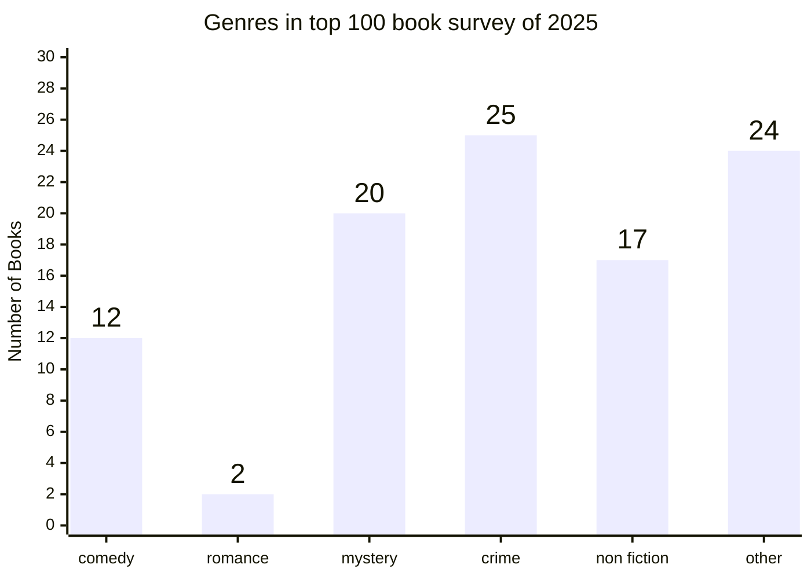

**Подписи точек линии (v11.16.0+)** — строка в кавычках после числа; «Labels are optional per point — you can mix labeled and unlabeled values»:

```mermaid
xychart
    title "Quarterly Performance"
    x-axis [Q1, Q2, Q3, Q4]
    y-axis "Revenue ($M)" 0 --> 100
    line [25 "Launch", 45, 72, 90 "Target Hit"]
```

«Point labels use a fixed font size of 12px. … Labels are currently supported on `line` plots only; the syntax is accepted on `bar` plots but labels are ignored.»

### Стили и классы

`classDef`, `style`, `class` не описаны. Переменные темы — внутри `themeVariables.xyChart`:

```yaml
---
config:
  themeVariables:
    xyChart:
      titleColor: '#ff0000'
---
```

| Parameter | Description |
|---|---|
| backgroundColor | Background color of the whole chart |
| titleColor | Color of the Title text |
| dataLabelColor | Color of the Data labels (if shown) |
| legendTextColor | Color of the legend text |
| xAxisLabelColor | Color of the x-axis labels |
| xAxisTitleColor | Color of the x-axis title |
| xAxisTickColor | Color of the x-axis tick |
| xAxisLineColor | Color of the x-axis line |
| yAxisLabelColor | Color of the y-axis labels |
| yAxisTitleColor | Color of the y-axis title |
| yAxisTickColor | Color of the y-axis tick |
| yAxisLineColor | Color of the y-axis line |
| plotColorPalette | String of colors separated by comma e.g. "#f3456, #43445" |

Цвета рядов — `plotColorPalette`, по порядку рядов:

```mermaid
---
config:
  themeVariables:
    xyChart:
      plotColorPalette: '#000000, #0000FF, #00FF00, #FF0000'
---
xychart
title "Different Colors in xyChart"
x-axis "categoriesX" ["Category 1", "Category 2", "Category 3", "Category 4"]
y-axis "valuesY" 0 --> 50
%% Black line
line [10,20,30,40]
%% Blue bar
bar [20,30,25,35]
%% Green bar
bar [15,25,20,30]
%% Red line
line [5,15,25,35]
```

### Ключи `config`, которые задаёт автор

Раздел `xyChart:` — дословно со страницы:

| Parameter | Description | Default value |
|---|---|---|
| width | Width of the chart | 700 |
| height | Height of the chart | 500 |
| titlePadding | Top and Bottom padding of the title | 10 |
| titleFontSize | Title font size | 20 |
| showTitle | Title to be shown or not | true |
| showLegend | Legend to be shown for named plots or not | true |
| legendFontSize | Legend font size | 14 |
| legendPadding | Padding around the legend | 10 |
| xAxis | xAxis configuration | AxisConfig |
| yAxis | yAxis configuration | AxisConfig |
| chartOrientation | 'vertical' or 'horizontal' | 'vertical' |
| plotReservedSpacePercent | Minimum space plots will take inside the chart | 50 |
| showDataLabel | Should show the value corresponding to the bar within the bar | false |
| showDataLabelOutsideBar | If showing data label then show it outside the bar. | false |

Настройки оси `AxisConfig` (для `xAxis` и `yAxis`):

| Parameter | Description | Default value |
|---|---|---|
| showLabel | Show axis labels or tick values | true |
| labelFontSize | Font size of the label to be drawn | 14 |
| labelPadding | Top and Bottom padding of the label | 5 |
| showTitle | Axis title to be shown or not | true |
| titleFontSize | Axis title font size | 16 |
| titlePadding | Top and Bottom padding of Axis title | 5 |
| showTick | Tick to be shown or not | true |
| tickLength | How long the tick will be | 5 |
| tickWidth | How width the tick will be | 2 |
| showAxisLine | Axis line to be shown or not | true |
| axisLineWidth | Thickness of the axis line | 2 |
| labelRotation | Label rotation in degrees (only applicable on bottom X axis) | 0 |

### Ловушки

- ЕСЛИ задаются переменные темы или ключи XY-диаграммы -> писать ключ `xyChart`, как в примерах: текст страницы называет его `xychart`.
- Ось Y не бывает категориальной; текст с пробелами — в кавычках.
- Безымянные ряды в легенду не попадают; подписи точек работают только у `line`.

---

## Диаграмма Санки (`sankey`)

Документация: https://mermaid.js.org/syntax/sankey.html

### Ключевое слово и статус

- `sankey`; по исходному коду Mermaid, на странице документации не описано: принимается и `sankey-beta` (https://github.com/mermaid-js/mermaid/tree/develop/packages/mermaid/src/diagrams/sankey/parser).
- Статус: experimental — «This is an experimental diagram. Its syntax are very close to plain CSV, but it is to be extended in the nearest future.» Появилась в v10.3.0.

### Минимальный пример

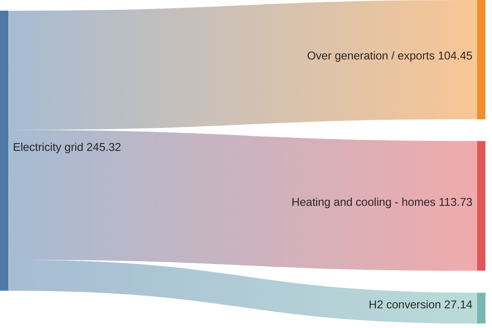

### Синтаксис

После `sankey` — CSV из трёх столбцов `source`, `target`, `value`. CSV по RFC 4180 (https://www.ietf.org/rfc/rfc4180.txt) с отличиями: «CSV must contain **3 columns only**» и «It is **allowed** to have **empty lines** without comma separators for visual purposes».

Пустые строки:

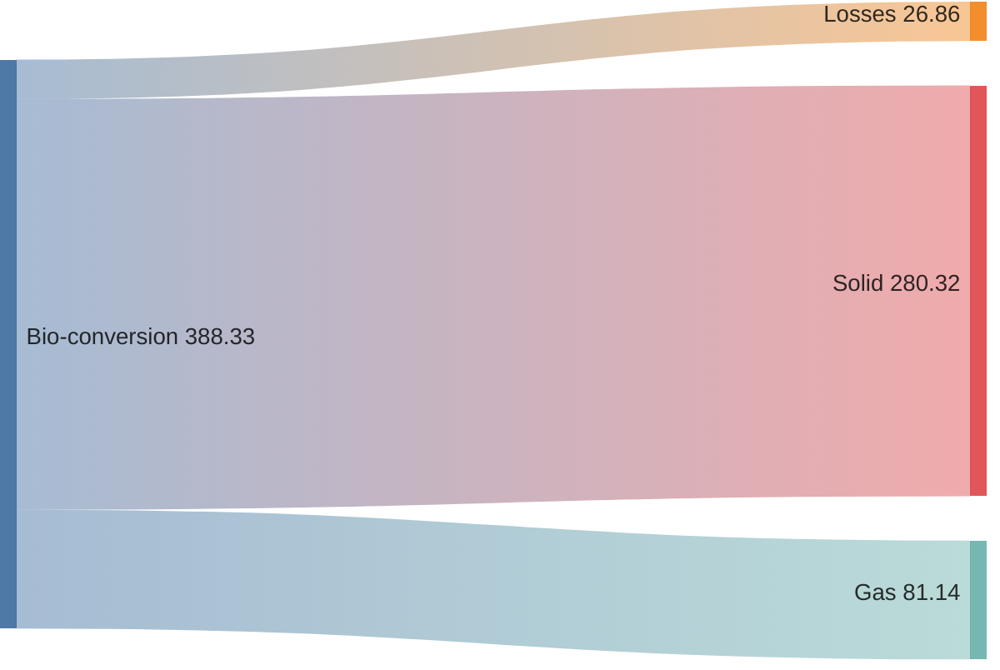

Запятая в значении — в двойных кавычках:

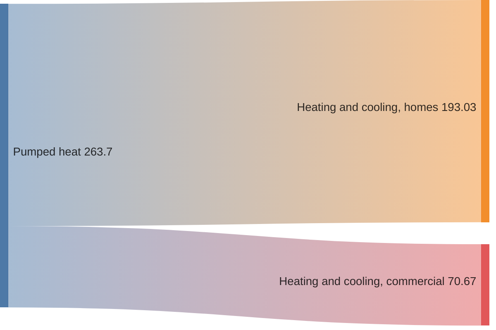

Кавычка внутри кавычек удваивается:

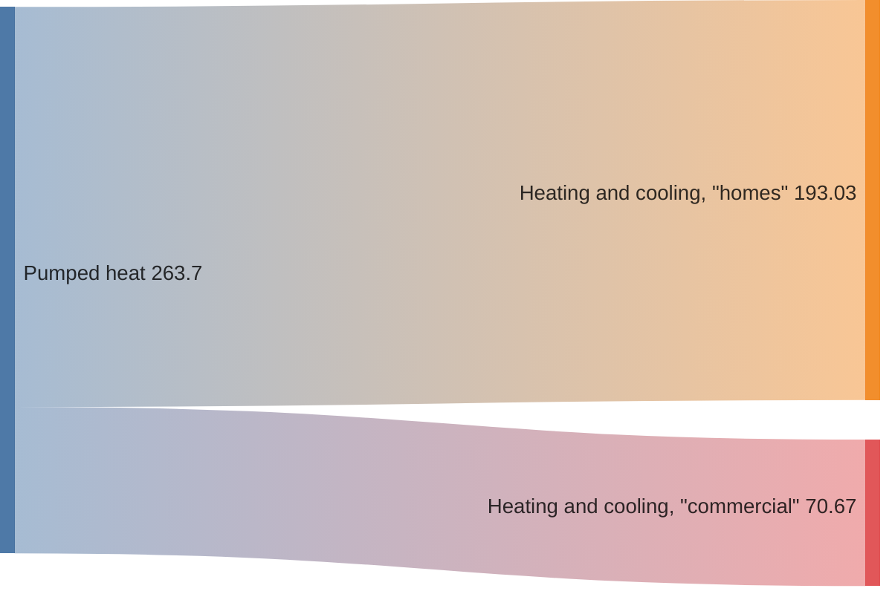

### Стили и классы

`classDef`, `style`, `class` не описаны. Цвет связей — `linkColor`: `source`, `target`, `gradient` или hex-код; выравнивание узлов — `nodeAlignment`: `justify`, `center`, `left`, `right`.

**Стиль подписей (v11.15.0+)** — `labelStyle`: «`legacy` (default) - plain text labels, positioned based on node x-coordinate», «`outlined` - labels with a background stroke for improved readability, positioned based on node layer relative to the central node».

**Ширина и отступ узлов (v11.15.0+)** — `nodeWidth` (по умолчанию `10`), `nodePadding` (`12`).

**Цвета узлов (v11.15.0+)** — словарь `nodeColors`: «Values must be valid CSS colors (hex, `rgb()`, `hsl()`, or named colors).»

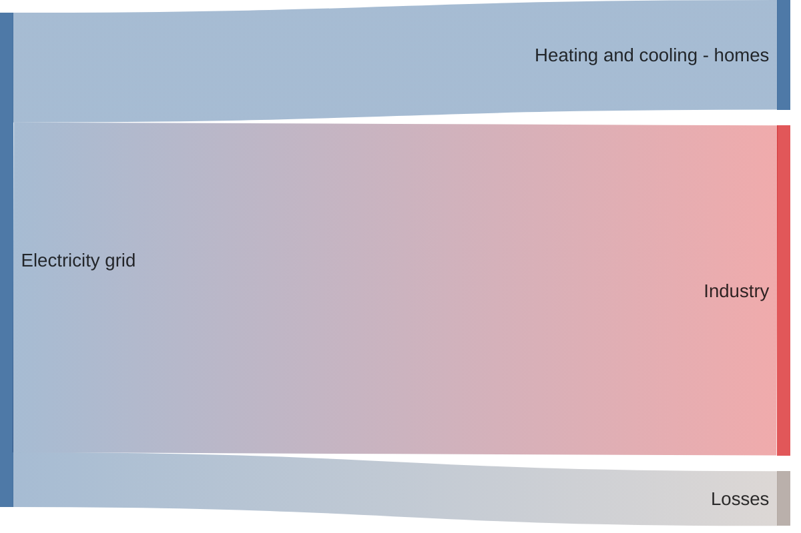

### Ключи `config`, которые задаёт автор

Раздел `sankey:`, по схеме конфигурации: `width` (`600`), `height` (`400`), `linkColor` (`"gradient"`), `nodeAlignment` (`"justify"`), `showValues` (`true`), `prefix` и `suffix` для значений (`""`), `nodeWidth` (`10`), `nodePadding` (`12`), `labelStyle` (`"legacy"`), `nodeColors`, `useMaxWidth` (`false`).

### Ловушки

- Ровно три столбца; запятая в значении — только в кавычках.
- ЕСЛИ в именах узлов кириллица или другие символы вне ASCII -> проверить результат целевым рендером: по исходному коду Mermaid, на странице документации не описано, символы текста без кавычек заданы диапазоном ASCII (https://github.com/mermaid-js/mermaid/tree/develop/packages/mermaid/src/diagrams/sankey/parser).

---

## Радарная диаграмма (`radar-beta`)

Документация: https://mermaid.js.org/syntax/radar.html

### Ключевое слово и статус

- `radar-beta`.
- Статус: beta (суффикс `-beta`). Появилась в v11.6.0. «A radar diagram is a simple way to plot low-dimensional data in a circular format.»

### Минимальный пример

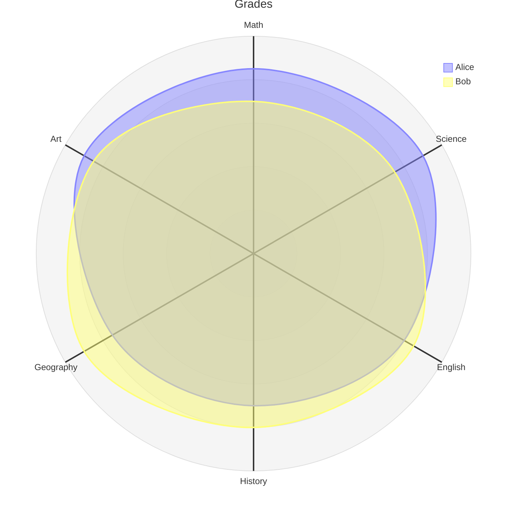

### Синтаксис

- `title` — необязательный заголовок.
- `axis` — идентификатор и необязательная подпись; несколько осей в строке через запятую.
- `curve` — идентификатор, необязательная подпись и список значений по порядку осей или пары «ось: значение»: «If key-value pairs are used, the key represents the axis ID and the value represents the data point. Else, the data points are assumed to be in the order of the axes defined.»

```
radar-beta
  axis axis1, axis2, axis3
  curve id1["Label1"]{1, 2, 3}
  curve id2["Label2"]{4, 5, 6}, id3{7, 8, 9}
  curve id4{ axis3: 30, axis1: 20, axis2: 10 }
  ...
```

Параметры — дословно:

- «`showLegend`: The showLegend keyword is used to show or hide the legend in the radar diagram. The legend is shown by default.»
- «`max`: The maximum value for the radar diagram. This is used to scale the radar diagram. If not provided, the maximum value is calculated from the data points.»
- «`min`: The minimum value for the radar diagram. This is used to scale the radar diagram. If not provided, the minimum value is `0`.»
- «`graticule`: The graticule keyword is used to define the type of graticule to be rendered in the radar diagram. The graticule can be `circle` or `polygon`. If not provided, the default graticule is `circle`.»
- «`ticks`: The ticks keyword is used to define the number of ticks on the graticule. It is the number of concentric circles or polygons drawn to indicate the scale of the radar diagram. If not provided, the default number of ticks is `5`.»

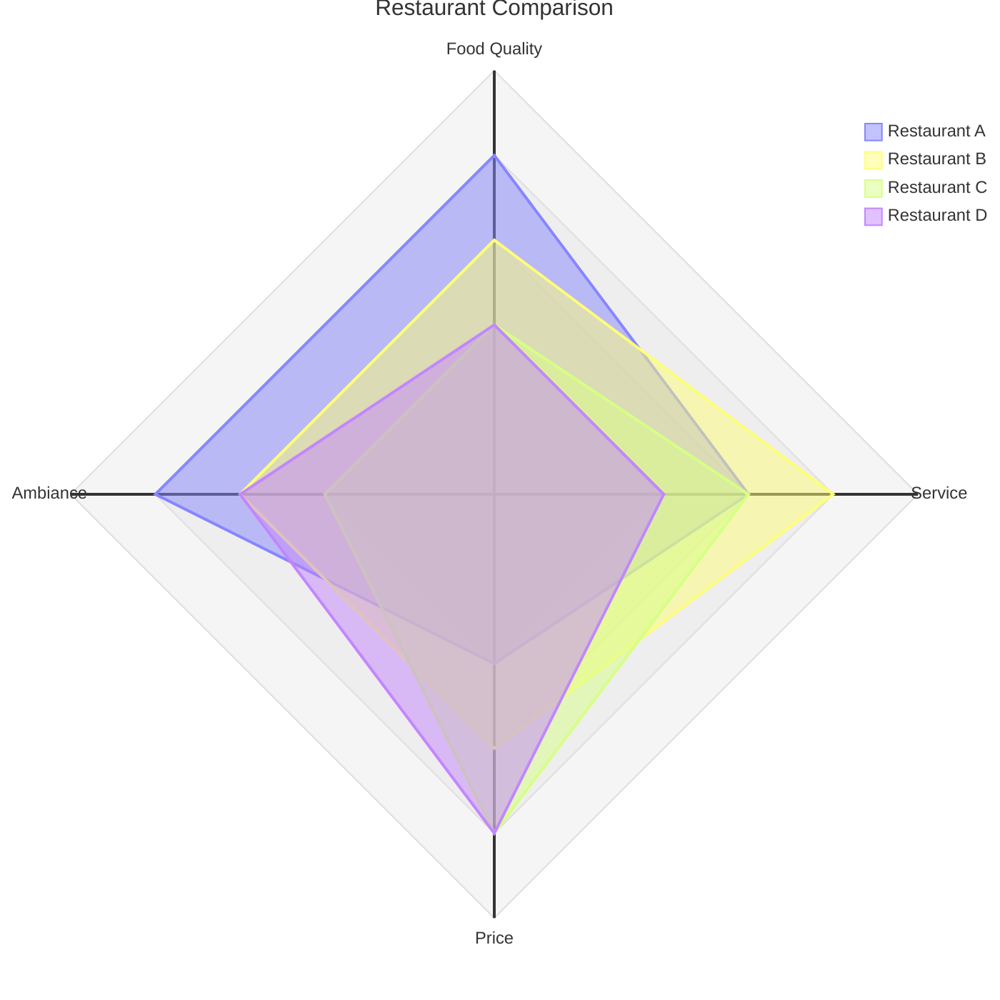

### Стили и классы

`classDef` и `style` не описаны; оформление — переменные темы. Цвета кривых — `cScale${i}`: «Usually, the maximum number of colors is `12`.» Параметры стиля радара — внутри `themeVariables.radar`:

| Property | Description | Default Value |
|---|---|---|
| axisColor | Color of the axis lines | `black` |
| axisStrokeWidth | Width of the axis lines | `1` |
| axisLabelFontSize | Font size of the axis labels | `12px` |
| curveOpacity | Opacity of the curves | `0.7` |
| curveStrokeWidth | Width of the curves | `2` |
| graticuleColor | Color of the graticule | `black` |
| graticuleOpacity | Opacity of the graticule | `0.5` |
| graticuleStrokeWidth | Width of the graticule | `1` |
| legendBoxSize | Size of the legend box | `10` |
| legendFontSize | Font size of the legend | `14px` |

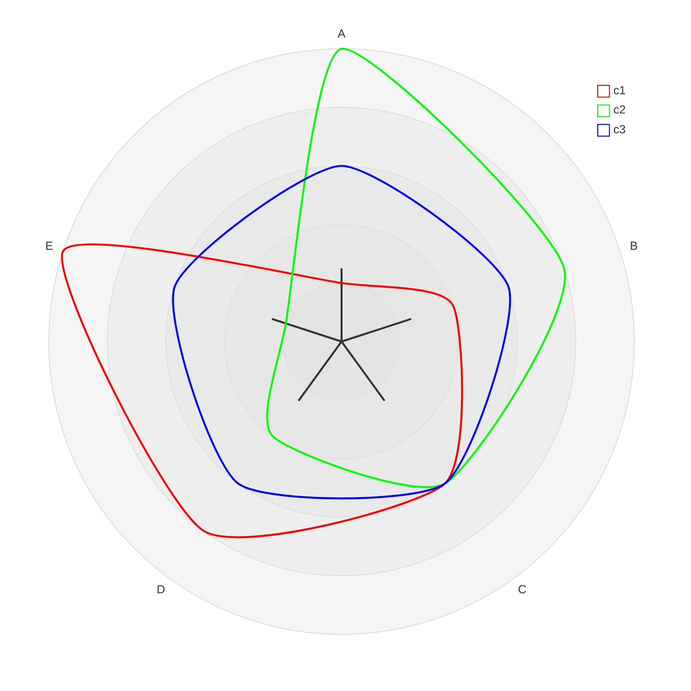

### Ключи `config`, которые задаёт автор

Раздел `radar:` — дословно со страницы:

| Parameter | Description | Default Value |
|---|---|---|
| width | Width of the radar diagram | `600` |
| height | Height of the radar diagram | `600` |
| marginTop | Top margin of the radar diagram | `50` |
| marginBottom | Bottom margin of the radar diagram | `50` |
| marginLeft | Left margin of the radar diagram | `50` |
| marginRight | Right margin of the radar diagram | `50` |
| axisScaleFactor | Scale factor for the axis | `1` |
| axisLabelFactor | Factor to adjust the axis label position | `1.05` |
| curveTension | Tension for the rounded curves | `0.17` |

### Ловушки

- По журналу изменений с 11.16.1 число делений `ticks` ограничено 32.
- Без пар «ось: значение» значения сопоставляются осям по порядку объявления.

---

## Древовидная карта (`treemap-beta`)

Документация: https://mermaid.js.org/syntax/treemap.html

### Ключевое слово и статус

- `treemap-beta`. По исходному коду Mermaid, на странице документации не описано: принимается и `treemap` (https://github.com/mermaid-js/mermaid/tree/develop/packages/parser/src/language/treemap).
- Статус: beta — «This is a new diagram type in Mermaid. Its syntax may evolve in future versions.» По журналу изменений появилась в 11.8.0.

### Минимальный пример

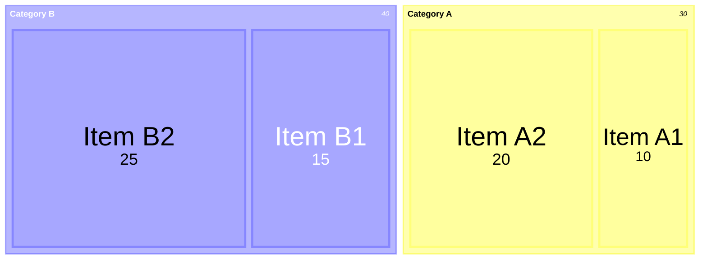

### Синтаксис

Дословно:

- «**Section/Parent nodes**: Defined with quoted text `"Section Name"`»
- «**Leaf nodes with values**: Defined with quoted text followed by a colon and value `"Leaf Name": value`»
- «**Hierarchy**: Created using indentation (spaces or tabs)»
- «**Styling**: Nodes can be styled using the `:::class` syntax»

```mermaid
treemap-beta
"Products"
    "Electronics"
        "Phones": 50
        "Computers": 30
        "Accessories": 20
    "Clothing"
        "Men's": 40
        "Women's": 40
```

### Стили и классы

`:::class` — после имени раздела или после значения листа; классы — `classDef`; цвета — темой:

```mermaid
treemap-beta
"Section 1"
    "Leaf 1.1": 12
    "Section 1.2":::class1
      "Leaf 1.2.1": 12
"Section 2"
    "Leaf 2.1": 20:::class1
    "Leaf 2.2": 25
    "Leaf 2.3": 12

classDef class1 fill:red,color:blue,stroke:#FFD600;
```

### Ключи `config`, которые задаёт автор

Раздел `treemap:` — дословно со страницы:

| Option | Description | Default |
|---|---|---|
| useMaxWidth | When true, the diagram width is set to 100% and scales with available space | true |
| padding | Internal padding between nodes | 10 |
| diagramPadding | Padding around the entire diagram | 8 |
| showValues | Whether to show values in the treemap | true |
| nodeWidth | Width of nodes | 100 |
| nodeHeight | Height of nodes | 40 |
| borderWidth | Width of borders | 1 |
| valueFontSize | Font size for values | 12 |
| labelFontSize | Font size for labels | 14 |
| valueFormat | Format for values (see Value Formatting section) | ',' |

Формат значений `valueFormat` — спецификаторы D3 (https://github.com/d3/d3-format#locale_format): `,` — разделитель тысяч (по умолчанию), `$` — знак доллара, `.1f` — один знак после запятой, `.1%` — процент с одним знаком, `$0,0` — доллар и разделитель тысяч, `$.2f` — доллар и два знака, `$,.2f` — доллар, разделитель тысяч и два знака.

```mermaid
---
config:
  treemap:
    valueFormat: '$0,0'
---
treemap-beta
"Budget"
    "Operations"
        "Salaries": 700000
        "Equipment": 200000
        "Supplies": 100000
    "Marketing"
        "Advertising": 400000
        "Events": 100000
```

### Ловушки

- Иерархия — только отступами.
- «Treemap diagrams are not well suited for representing data with negative values»; очень малые значения плохо видны.

---

## Диаграмма Венна (`venn-beta`)

Документация: https://mermaid.js.org/syntax/venn.html

### Ключевое слово и статус

- `venn-beta`.
- Статус: beta — «This is a new diagram type in Mermaid. Its syntax may evolve in future versions.» Версия появления: v11.12.3 по странице, 11.13.0 по журналу изменений.
- «Venn diagrams show relationships between sets using overlapping circles.»

### Минимальный пример

```mermaid
venn-beta
  title What makes a good feature
  set Desirable
  set Feasible
  set Viable
  union Desirable,Feasible["Buildable"]
  union Feasible,Viable["Sustainable"]
  union Desirable,Viable["Marketable"]
  union Desirable,Feasible,Viable["Ship it"]
```

### Синтаксис

Дословно:

- «Start with `venn-beta`.»
- «Use `set` for a single set name.»
- «Use `union` for an overlap of two or more set names.»
- «Identifiers in `union` must be defined by earlier `set` lines.»
- «Set identifiers can be bare words (`A`, `Set_1`) or quoted strings (`"Foo Bar"`).»

**Подписи** — `["…"]`; **размеры** — суффикс `:N`:

```mermaid
venn-beta
  set A["Alpha"]:20
  set B["Beta"]:12
  union A,B["AB"]:3
```

**Пересечения трёх и более множеств:** «The diagram renders the implied pairwise overlaps automatically, so the label on the higher-arity union has a visible region to sit in».

**Текстовые узлы** — `text` с отступом привязывается к последнему `set` или `union`:

```mermaid
venn-beta
  set A["Frontend"]
    text A1["React"]
    text A2["Design Systems"]
  set B["Backend"]
    text B1["API"]
  union A,B["Shared"]
    text AB1["OpenAPI"]
```

### Стили и классы

Только `style` — к множеству, пересечению (идентификаторы через запятую) или текстовому узлу; свойства `fill`, `color`, `stroke`, `stroke-width`, `fill-opacity`. `classDef` и `class` не описаны.

```mermaid
venn-beta
  set A["Alpha"]:20
    text A1["React"]
    text A2["Design Systems"]
  set B["Beta"]:12
  union A,B["AB"]:3
  style A fill:#ff6b6b
  style A,B color:#333
  style A1 color:red
```

### Комментарии и доступность

По исходному коду Mermaid, на странице документации не описано: строки `%%` пропускаются; токенов `accTitle`, `accDescr` и `click` в лексере нет; символы `#` и `;` обрывают заголовок (https://github.com/mermaid-js/mermaid/tree/develop/packages/mermaid/src/diagrams/venn/parser).

### Ключи `config`, которые задаёт автор

Раздел `venn:`: `width` (`800`), `height` (`450`), `padding` (`8`); тема по умолчанию `redux-color`, вид `neo`.

### Ловушки

- Множества объявляются `set` раньше, чем упоминаются в `union`.
- `accTitle` и `accDescr` не использовать — грамматика их не принимает.
