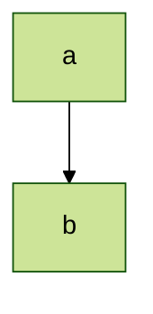
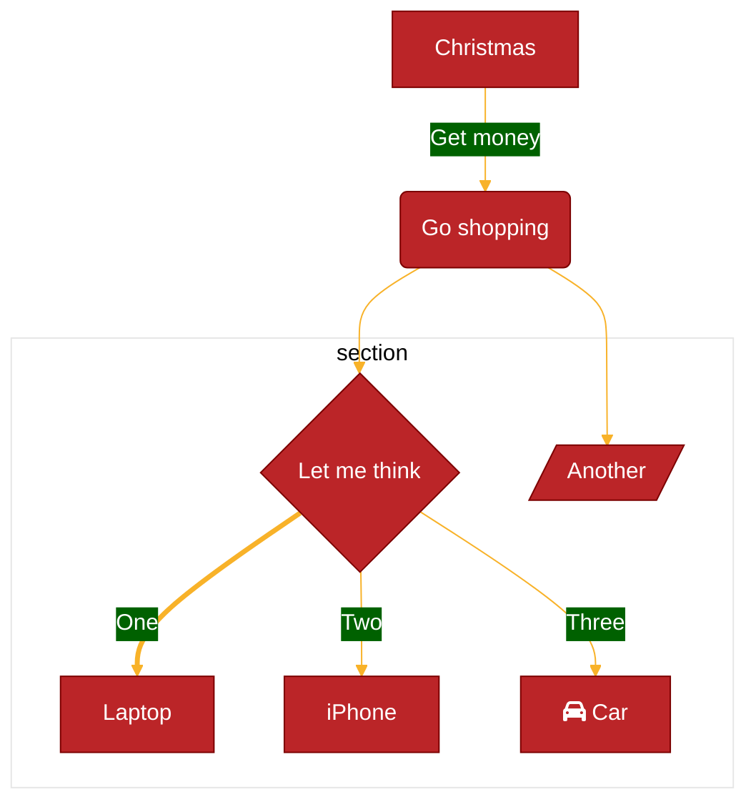
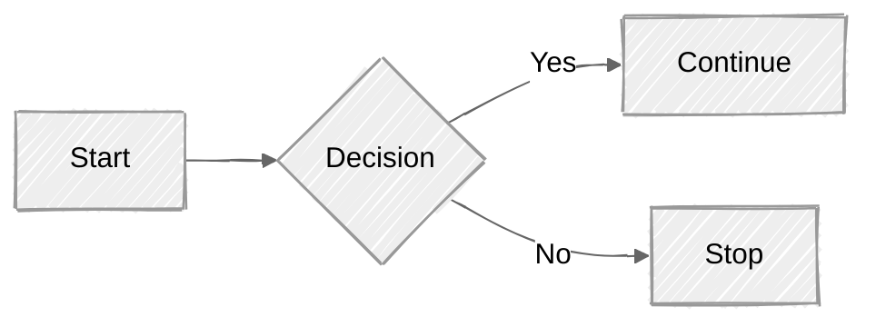
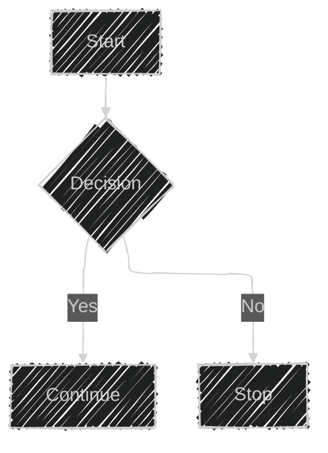
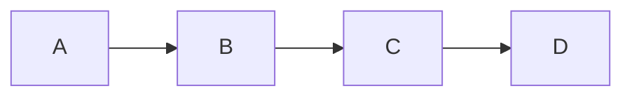
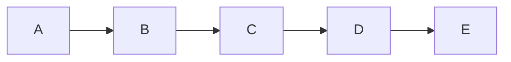

# Mermaid: темы, look и layout, securityLevel, click, ключи конфигурации

Сверено по Mermaid 12.1.0. Общие правила — frontmatter, массив `secure`, умолчания Mermaid 12 — в [mermaid.md](mermaid.md). Схема конфигурации: https://github.com/mermaid-js/mermaid/blob/develop/packages/mermaid/src/schemas/config.schema.yaml; справочник ключей: https://mermaid.js.org/config/schema-docs/config.html

Автор диаграммы задаёт всё ниже во frontmatter под `config:`, кроме ключей из массива `secure` — их задаёт только сайт.

---

## Темы

Документация: https://mermaid.js.org/config/theming.html

- Темы: `redux-color`, `redux-dark-color`, `redux`, `redux-dark`, `default`, `neutral`, `dark`, `forest`, `neo`, `neo-dark`, `base`. Схема допускает ещё `null` — «Can be set to disable any pre-defined mermaid theme».
- Настраивать переменными можно только `base`: «This is the only theme that can be modified. Use this theme as the base for customizations.»
- Тема `dark` и режим `darkMode` — разное: «To use the dark theme (which changes the theme of the schema itself) with dark-mode (which sets the background), set `darkMode` to `true` in your config.»
- Порядок приоритета — дословно:

> 1. The diagram's own frontmatter or `%%{init}%%` directive.
> 2. What you passed to `mermaid.initialize()`.
> 3. The diagram type's default, above.
> 4. The global default (`theme: default`, `look: classic`, `layout: dagre`).

Тема, look и layout задаются и для одного типа диаграммы:

```yaml
---
config:
  flowchart:
    look: handDrawn
---
```

Тема одной диаграммы:



## Переменные темы

Задаются в `themeVariables` и только с темой `base`: «**Reminder**: the only theme that can be customized is the `base` theme.»



- Цвета — только hex: «The theming engine will only recognize hex colors and not color names. So, the value `#ff0000` will work, but `red` will not.»
- Часть переменных вычисляется из других: «For example, `primaryBorderColor` is derived from the `primaryColor` variable. So if the `primaryColor` variable is customized, Mermaid will adjust `primaryBorderColor` automatically.»
- Вид `neo` и градиент: «Note that the `neo` look paints node strokes with a gradient when the active theme sets `useGradient`, which `base` does by default. Setting a custom `nodeBorder` on `base` turns the gradient off so your colour is what shows; set `useGradient: true` alongside it if you want to keep the gradient.»

**Общие переменные:**

| Variable             | Default value                      | Description                                                                                                                      |
| -------------------- | ---------------------------------- | -------------------------------------------------------------------------------------------------------------------------------- |
| darkMode             | false                              | Affects how derived colors are calculated. Set value to `true` for dark mode.                                                    |
| background           | #f4f4f4                            | Used to calculate color for items that should either be background colored or contrasting to the background                      |
| fontFamily           | trebuchet ms, verdana, arial       | Font family for diagram text                                                                                                     |
| fontSize             | 16px                               | Font size in pixels                                                                                                              |
| primaryColor         | #fff4dd                            | Color to be used as background in nodes, other colors will be derived from this                                                  |
| primaryTextColor     | calculated from darkMode #ddd/#333 | Color to be used as text color in nodes using `primaryColor`                                                                     |
| secondaryColor       | calculated from primaryColor       |                                                                                                                                  |
| primaryBorderColor   | calculated from primaryColor       | Color to be used as border in nodes using `primaryColor`                                                                         |
| secondaryBorderColor | calculated from secondaryColor     | Color to be used as border in nodes using `secondaryColor`                                                                       |
| secondaryTextColor   | calculated from secondaryColor     | Color to be used as text color in nodes using `secondaryColor`                                                                   |
| tertiaryColor        | calculated from primaryColor       |                                                                                                                                  |
| tertiaryBorderColor  | calculated from tertiaryColor      | Color to be used as border in nodes using `tertiaryColor`                                                                        |
| tertiaryTextColor    | calculated from tertiaryColor      | Color to be used as text color in nodes using `tertiaryColor`                                                                    |
| noteBkgColor         | #fff5ad                            | Color used as background in notes                                                                                                |
| noteTextColor        | #333                               | Text color in note rectangles                                                                                                    |
| noteBorderColor      | calculated from noteBkgColor       | Border color in note rectangles                                                                                                  |
| lineColor            | calculated from background         |                                                                                                                                  |
| textColor            | calculated from primaryTextColor   | Text in diagram over the background for instance text on labels and on signals in sequence diagram or the title in Gantt diagram |
| mainBkg              | calculated from primaryColor       | Background in flowchart objects like rects/circles, class diagram classes, sequence diagram etc                                  |
| errorBkgColor        | tertiaryColor                      | Color for syntax error message                                                                                                   |
| errorTextColor       | tertiaryTextColor                  | Color for syntax error message                                                                                                   |

**Блок-схема:**

| Variable            | Default value                  | Description                 |
| ------------------- | ------------------------------ | --------------------------- |
| nodeBorder          | primaryBorderColor             | Node Border Color           |
| clusterBkg          | tertiaryColor                  | Background in subgraphs     |
| clusterBorder       | tertiaryBorderColor            | Cluster Border Color        |
| defaultLinkColor    | lineColor                      | Link Color                  |
| titleColor          | tertiaryTextColor              | Title Color                 |
| edgeLabelBackground | calculated from secondaryColor |                             |
| nodeTextColor       | primaryTextColor               | Color for text inside Nodes |

**Диаграмма последовательности:**

| Variable              | Default value                  | Description                 |
| --------------------- | ------------------------------ | --------------------------- |
| actorBkg              | mainBkg                        | Actor Background Color      |
| actorBorder           | primaryBorderColor             | Actor Border Color          |
| actorTextColor        | primaryTextColor               | Actor Text Color            |
| actorLineColor        | actorBorder                    | Actor Line Color            |
| signalColor           | textColor                      | Signal Color                |
| signalTextColor       | textColor                      | Signal Text Color           |
| labelBoxBkgColor      | actorBkg                       | Label Box Background Color  |
| labelBoxBorderColor   | actorBorder                    | Label Box Border Color      |
| labelTextColor        | actorTextColor                 | Label Text Color            |
| loopTextColor         | actorTextColor                 | Loop Text Color             |
| activationBorderColor | calculated from secondaryColor | Activation Border Color     |
| activationBkgColor    | secondaryColor                 | Activation Background Color |
| sequenceNumberColor   | calculated from lineColor      | Sequence Number Color       |

**Круговая диаграмма:**

| Variable            | Default value                  | Description                                |
| ------------------- | ------------------------------ | ------------------------------------------ |
| pie1                | primaryColor                   | Fill for 1st section in pie diagram        |
| pie2                | secondaryColor                 | Fill for 2nd section in pie diagram        |
| pie3                | calculated from tertiary       | Fill for 3rd section in pie diagram        |
| pie4                | calculated from primaryColor   | Fill for 4th section in pie diagram        |
| pie5                | calculated from secondaryColor | Fill for 5th section in pie diagram        |
| pie6                | calculated from tertiaryColor  | Fill for 6th section in pie diagram        |
| pie7                | calculated from primaryColor   | Fill for 7th section in pie diagram        |
| pie8                | calculated from primaryColor   | Fill for 8th section in pie diagram        |
| pie9                | calculated from primaryColor   | Fill for 9th section in pie diagram        |
| pie10               | calculated from primaryColor   | Fill for 10th section in pie diagram       |
| pie11               | calculated from primaryColor   | Fill for 11th section in pie diagram       |
| pie12               | calculated from primaryColor   | Fill for 12th section in pie diagram       |
| pieTitleTextSize    | 25px                           | Title text size                            |
| pieTitleTextColor   | taskTextDarkColor              | Title text color                           |
| pieSectionTextSize  | 17px                           | Text size of individual section labels     |
| pieSectionTextColor | textColor                      | Text color of individual section labels    |
| pieLegendTextSize   | 17px                           | Text size of labels in diagram legend      |
| pieLegendTextColor  | taskTextDarkColor              | Text color of labels in diagram legend     |
| pieStrokeColor      | black                          | Border color of individual pie sections    |
| pieStrokeWidth      | 2px                            | Border width of individual pie sections    |
| pieOuterStrokeWidth | 2px                            | Border width of pie diagram's outer circle |
| pieOuterStrokeColor | black                          | Border color of pie diagram's outer circle |
| pieOpacity          | 0.7                            | Opacity of individual pie sections         |

**Диаграмма состояний:**

| Variable      | Default value    | Description                                  |
| ------------- | ---------------- | -------------------------------------------- |
| labelColor    | primaryTextColor |                                              |
| altBackground | tertiaryColor    | Used for background in deep composite states |

**Диаграмма классов:**

| Variable  | Default value | Description                     |
| --------- | ------------- | ------------------------------- |
| classText | textColor     | Color of Text in class diagrams |

**Путь пользователя:**

| Variable  | Default value                  | Description                             |
| --------- | ------------------------------ | --------------------------------------- |
| fillType0 | primaryColor                   | Fill for 1st section in journey diagram |
| fillType1 | secondaryColor                 | Fill for 2nd section in journey diagram |
| fillType2 | calculated from primaryColor   | Fill for 3rd section in journey diagram |
| fillType3 | calculated from secondaryColor | Fill for 4th section in journey diagram |
| fillType4 | calculated from primaryColor   | Fill for 5th section in journey diagram |
| fillType5 | calculated from secondaryColor | Fill for 6th section in journey diagram |
| fillType6 | calculated from primaryColor   | Fill for 7th section in journey diagram |
| fillType7 | calculated from secondaryColor | Fill for 8th section in journey diagram |

Переменные остальных типов (git-граф, квадрантная и XY-диаграммы, радар, Cynefin, дерево каталогов, варианты использования, временная шкала) описаны на их страницах — в файлах групп по каталогу из [mermaid.md](mermaid.md).

---

## Look и layout

Документация: https://mermaid.js.org/intro/syntax-reference.html#layout-and-look и https://mermaid.js.org/config/layouts.html

Выбор look и layout поддерживают не все типы: «**Currently, this is supported for flowchart, state, class, entity relationship, requirement, use case, and agentflow diagrams**, with plans to extend support to all diagram types. Mindmaps are the exception: they keep their own `cose-bilkent` layout unless a layout is explicitly set».

**Look** — `neo`, `handDrawn`, `classic`:

- «Neo Look: A flatter, softer style with rounded corners and subtle shadows, designed to pair with the `redux-color` theme family.»
- «Hand-Drawn Look: For a more personal, creative touch, the hand-drawn look brings a sketch-like quality to your diagrams.»
- «Classic Look: If you prefer the traditional Mermaid style, the classic look maintains the original appearance that many users are familiar with.»
- `handDrawnSeed` — зерно для `handDrawn`; «The default value is 0 which gives a random seed.»



**Layout:**

- `elk` — по умолчанию с v12.0.0, встроен в Mermaid; варианты алгоритма — `elk.stress`, `elk.force`, `elk.mrtree`, `elk.sporeOverlap`, `elk.box`, `elk.rectpacking`;
- `dagre` — прежняя раскладка для многоуровневых графов;
- `cose-bilkent` — силовая раскладка, по умолчанию у интеллект-карты;
- `tidy-tree` — для иерархий, из пакета `@mermaid-js/layout-tidy-tree`, который должен установить сайт; «Currently, tidy-tree is primarily supported for mindmap diagrams.»
- `swimlane` — раскладка диаграммы дорожек.



**Ключи `elk.*`** — задаются во frontmatter под `elk:`:

```
---
config:
  layout: elk
  elk:
    mergeEdges: true
    nodePlacementStrategy: LINEAR_SEGMENTS
    nodePlacementAlignment: NONE
---
flowchart LR
  A[Start] --> B{Choose Path}
  B -->|Option 1| C[Path 1]
  B -->|Option 2| D[Path 2]

```

| Ключ | Значения | По умолчанию | Что задаёт |
|---|---|---|---|
| `mergeEdges` | boolean | `false` | рёбра делят общий путь, где удобно |
| `nodePlacementStrategy` | `SIMPLE`, `NETWORK_SIMPLEX`, `LINEAR_SEGMENTS`, `BRANDES_KOEPF` | — | способ размещения узлов |
| `nodePlacementAlignment` | `NONE`, `LEFTUP`, `LEFTDOWN`, `RIGHTUP`, `RIGHTDOWN`, `BALANCED` | — | выравнивание при размещении Brandes-Koepf; без значения — по `preset` |
| `preset` | `default`, `legacy`, `modelOrder`, `depthFirst` | `default` | набор настроек раскладки; `depthFirst` — прежняя раскладка по умолчанию |
| `layeringStrategy` | `NETWORK_SIMPLEX`, `LONGEST_PATH`, `LONGEST_PATH_SOURCE`, `COFFMAN_GRAHAM`, `MIN_WIDTH`, `STRETCH_WIDTH`, `INTERACTIVE` | — | распределение узлов по слоям |
| `layeringLayerBound` | number | `4` | предел узлов в слое для `COFFMAN_GRAHAM` |
| `cycleBreakingStrategy` | `GREEDY`, `DEPTH_FIRST`, `INTERACTIVE`, `MODEL_ORDER`, `GREEDY_MODEL_ORDER` | — | разрыв циклов |
| `considerModelOrder` | `NONE`, `NODES_AND_EDGES`, `PREFER_EDGES`, `PREFER_NODES` | `NODES_AND_EDGES` | сохранять порядок узлов и рёбер из текста |
| `forceNodeModelOrder` | boolean | `false` | не менять порядок узлов из текста |
| `keepEntryNodeOnTop` | boolean | `false` | входной узел циклического потока — в первом слое |
| `straightenEdges` | boolean | `true` | выпрямлять мелкую ступеньку ребра у узла |
| `lineHops` | boolean, `arc`, `gap` | `true` | пересечения рёбер дугой или разрывом |
| `orientFeedbackEdges` | boolean | `true` | ребро, возвращающееся в подграф, вести вниз по потоку |

---

## securityLevel

Документация: https://mermaid.js.org/config/usage.html#securitylevel

Уровень доверия задаёт сайт: ключ входит в массив `secure`, из диаграммы не меняется. Значения — дословно:

> - **strict**: (**default**) HTML tags in the text are encoded and click functionality is disabled.
> - **antiscript**: HTML tags in text are allowed (only script elements are removed) and click functionality is enabled.
> - **loose**: HTML tags in text are allowed and click functionality is enabled.
> - **sandbox**: With this security level, all rendering takes place in a sandboxed iframe. This prevents any JavaScript from running in the context. This may hinder interactive functionality of the diagram, like scripts, popups in the sequence diagram, links to other tabs or targets, etc.

> **sandbox** security level is still in the beta version.

Уровень на конкретных площадках — [mermaid-platforms.md](mermaid-platforms.md).

---

## click и цели ссылок

Документация: https://mermaid.js.org/syntax/flowchart.html#interaction

`click` работает, только если уровень доверия сайта его разрешает: «This functionality is disabled when using `securityLevel='strict'` and enabled when using `securityLevel='loose'`.» Функция обратного вызова должна быть определена на странице, где показана диаграмма; автор диаграммы на чужой площадке её не задаёт.

Формы в блок-схеме:

```
click nodeId callback
click nodeId call callback()
```

Ссылка с подсказкой; стиль подсказки — класс `.mermaidTooltip`:



Цели ссылки — `_self`, `_blank`, `_parent`, `_top`; по умолчанию — та же вкладка:



Синтаксис в других типах:

| Тип | Форма | Файл |
|---|---|---|
| диаграмма классов | `link`, `callback`, `click … call` / `click … href` после объявления всех классов | [mermaid-uml.md](mermaid-uml.md) |
| диаграмма Ганта | `click taskId call callback(arguments)`, `click taskId href URL`; ссылка открывается в текущей вкладке | [mermaid-timeline.md](mermaid-timeline.md) |
| диаграмма последовательности | меню участника `link` / `links` вместо `click` | [mermaid-sequence.md](mermaid-sequence.md) |

---

## Ключи верхнего уровня во frontmatter

Документация: https://mermaid.js.org/config/configuration.html; значения по умолчанию — по схеме конфигурации.

| Ключ | По умолчанию | Что задаёт |
|---|---|---|
| `theme` | `default` (для типов из таблицы «Per-diagram defaults» — `redux-color`) | тема |
| `themeVariables` | — | переменные темы, только с темой `base` |
| `themeCSS` | — | собственный CSS |
| `look` | `classic` (для типов из таблицы «Per-diagram defaults» — `neo`) | вид |
| `handDrawnSeed` | `0` | зерно для `handDrawn` |
| `layout` | `elk` | раскладка |
| `elk` | — | ключи `elk.*` |
| `darkMode` | `false` | расчёт производных цветов для тёмного фона |
| `htmlLabels` | — | HTML в подписях узлов и рёбер; заменяет устаревший `flowchart.htmlLabels` |
| `fontFamily` | `"trebuchet ms", verdana, arial, sans-serif;` | шрифт |
| `fontSize` | `16` | размер шрифта |
| `markdownAutoWrap` | `true` | автоперенос Markdown-строк |
| `wrap` | — | автоперенос текста |
| `deterministicIds` | `false` | идентификаторы в SVG от зерна, а не от времени |
| `deterministicIDSeed` | — | зерно идентификаторов |
| `logLevel` | `5` | уровень журнала |
| `legacyMathML` | `false` | откат на CSS-рендер KaTeX без MathML |
| `forceLegacyMathML` | `false` | всегда стили KaTeX |
| `flowchart`, `sequence`, `class`, `state`, `er`, `gantt`, `gitGraph` и другие | — | разделы отдельных типов — в файлах групп |

Только сайт (массив `secure`): `secure`, `securityLevel`, `startOnLoad`, `maxTextSize` (по умолчанию `50000`), `suppressErrorRendering`, `maxEdges` (по умолчанию `500`).

## Иконки

Документация: https://mermaid.js.org/config/icons.html

Пакеты иконок в формате Iconify регистрирует сайт; автор в коде диаграммы ссылается на иконку как `пакет:иконка` — например в форме `icon` блок-схемы, в диаграмме архитектуры, в дереве каталогов. Что выводится вместо незарегистрированной иконки, зависит от типа: в дереве каталогов — вопросительный знак, у актёра диаграммы вариантов использования — стандартная заглушка неизвестной иконки; в блок-схеме иконки Font Awesome без регистрации пакета берутся из CSS Font Awesome, если сайт его подключил.
