# Mermaid: блок-схема, диаграмма дорожек, блочная диаграмма

Сверено по Mermaid 12.1.0. Общие правила — встраивание, объявление, комментарии, frontmatter, экранирование, умолчания Mermaid 12, общие ловушки — в [mermaid.md](mermaid.md).

---

## Блок-схема (`flowchart`)

Документация: https://mermaid.js.org/syntax/flowchart.html

### Ключевое слово и статус

- `flowchart`; вместо него можно `graph`: «Instead of `flowchart` one can also use `graph`.» Устаревшая форма `flowchart-elk`: «The `flowchart-elk` diagram type still works, but is no longer needed».
- Направление — сразу после ключевого слова: `TB` — сверху вниз, `TD` — то же, что `TB`, `BT` — снизу вверх, `RL` — справа налево, `LR` — слева направо.
- Статус: стабильный.

### Минимальный пример

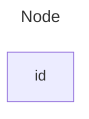

«The id is what is displayed in the box.»

### Синтаксис

**Узел с текстом.** Текст в скобках формы отличается от идентификатора. «If this is done several times, it is the last text found for the node that will be used. Also if you define edges for the node later on, you can omit text definitions.»

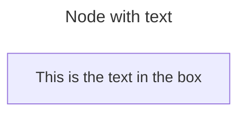

**Направление:**

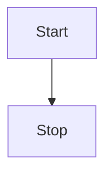

**Классические формы узлов** — форма задаётся скобками вокруг текста:

| Раздел страницы | Форма | Пример |
|---|---|---|
| «A node with round edges» | скруглённый прямоугольник | `id1(This is the text in the box)` |
| «A stadium-shaped node» | «стадион» | `id1([This is the text in the box])` |
| «A node in a subroutine shape» | подпрограмма | `id1[[This is the text in the box]]` |
| «A node in a cylindrical shape» | цилиндр | `id1[(Database)]` |
| «A node in the form of a circle» | круг | `id1((This is the text in the circle))` |
| «A node in an asymmetric shape» | асимметричная | `id1>This is the text in the box]` |
| «A node (rhombus)» | ромб | `id1{This is the text in the box}` |
| «A hexagon node» | шестиугольник | `id1{{This is the text in the box}}` |
| «Parallelogram» | параллелограмм | `id1[/This is the text in the box/]` |
| «Parallelogram alt» | обратный параллелограмм | `id1[\This is the text in the box\]` |
| «Trapezoid» | трапеция | `A[/Christmas\]` |
| «Trapezoid alt» | обратная трапеция | `B[\Go shopping/]` |
| «Double circle» | двойной круг | `id1(((This is the text in the circle)))` |

Асимметричная форма без зеркального варианта: «Currently only the shape above is possible and not its mirror.»

**Расширенные формы `@{ shape: … }` (v11.3.0+).** Общая форма:

```
A@{ shape: rect }
```

«This syntax creates a node A as a rectangle. It renders in the same way as `A["A"]`, or `A`.» Каталог форм — дословно со страницы; в `shape:` пишется короткое имя (Short Name) или псевдоним (Alias Supported):

| **Semantic Name**                 | **Shape Name**            | **Short Name** | **Description**                             | **Alias Supported**                                              |
| --------------------------------- | ------------------------- | -------------- | ------------------------------------------- | ---------------------------------------------------------------- |
| Bang                              | Bang                      | `bang`         | Bang                                        | `bang`                                                           |
| Browser                           | Browser                   | `browser`      | Browser window                              |                                                                  |
| Bucket                            | Bucket                    | `bucket`       | Object storage bucket                       |                                                                  |
| Card                              | Notched Rectangle         | `notch-rect`   | Represents a card                           | `card`, `notched-rectangle`                                      |
| Cloud                             | Cloud                     | `cloud`        | cloud                                       | `cloud`                                                          |
| Collate                           | Hourglass                 | `hourglass`    | Represents a collate operation              | `collate`, `hourglass`                                           |
| Com Link                          | Lightning Bolt            | `bolt`         | Communication link                          | `com-link`, `lightning-bolt`                                     |
| Comment                           | Curly Brace               | `brace`        | Adds a comment                              | `brace-l`, `comment`                                             |
| Comment Right                     | Curly Brace               | `brace-r`      | Adds a comment                              |                                                                  |
| Comment with braces on both sides | Curly Braces              | `braces`       | Adds a comment                              |                                                                  |
| Console                           | Console (terminal window) | `console`      | Terminal or console window                  |                                                                  |
| Data Input/Output                 | Lean Right                | `lean-r`       | Represents input or output                  | `in-out`, `lean-right`                                           |
| Data Input/Output                 | Lean Left                 | `lean-l`       | Represents output or input                  | `lean-left`, `out-in`                                            |
| Data Store                        | Data Store                | `datastore`    | Data flow diagram data store                | `data-store`                                                     |
| Database                          | Cylinder                  | `cyl`          | Database storage                            | `cylinder`, `database`, `db`                                     |
| Decision                          | Diamond                   | `diam`         | Decision-making step                        | `decision`, `diamond`, `question`                                |
| Delay                             | Half-Rounded Rectangle    | `delay`        | Represents a delay                          | `half-rounded-rectangle`                                         |
| Direct Access Storage             | Horizontal Cylinder       | `h-cyl`        | Direct access storage                       | `das`, `horizontal-cylinder`                                     |
| Disk Storage                      | Lined Cylinder            | `lin-cyl`      | Disk storage                                | `disk`, `lined-cylinder`                                         |
| Display                           | Curved Trapezoid          | `curv-trap`    | Represents a display                        | `curved-trapezoid`, `display`                                    |
| Divided Process                   | Divided Rectangle         | `div-rect`     | Divided process shape                       | `div-proc`, `divided-process`, `divided-rectangle`               |
| Document                          | Document                  | `doc`          | Represents a document                       | `doc`, `document`                                                |
| Event                             | Rounded Rectangle         | `rounded`      | Represents an event                         | `event`                                                          |
| Extract                           | Triangle                  | `tri`          | Extraction process                          | `extract`, `triangle`                                            |
| Folder                            | Folder                    | `folder`       | Folder or directory                         | `directory`                                                      |
| Fork/Join                         | Filled Rectangle          | `fork`         | Fork or join in process flow                | `join`                                                           |
| Internal Storage                  | Window Pane               | `win-pane`     | Internal storage                            | `internal-storage`, `window-pane`                                |
| Junction                          | Filled Circle             | `f-circ`       | Junction point                              | `filled-circle`, `junction`                                      |
| Lined Document                    | Lined Document            | `lin-doc`      | Lined document                              | `lined-document`                                                 |
| Lined/Shaded Process              | Lined Rectangle           | `lin-rect`     | Lined process shape                         | `lin-proc`, `lined-process`, `lined-rectangle`, `shaded-process` |
| Loop Limit                        | Trapezoidal Pentagon      | `notch-pent`   | Loop limit step                             | `loop-limit`, `notched-pentagon`                                 |
| Manual File                       | Flipped Triangle          | `flip-tri`     | Manual file operation                       | `flipped-triangle`, `manual-file`                                |
| Manual Input                      | Sloped Rectangle          | `sl-rect`      | Manual input step                           | `manual-input`, `sloped-rectangle`                               |
| Manual Operation                  | Trapezoid Base Top        | `trap-t`       | Represents a manual task                    | `inv-trapezoid`, `manual`, `trapezoid-top`                       |
| Multi-Document                    | Stacked Document          | `docs`         | Multiple documents                          | `documents`, `st-doc`, `stacked-document`                        |
| Multi-Process                     | Stacked Rectangle         | `st-rect`      | Multiple processes                          | `processes`, `procs`, `stacked-rectangle`                        |
| Odd                               | Odd                       | `odd`          | Odd shape                                   |                                                                  |
| Paper Tape                        | Flag                      | `flag`         | Paper tape                                  | `paper-tape`                                                     |
| Person                            | Person                    | `person`       | Person (circular head above a rounded body) |                                                                  |
| Prepare Conditional               | Hexagon                   | `hex`          | Preparation or condition step               | `hexagon`, `prepare`                                             |
| Priority Action                   | Trapezoid Base Bottom     | `trap-b`       | Priority action                             | `priority`, `trapezoid`, `trapezoid-bottom`                      |
| Process                           | Rectangle                 | `rect`         | Standard process shape                      | `proc`, `process`, `rectangle`                                   |
| Start                             | Circle                    | `circle`       | Starting point                              | `circ`                                                           |
| Start                             | Small Circle              | `sm-circ`      | Small starting point                        | `small-circle`, `start`                                          |
| Stop                              | Double Circle             | `dbl-circ`     | Represents a stop point                     | `double-circle`                                                  |
| Stop                              | Framed Circle             | `fr-circ`      | Stop point                                  | `framed-circle`, `stop`                                          |
| Stored Data                       | Bow Tie Rectangle         | `bow-rect`     | Stored data                                 | `bow-tie-rectangle`, `stored-data`                               |
| Subprocess                        | Framed Rectangle          | `fr-rect`      | Subprocess                                  | `framed-rectangle`, `subproc`, `subprocess`, `subroutine`        |
| Summary                           | Crossed Circle            | `cross-circ`   | Summary                                     | `crossed-circle`, `summary`                                      |
| Tagged Document                   | Tagged Document           | `tag-doc`      | Tagged document                             | `tag-doc`, `tagged-document`                                     |
| Tagged Process                    | Tagged Rectangle          | `tag-rect`     | Tagged process                              | `tag-proc`, `tagged-process`, `tagged-rectangle`                 |
| Terminal Point                    | Stadium                   | `stadium`      | Terminal point                              | `pill`, `terminal`                                               |
| Text Block                        | Text Block                | `text`         | Text block                                  |                                                                  |

По журналу изменений форма `datastore` появилась в 11.15.0, формы `folder`, `bucket`, `console`, `browser` и `person` — в 11.17.0.

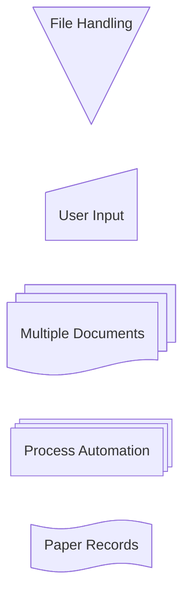

**Особые формы: иконка и изображение (v11.3.0+).** Иконка требует пакета иконок, зарегистрированного сайтом: «To use icons, you need to register the icon pack first.»

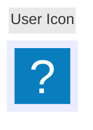

Параметры иконки — дословно:

- **icon**: The name of the icon from the registered icon pack.
- **form**: Specifies the background shape of the icon. If not defined there will be no background to icon. Options include: `square`, `circle`, `rounded`
- **label**: The text label associated with the icon. This can be any string. If not defined, no label will be displayed.
- **pos**: The position of the label. If not defined label will default to bottom of icon. Possible values are: `t`, `b`
- **h**: The height of the icon. If not defined this will default to 48 which is minimum.

Изображение:

```
flowchart TD
    A@{ img: "https://example.com/image.png", label: "Image Label", pos: "t", w: 60, h: 60, constraint: "off" }
```

Параметры изображения — дословно:

- **img**: The URL of the image to be displayed.
- **label**: The text label associated with the image. This can be any string. If not defined, no label will be displayed.
- **pos**: The position of the label. If not defined, the label will default to the bottom of the image. Possible values are: `t`, `b`
- **w**: The width of the image. If not defined, this will default to the natural width of the image.
- **h**: The height of the image. If not defined, this will default to the natural height of the image.
- **constraint**: Determines if the image should constrain the node size. This setting also ensures the image maintains its original aspect ratio, adjusting the width (`w`) accordingly to the height (`h`). If not defined, this will default to `off` Possible values are: `on`, `off`

«If you want to resize an image, but keep the same aspect ratio, set `h`, and set `constraint: on` to constrain the aspect ratio.»

```mermaid
flowchart TD
  %% My image with a constrained aspect ratio
  A@{ img: "https://mermaid.js.org/favicon.svg", label: "My example image label", pos: "t", h: 60, constraint: "on" }
```

**Связи между узлами:**

| Раздел страницы | Вид связи | Синтаксис из примера |
|---|---|---|
| «A link with arrow head» | со стрелкой | `A-->B` |
| «An open link» | без стрелки | `A --- B` |
| «Text on links» | без стрелки, с текстом | `A-- This is the text! ---B` или `A---\|This is the text\|B` |
| «A link with arrow head and text» | со стрелкой и текстом | `A-->\|text\|B` или `A-- text -->B` |
| «Dotted link» | пунктирная | `A-.->B;` |
| «Dotted link with text» | пунктирная с текстом | `A-. text .-> B` |
| «Thick link» | толстая | `A ==> B` |
| «Thick link with text» | толстая с текстом | `A == text ==> B` |
| «An invisible link» | невидимая | `A ~~~ B` |

О невидимой связи: «This can be a useful tool in some instances where you want to alter the default positioning of a node.»

**Цепочки связей** — несколько связей в строке и связи с несколькими узлами через `&`:

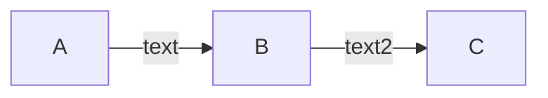

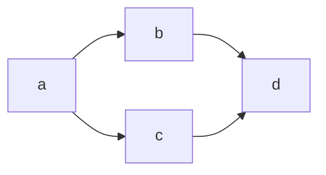

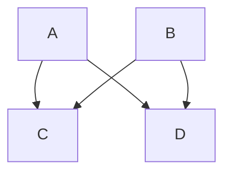

«A word of warning, one could go overboard with this making the flowchart harder to read in markdown form.»

**Наконечники-кружок и крестик, двунаправленные связи:**

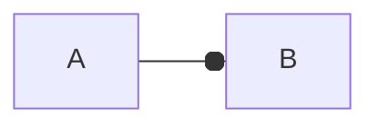

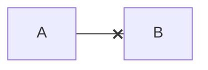

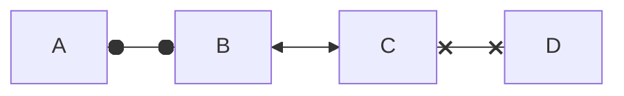

**Минимальная длина связи** — каждый лишний дефис удлиняет связь на один ранг. «When the link label is written in the middle of the link, the extra dashes must be added on the right side of the link.»

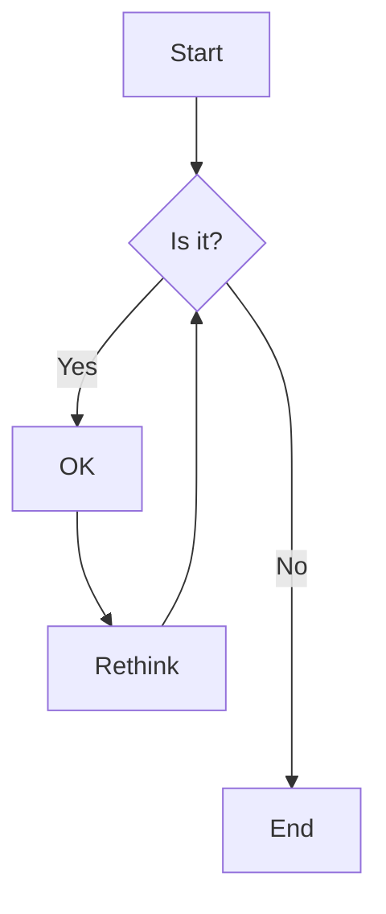

| Length            |   1    |    2    |    3     |
| ----------------- | :----: | :-----: | :------: |
| Normal            | `---`  | `----`  | `-----`  |
| Normal with arrow | `-->`  | `--->`  | `---->`  |
| Thick             | `===`  | `====`  | `=====`  |
| Thick with arrow  | `==>`  | `===>`  | `====>`  |
| Dotted            | `-.-`  | `-..-`  | `-...-`  |
| Dotted with arrow | `-.->` | `-..->` | `-...->` |

«Links may still be made longer than the requested number of ranks by the rendering engine to accommodate other requests.»

**Идентификатор ребра и анимация.** «To give an edge an ID, prepend the edge syntax with the ID followed by an `@` character.» Идентификатор ребра используется в метаданных и стилях так же, как идентификатор узла.


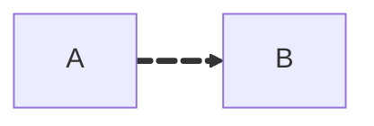

Скорость анимации — `fast` или `slow`; `animation: fast` — «equivalent to `{ animate: true, animation: fast }`»:


Анимация через `classDef`:

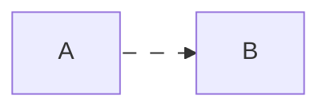

**Подграфы.** Общая форма:

```
subgraph title
    graph definition
end
```

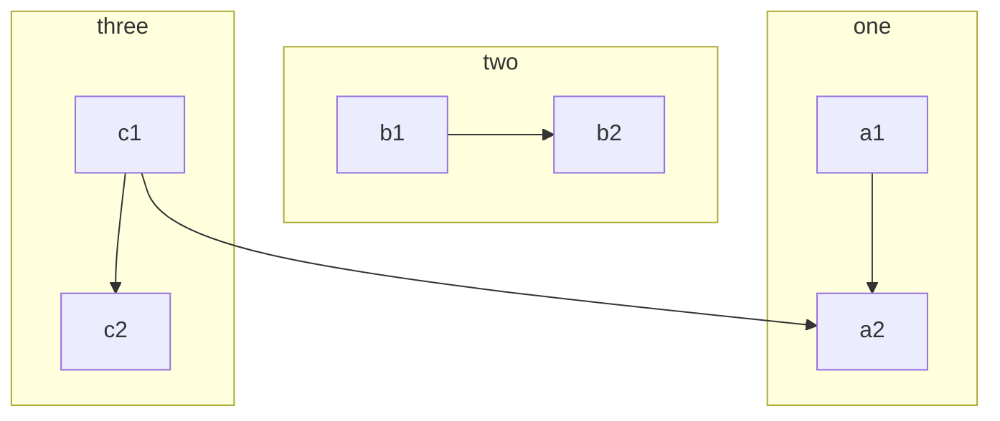

Явный идентификатор подграфа:

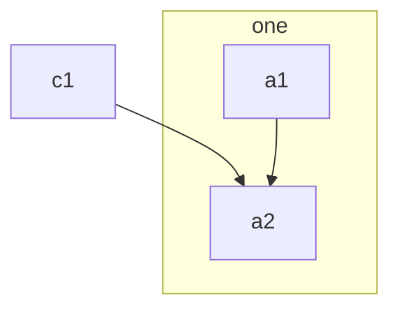

Связи к подграфам и от них:

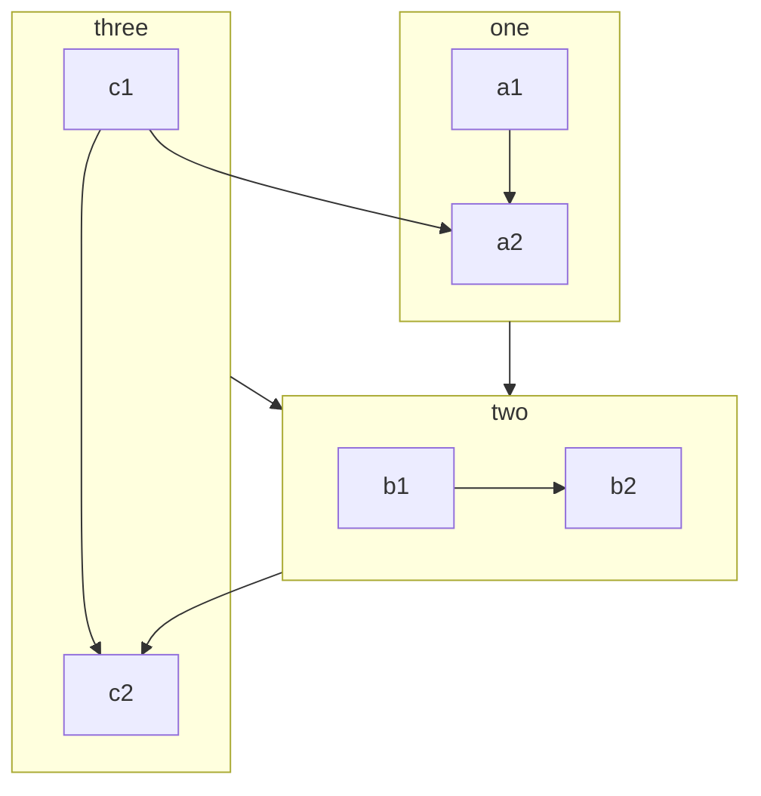

Направление внутри подграфа:

```mermaid
flowchart LR
  subgraph TOP
    direction TB
    subgraph B1
        direction RL
        i1 -->f1
    end
    subgraph B2
        direction BT
        i2 -->f2
    end
  end
  A --> TOP --> B
  B1 --> B2
```

Ограничение: «If any of a subgraph's nodes are linked to the outside, subgraph direction will be ignored. Instead the subgraph will inherit the direction of the parent graph:»

```mermaid
flowchart LR
    subgraph subgraph1
        direction TB
        top1[top] --> bottom1[bottom]
    end
    subgraph subgraph2
        direction TB
        top2[top] --> bottom2[bottom]
    end
    %% ^ These subgraphs are identical, except for the links to them:

    %% Link *to* subgraph1: subgraph1 direction is maintained
    outside --> subgraph1
    %% Link *within* subgraph2:
    %% subgraph2 inherits the direction of the top-level graph (LR)
    outside ---> top2
```

**Сворачиваемые подграфы (v11.17.0+):** «A subgraph can be collapsed into a single compact node by attaching the metadata `@{ view: collapsed }` to its id.»

```mermaid
flowchart TD
    Start --> one
    subgraph one [My Group]
        A --> B
        B --> C
    end
    one --> End
    one@{ view: collapsed }
```

Поведение свёрнутого подграфа — дословно:

- "Its internal nodes are hidden and it is drawn as a single node carrying the subgraph's title."
- "Edges that cross the subgraph boundary are **redirected to the collapsed node**."
- "Edges that are entirely internal to the collapsed subgraph are dropped (they would otherwise become self-loops on the collapsed node)."
- "For nested subgraphs, a collapse resolves to the **outermost** collapsed ancestor, so an edge pointing at a deeply nested node lands on the outermost collapsed group."

«`view: expanded` is the default and renders the subgraph normally, so omitting the metadata (or setting `view: expanded`) keeps the existing behavior.»

**Markdown-строки** — в подписях узлов, рёбер и подграфов: «This feature is applicable to node labels, edge labels, and subgraph labels.» Общие правила — в [mermaid.md](mermaid.md).

```mermaid
---
config:
  htmlLabels: false
---
flowchart LR
subgraph "One"
  a("`The **cat**
  in the hat`") -- "edge label" --> b{{"`The **dog** in the hog`"}}
end
subgraph "`**Two**`"
  c("`The **cat**
  in the hat`") -- "`Bold **edge label**`" --> d("The dog in the hog")
end
```

**Формулы (v10.9.0+)** — между `$$`, синтаксис формулы — LaTeX (https://mermaid.js.org/config/math.html):

```mermaid
 graph LR
      A["$$x^2$$"] -->|"$$\sqrt{x+3}$$"| B("$$\frac{1}{2}$$")
      A -->|"$$\overbrace{a+b+c}^{\text{note}}$$"| C("$$\pi r^2$$")
      B --> D("$$x = \begin{cases} a &\text{if } b \\ c &\text{if } d \end{cases}$$")
      C --> E("$$x(t)=c_1\begin{bmatrix}-\cos{t}+\sin{t}\\ 2\cos{t} \end{bmatrix}e^{2t}$$")
```

**Иконки Font Awesome** — в тексте узла: «The icons are accessed via the syntax fa:#icon class name#.» Работают, если сайт зарегистрировал пакеты Font Awesome (v11.7.0+, «Supported prefixes: `fa`, `fab`, `fas`, `far`, `fal`, `fad`.») или подключил CSS Font Awesome. Пользовательские иконки — префикс `fak`: «Note that this is currently a paid feature from Font Awesome.»

```mermaid
flowchart TD
    B["fa:fa-twitter for peace"]
    B-->C[fa:fa-ban forbidden]
    B-->D(fa:fa-spinner)
    B-->E(A fa:fa-camera-retro perhaps?)
```

**Взаимодействие — `click`.** «This functionality is disabled when using `securityLevel='strict'` and enabled when using `securityLevel='loose'`.» Уровни доверия и что каждый разрешает — [mermaid-config.md](mermaid-config.md). Формы с функцией обратного вызова; функция определяется на странице, где показана диаграмма:

```
click nodeId callback
click nodeId call callback()
```

Ссылка и подсказка: «The tooltip text is surrounded in double quotes. The styles of the tooltip are set by the class `.mermaidTooltip`.»

```mermaid
flowchart LR
    A-->B
    B-->C
    C-->D
    click A callback "Tooltip for a callback"
    click B "https://www.github.com" "This is a tooltip for a link"
    click C call callback() "Tooltip for a callback"
    click D href "https://www.github.com" "This is a tooltip for a link"
```

Цель ссылки: «Links are opened in the same browser tab/window by default. It is possible to change this by adding a link target to the click definition (`_self`, `_blank`, `_parent` and `_top` are supported):»

```mermaid
flowchart LR
    A-->B
    B-->C
    C-->D
    D-->E
    click A "https://www.github.com" _blank
    click B "https://www.github.com" "Open this in a new tab" _blank
    click C href "https://www.github.com" _blank
    click D href "https://www.github.com" "Open this in a new tab" _blank
```

**Точка с запятой и пробелы.** «After release 0.2.16, ending a graph statement with semicolon is just optional.» «A single space is allowed between vertices and the link. However there should not be any space between a vertex and its text and a link and its text.»

```mermaid
flowchart LR
    A[Hard edge] -->|Link text| B(Round edge)
    B --> C{Decision}
    C -->|One| D[Result one]
    C -->|Two| E[Result two]
```

### Стили и классы

Общие правила `style`, `classDef`, `class`, `:::`, класс `default` — в [mermaid.md](mermaid.md). Специфика блок-схемы:

- Стиль связей — `linkStyle` по порядковому номеру определения связи (с нуля) или `default` для всех связей: «Instead of ids, the order number of when the link was defined in the graph is used, or use default to apply to all links.» Пример относится к четвёртой связи; несколько связей — номера через запятую:

```
linkStyle 3 stroke:#ff3,stroke-width:4px,color:red;
```

```
linkStyle 1,2,7 color:blue;
```

- Кривые линий: «Available curve styles include `basis`, `bumpX`, `bumpY`, `cardinal`, `catmullRom`, `linear`, `monotoneX`, `monotoneY`, `natural`, `step`, `stepAfter`, and `stepBefore`.» По исходному коду Mermaid, на странице документации не описано: схема конфигурации допускает ещё `rounded` (https://github.com/mermaid-js/mermaid/blob/develop/packages/mermaid/src/schemas/config.schema.yaml). Кривая для всей диаграммы:

```
---
config:
  flowchart:
    curve: stepBefore
---
graph LR
```

- Кривая отдельного ребра через его идентификатор (v11.10.0+): «Any edge curve style modified at the edge level overrides the diagram level style.» и «If the same edge is modified multiple times the last modification will be rendered.»

```mermaid
flowchart LR
    A e1@==> B
    A e2@--> C
    e1@{ curve: linear }
    e2@{ curve: natural }
```

- Классы в связях между несколькими узлами:

```mermaid
flowchart LR
    A:::foo & B:::bar --> C:::foobar
    classDef foo stroke:#f00
    classDef bar stroke:#0f0
    classDef foobar stroke:#00f
```

### Ключи `config`, которые задаёт автор

Раздел `flowchart:` во frontmatter, по схеме конфигурации:

| Ключ | По умолчанию | Что задаёт |
|---|---|---|
| `curve` | `basis` | кривая всех линий |
| `nodeSpacing` | `50` | расстояние между узлами одного уровня |
| `rankSpacing` | `50` | расстояние между уровнями |
| `wrappingWidth` | `120` | ширина, по которой переносится текст узла |
| `minNodeWidth` | `120` | минимальная ширина подписи узла |
| `padding` | `15` | отступ между подписью и формой |
| `diagramPadding` | `8` | отступ вокруг диаграммы |
| `subGraphTitleMargin` | `{"top": 0, "bottom": 0}` | отступ заголовка подграфа |
| `titleTopMargin` | `25` | отступ над заголовком диаграммы |
| `inheritDir` | `false` | подграфы без своего направления наследуют направление диаграммы |
| `useMaxWidth` | `true` | ширина 100% с масштабированием под доступное место |

Ключ `flowchart.htmlLabels` устарел: «**DEPRECATED: Use global `htmlLabels` instead.**» Раскладку выбирает ключ верхнего уровня `layout`, по умолчанию `elk`; вернуть Dagre:

```
config:
  layout: dagre
```

### Ловушки

- Слово `end` и буквы `o`, `x` сразу после связи — [mermaid.md](mermaid.md).
- Направление подграфа игнорируется, если его узлы связаны с внешними.
- Длина связи по числу дефисов — минимальная, рендер может удлинить её.
- Между узлом и его текстом, связью и её текстом пробела быть не должно.
- `click` не работает при `securityLevel='strict'`.
- ЕСЛИ анимация через `classDef` не применилась -> экранировать запятые в `stroke-dasharray` как `\,`: правило страницы требует экранирования, а пример анимации на той же странице записан без него.
- Ограничения площадок на число `&` и размер исходника — [mermaid-platforms.md](mermaid-platforms.md).

---

## Диаграмма дорожек (`swimlane-beta`)

Документация: https://mermaid.js.org/syntax/swimlanes.html

### Ключевое слово и статус

- `swimlane-beta`, необязательно с направлением: «A swimlane diagram starts with the `swimlane-beta` keyword. You can optionally add a direction after the keyword.» Без направления — `TB`.
- Статус: beta, «This is a new diagram type in Mermaid. Its syntax may evolve in future versions.» Появилась в v11.16.0.
- Назначение: «A swimlane diagram shows a process divided by responsibility. Each lane represents an actor, team, system, or phase, and the nodes inside the lane show the work that happens there.»

### Минимальный пример

```mermaid
swimlane-beta LR
  subgraph Customer
    Browse[Browse catalogue]
    Pay[Pay]
  end
  subgraph Warehouse
    Pick[Pick items]
    Ship[Ship order]
  end
  subgraph Finance
    Invoice[Raise invoice]
  end
  Browse --> Pay
  Pay --> Pick
  Pick --> Ship
  Pay --> Invoice
```

### Синтаксис

Объявление:

```
swimlane-beta
```

```
swimlane-beta LR
```

| Direction | Meaning                |
| --------- | ---------------------- |
| `TB`      | Top to bottom          |
| `TD`      | Top down, same as `TB` |
| `BT`      | Bottom to top          |
| `LR`      | Left to right          |
| `RL`      | Right to left          |

**Дорожки** — подграфы верхнего уровня: «Use `subgraph` to create a lane. In a swimlane diagram, top-level subgraphs are rendered as swimlanes. A lane ends with `end`.» У дорожки может быть внутренний идентификатор и подпись:

```mermaid
swimlane-beta LR
  subgraph sales [Sales team]
    lead[Qualify lead]
    quote[Prepare quote]
  end

  subgraph finance [Finance team]
    review[Review terms]
    approve[Approve quote]
  end

  lead --> quote --> review --> approve
```

**Узлы и рёбра** — синтаксис блок-схемы; рёбра соединяют узлы в одной дорожке и между дорожками. Частые формы — дословно:

| Syntax       | Shape             | Common use          |
| ------------ | ----------------- | ------------------- |
| `id[Text]`   | Rectangle         | Task or activity    |
| `id(Text)`   | Rounded rectangle | Step or event       |
| `id([Text])` | Stadium           | Start or end        |
| `id{Text}`   | Decision          | Branching question  |
| `id((Text))` | Circle            | Connector or marker |

| Syntax             | Meaning                |
| ------------------ | ---------------------- |
| `A --> B`          | Arrow                  |
| `A --- B`          | Line without arrowhead |
| `A -->\|Label\| B` | Arrow with label       |
| `A -.-> B`         | Dotted arrow           |
| `A ==> B`          | Thick arrow            |

Полный каталог форм, иконки, изображения, Markdown-строки и все виды рёбер — раздел о блок-схеме выше.

**Практики со страницы:** в каждой дорожке — один вид ответственности («who owns this step?»); подписывать стрелки между дорожками, где передача зависит от документа, решения, сообщения или условия; длинный процесс делить на несколько диаграмм; идентификаторы узлов и дорожек короткие и стабильные; узел решения ставить в дорожку того, кто решает. Если ответственность не важна — обычная блок-схема; если важны сообщения во времени — диаграмма последовательности; если важна смена состояний одного объекта — диаграмма состояний.

### Стили и классы

Как в блок-схеме — `classDef` и `class`:

```mermaid
swimlane-beta LR
  subgraph ops [Operations]
    intake[Receive request]
    plan[Plan work]
  end

  subgraph legal [Legal]
    review[Review contract]
  end

  intake --> plan --> review

  classDef attention fill:#fff2cc,stroke:#d6a500,color:#111;
  class review attention;
```

### Доступность

«Use `accTitle` and `accDescr` to provide an accessible title and description.»

```mermaid
swimlane-beta LR
  accTitle: Support escalation
  accDescr: A request starts with the customer, is triaged by support, and may be escalated to engineering.

  subgraph Customer
    request[Open request]
  end

  subgraph Support
    triage[Triage]
  end

  subgraph Engineering
    resolve[Resolve]
  end

  request --> triage --> resolve
```

### Ключи `config`, которые задаёт автор

Раздел `swimlane:`. Общие параметры берутся из раздела `flowchart:`: «Swimlanes reuses the flowchart renderer and flowchart config for shared options (curve, htmlLabels, spacing, …)».

| Ключ | По умолчанию | Что задаёт |
|---|---|---|
| `layout` | `swimlane` | раскладка |
| `lineHops` | `arc` | пересечения рёбер дугой или разрывом (`gap`); `false` — выключить |
| `ignoreCrossLaneEdges` | `true` | не учитывать межполосные рёбра при распределении по рангам |
| `optimizeRanksByCrossings` | `true` | оптимизация рангов по числу пересечений |
| `automaticLaneOrdering` | `false` | автоматический порядок дорожек |

### Ловушки

- Дорожками становятся только подграфы верхнего уровня.
- Порядок дорожек по умолчанию — порядок в тексте: «Disabled by default because source swimlane order can carry semantic meaning.»
- `lineHops` пропускает рёбра-кривые: «Edges rendered as curves are skipped to avoid corrupting the geometry.»

---

## Блочная диаграмма (`block`)

Документация: https://mermaid.js.org/syntax/block.html

### Ключевое слово и статус

- `block`. По исходному коду Mermaid, на странице документации не описано: принимается и `block-beta` (https://github.com/mermaid-js/mermaid/tree/develop/packages/mermaid/src/diagrams/block).
- Статус: стабильный; суффикс `-beta` снят в 11.10.0.
- Отличие от блок-схемы: «In this diagram we give the author full control over where the shapes are positioned.» Положение задают колонки и пустые блоки, автоматической раскладки нет.

### Минимальный пример

```mermaid
block
  a b c
```

«This example will produce a horizontal sequence of three blocks.» Пример, который показывает основные конструкции:

```mermaid
block
columns 1
  db(("DB"))
  blockArrowId6<["&nbsp;&nbsp;&nbsp;"]>(down)
  block:ID
    A
    B["A wide one in the middle"]
    C
  end
  space
  D
  ID --> D
  C --> D
  style B fill:#969,stroke:#333,stroke-width:4px
```

### Синтаксис

**Колонки** — `columns N`; блоки переносятся на следующую строку по заполнении колонок:

```mermaid
block
  columns 3
  a b c d
```

**Ширина блока** — `id:N` растягивает блок на N колонок:

```mermaid
block
  columns 3
  a["A label"] b:2 c:2 d
```

**Составные блоки** — вложенный `block … end`; у вложенного блока свой `columns`, идентификатор и ширина пишутся как `block:group1:2`, по умолчанию `columns auto`; ширину колонки задаёт самый широкий блок в ней: «The width of the columns is determined by the widest block in the column».

```mermaid
block
    block
      D
    end
    A["A: I am a wide one"]
```

```mermaid
block
  columns 3
  a:3
  block:group1:2
    columns 2
    h i j k
  end
  g
  block:group2:3
    %% columns auto (default)
    l m n o p q r
  end
```

Вертикальная укладка: «Blocks can be arranged vertically by putting them in a single column.»

```mermaid
block
  block
    columns 1
    a["A label"] b c d
  end
```

**Формы** — те же скобки, что в блок-схеме; в примерах страницы текст всегда в кавычках:

```mermaid
block
    id1("This is the text in the box")
```

```mermaid
block
    id1(["This is the text in the box"])
```

```mermaid
block
    id1[["This is the text in the box"]]
```

```mermaid
block
    id1[("Database")]
```

```mermaid
block
    id1(("This is the text in the circle"))
```

```mermaid
block
  id1>"This is the text in the box"]
```

```mermaid
block
    id1{"This is the text in the box"}
```

```mermaid
block
    id1{{"This is the text in the box"}}
```

```mermaid
block
  id1[/"This is the text in the box"/]
  id2[\"This is the text in the box"\]
  A[/"Christmas"\]
  B[\"Go shopping"/]
```

```mermaid
block
    id1((("This is the text in the circle")))
```

**Блочные стрелки** — `id<["Подпись"]>(направление)`; направления `right`, `left`, `up`, `down`, `x`, `y` и сочетание `x, down`:

```mermaid
block
  blockArrowId<["Label"]>(right)
  blockArrowId2<["Label"]>(left)
  blockArrowId3<["Label"]>(up)
  blockArrowId4<["Label"]>(down)
  blockArrowId5<["Label"]>(x)
  blockArrowId6<["Label"]>(y)
  blockArrowId7<["Label"]>(x, down)
```

**Пустые блоки** — `space`; ширина — `space:N`: «Note that you can set how many columns the space block occupied using the number notation `space:num` where num is a number indicating the num columns width. You can also use `space` which defaults to one column.»

```mermaid
block
  columns 3
  a space b
  c   d   e
```

```mermaid
block
  ida space:3 idb idc
```

**Связи** — `-->` со стрелкой; `---` — линия без направления (по журналу изменений, 11.10.0); текст на связи:

```mermaid
block
  A space B
  A-->B
```

```mermaid
block
  A space:2 B
  A-- "X" -->B
```

### Стили и классы

`style`, `classDef`, `class`; `class` принимает список блоков через запятую:

```mermaid
block
  id1 space id2
  id1("Start")-->id2("Stop")
  style id1 fill:#636,stroke:#333,stroke-width:4px
  style id2 fill:#bbf,stroke:#f66,stroke-width:2px,color:#fff,stroke-dasharray: 5 5
```

```mermaid
block
  A space B
  A-->B
  classDef blue fill:#6e6ce6,stroke:#333,stroke-width:4px;
  class A blue
  style B fill:#bbf,stroke:#f66,stroke-width:2px,color:#fff,stroke-dasharray: 5 5
```

```mermaid
block
  columns 3
  Frontend blockArrowId6<[" "]>(right) Backend
  space:2 down<[" "]>(down)
  Disk left<[" "]>(left) Database[("Database")]

  classDef front fill:#696,stroke:#333;
  classDef back fill:#969,stroke:#333;
  class Frontend front
  class Backend,Database back
```

### Комментарии

`%%`: «Use comments with `%%` within the Mermaid syntax to document the purpose of various parts of the diagram.»

### Ключи `config`, которые задаёт автор

Раздел `block:` — один ключ `padding`, по умолчанию `8`.

### Ловушки

Неверная связь:

```
block
  A - B
```

Исправление — стрелка и пустой блок между блоками: «Ensure that links between blocks are correctly specified with arrows (--> or ---) to define the direction and type of connection. Also remember that one of the fundamentals for block diagram is to give the author full control of where the boxes are positioned so in the example you need to add a space between the boxes:»

```mermaid
block
  A space B
  A --> B
```

Стиль без двоеточия ломается:

```mermaid
  block
    A
    style A fill#969;
```

Исправление: «Correct the syntax by ensuring proper separation of style properties with commas and using the correct CSS property format:»

```mermaid
block
  A
  style A fill:#969,stroke:#333;

```
