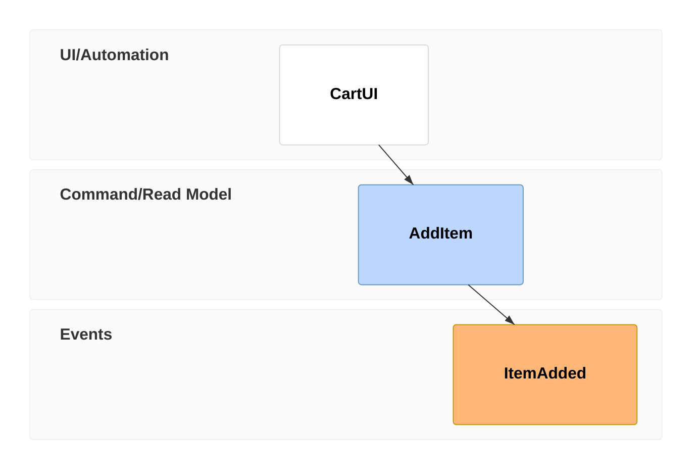
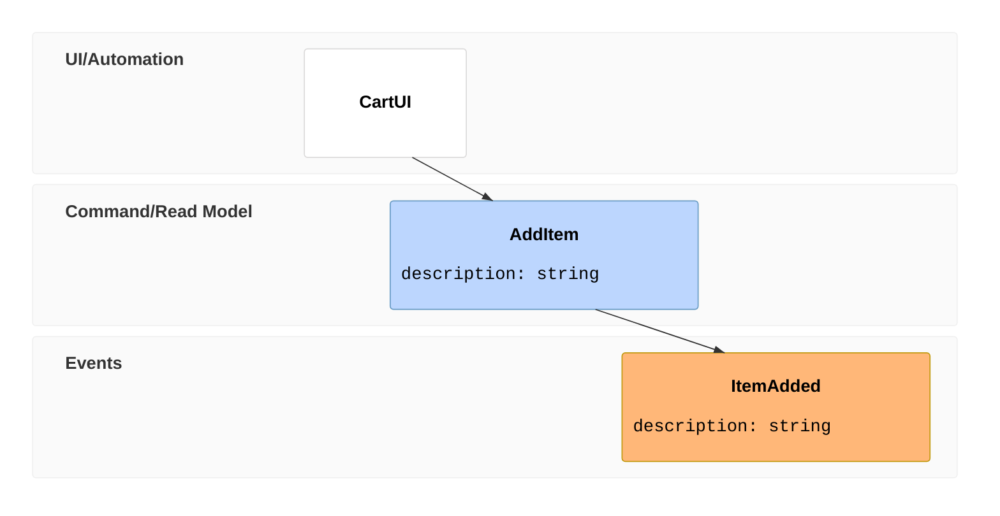
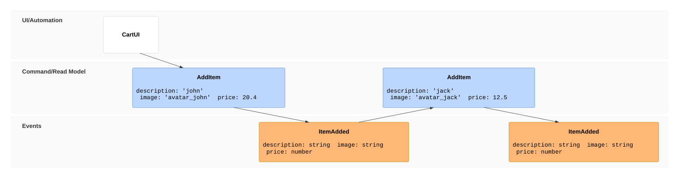
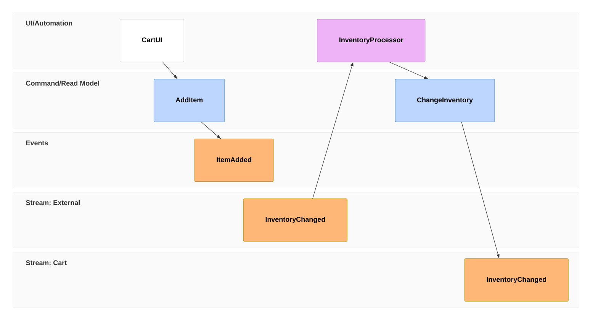
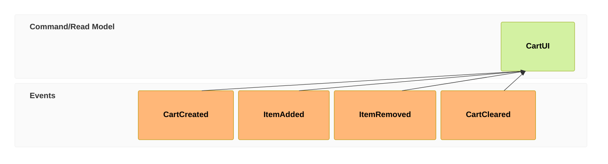
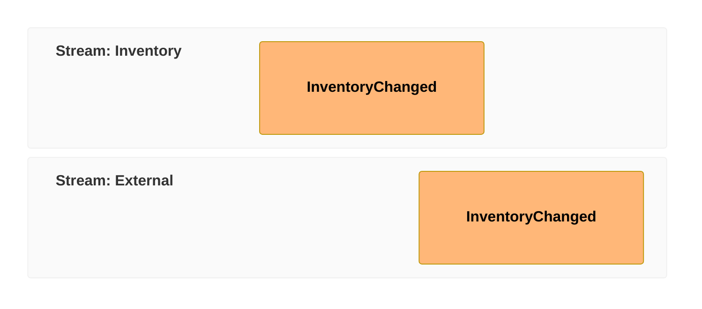

# Mermaid: карта Уордли, Cynefin, Event Modeling, railroad, Agentflow

Сверено по Mermaid 12.1.0. Общие правила — встраивание, объявление, комментарии, frontmatter, экранирование, умолчания Mermaid 12, общие ловушки — в [mermaid.md](mermaid.md).

---

## Карта Уордли (`wardley-beta`)

Документация: https://mermaid.js.org/syntax/wardley.html

### Ключевое слово и статус

- `wardley-beta` — «Required diagram type identifier (beta release)».
- Статус: beta. Появилась в v11.14.0. «Wardley Maps are visual representations of business strategy that map value chains and component evolution.»

### Минимальный пример

```mermaid
wardley-beta
title Tea Shop Value Chain

anchor Business [0.95, 0.63]
component Cup of Tea [0.79, 0.61]
component Tea [0.63, 0.81]
component Hot Water [0.52, 0.80]
component Kettle [0.43, 0.35]
component Power [0.10, 0.70]

Business -> Cup of Tea
Cup of Tea -> Tea
Cup of Tea -> Hot Water
Hot Water -> Kettle
Kettle -> Power

evolve Kettle 0.62
evolve Power 0.89

note "Standardising power allows Kettles to evolve faster" [0.30, 0.49]
```

### Синтаксис

**Объявление** — `wardley-beta`, необязательные `title` и `size` (размер холста в пикселях):

```mermaid
wardley-beta
title Your Map Title
size [1100, 600]
```

**Координаты:** «**IMPORTANT**: Wardley Maps use the OnlineWardleyMaps (OWM) format: `[visibility, evolution]`» — первое значение видимость (0.0–1.0 снизу вверх), второе эволюция (0.0–1.0 слева направо). «This is **opposite** of typical (x, y) notation!»

**Компоненты и якоря:**

```txt
component Name [visibility, evolution]
component Name [visibility, evolution] label [offsetX, offsetY]
component Name [visibility, evolution] (decorator)
```

«Names may contain hyphens (`real-time processing`, `end-user`) without quoting. Quote a name only if it begins with a non-letter or contains a character the grammar does not otherwise accept.» Якорь `anchor` — пользователь или заказчик, выводится жирной подписью.

```mermaid
wardley-beta
title Components

component API [0.60, 0.70]
component Database [0.40, 0.85] label [-50, 10]
component "Custom Service" [0.55, 0.35]
```

**Декораторы** — `(inertia)` для компонента, сопротивляющегося изменениям; стратегия получения — `(build)` треугольник, `(buy)` ромб, `(outsource)` квадрат, `(market)` круг:

```mermaid
wardley-beta
title Sourcing Strategy

anchor Customer [0.80, 0.95]
component Custom App [0.45, 0.85] (build)
component Off-the-shelf Tool [0.85, 0.65] (buy)
component Managed Service [0.60, 0.40] (outsource)
component Cloud Platform [0.95, 0.25] (market)

Customer -> Custom App
Custom App -> Off-the-shelf Tool
Custom App -> Managed Service
Off-the-shelf Tool -> Cloud Platform
```

**Связи:**

```txt
A -> B              %% Basic dependency
A --> B             %% Basic dependency (alternative style)
A -> B; label       %% With annotation
A -.-> B            %% Dashed flow
A +> B              %% Flow (with arrow marker)
A +< B              %% Reverse flow
A +<> B             %% Bi-directional flow
A +'text'> B        %% Labeled flow
```

**Эволюция** — `evolve <имя> <целевая эволюция>`, красная пунктирная стрелка; тренд — `Component -.- (x, y)`: «Note: Trends use standard (x, y) order, not \[visibility, evolution]!»

**Конвейер** — компоненты с одной видимостью, у каждого только эволюция:

```mermaid
wardley-beta
title Pipeline Evolution

component Database [0.40, 0.60]

pipeline Database {
  component "File System" [0.25]
  component "SQL DB" [0.50]
  component "NoSQL" [0.70]
  component "Cloud DB" [0.85]
}
```

**Свои стадии эволюции** — `evolution` со стрелками `->`, двойные подписи через `/`, ширина стадий через `@`:

```mermaid
wardley-beta
title Custom Widths

evolution Genesis@0.2 -> Custom@0.4 -> Product@0.75 -> Commodity@1.0

component Novel [0.75, 0.15]
component Bespoke [0.70, 0.35]
component Product [0.65, 0.65]
component Utility [0.60, 0.90]
```

**Заметки и нумерованные аннотации** — текст обязательно в кавычках:

```mermaid
wardley-beta
title Annotations

component API [0.60, 0.70]
component Cache [0.50, 0.55]
component Database [0.40, 0.40]

API -> Cache
Cache -> Database

annotations [0.10, 0.90]
annotation 1,[0.60, 0.65] "Critical component"
annotation 2,[0.50, 0.50] "Performance layer"
annotation 3,[0.40, 0.35] "Data persistence"
```

**Ускорители и замедлители** — `accelerator` и `deaccelerator` с текстом в кавычках и координатами:

```mermaid
wardley-beta
title Forces

component Legacy [0.20, 0.85]
component Modern [0.55, 0.60]
component AI [0.70, 0.35]

Legacy -> Modern
Modern -> AI

accelerator "AI Adoption" [0.55, 0.25]
deaccelerator "Legacy Constraints" [0.15, 0.75]
```

**Смещение подписи:** «Negative X moves left, positive X moves right. Negative Y moves up, positive Y moves down.»

Сводка синтаксиса — дословно:

| Element    | Syntax                              | Example                             |
| ---------- | ----------------------------------- | ----------------------------------- |
| Diagram    | `wardley-beta`                      | `wardley-beta`                      |
| Title      | `title Text`                        | `title My Map`                      |
| Size       | `size [width, height]`              | `size [1100, 800]`                  |
| Component  | `component Name [vis, evo]`         | `component API [0.6, 0.7]`          |
| Anchor     | `anchor Name [vis, evo]`            | `anchor User [0.9, 0.95]`           |
| Link       | `A -> B`                            | `API -> Database`                   |
| Flow       | `A +> B`                            | `User +> API`                       |
| Evolve     | `evolve Name targetEvo`             | `evolve API 0.85`                   |
| Note       | `note "Text" [vis, evo]`            | `note "Key insight" [0.4, 0.5]`     |
| Annotation | `annotation N,[x,y] "Text"`         | `annotation 1,[0.5,0.5] "Critical"` |
| Inertia    | `(inertia)`                         | `component DB [0.4, 0.6] (inertia)` |
| Strategy   | `(build\|buy\|outsource\|market)`   | `component API [0.6, 0.7] (buy)`    |
| Pipeline   | `pipeline Parent { ... }`           | See pipeline example above          |
| Evolution  | `evolution Stage1 -> Stage2 -> ...` | See evolution examples above        |

### Стили и классы

«Wardley Maps support Mermaid's theme system. Use standard Mermaid configuration to customize appearance.» `classDef`, `style`, `class`, `:::` не описаны.

### Ключи `config`, которые задаёт автор

Ключ раздела — `wardley-beta`, а не `wardley`: `width` (`900`), `height` (`600`), `padding` (`48`), `nodeRadius` (`6`), `nodeLabelOffset` (`8`), `axisFontSize` (`12`), `labelFontSize` (`10`), `showGrid` (`false`).

### Ловушки

- Координаты `[visibility, evolution]`, тренды — `(x, y)`.
- ЕСЛИ важен размер холста -> задать `size` явно: страница и схема конфигурации называют разную ширину по умолчанию.
- «Handdrawn/rough mode (`look: handDrawn`) is not currently supported for Wardley Maps.»

---

## Фреймворк Cynefin (`cynefin-beta`)

Документация: https://mermaid.js.org/syntax/cynefin.html

### Ключевое слово и статус

- `cynefin-beta` — «Diagram type declaration (required, first line after any front matter)».
- Статус: beta (суффикс `-beta`). Появилась в v11.16.0. Пять доменов: Clear, Complicated, Complex, Chaotic, Confusion.

### Минимальный пример

```mermaid
cynefin-beta
  title Incident Response

  complex
    "Investigate root cause"
    "Run chaos experiment"

  complicated
    "Analyze performance data"
    "Expert review needed"

  clear
    "Restart service"
    "Apply known fix"

  chaotic
    "Page on-call immediately"

  confusion
    "Unknown failure mode"
```

### Синтаксис

| Keyword        | Meaning                                                                |
| -------------- | ---------------------------------------------------------------------- |
| `cynefin-beta` | Diagram type declaration (required, first line after any front matter) |
| `title`        | Optional diagram title                                                 |
| `complex`      | Opens the Complex domain block                                         |
| `complicated`  | Opens the Complicated domain block                                     |
| `clear`        | Opens the Clear domain block                                           |
| `chaotic`      | Opens the Chaotic domain block                                         |
| `confusion`    | Opens the Confusion / Disorder domain block                            |
| `-->`          | Declares a transition from one domain to another                       |

Элементы — строки в кавычках, каждая на своей строке внутри блока домена. Переходы — на верхнем уровне, подпись необязательна:

```mermaid
cynefin-beta
  title Strategy Categorization

  complex
    "Market research"

  complicated
    "Competitive analysis"

  clear
    "Standard pricing"

  chaotic
    "Crisis management"

  complex --> complicated : "Pattern identified"
  complicated --> clear : "Best practice codified"
  clear --> chaotic : "Complacency"
  chaotic --> complex : "Stabilized"
```

### Стили и классы

Переменные темы — в `themeVariables.cynefin`:

| Variable         | Description                                      |
| ---------------- | ------------------------------------------------ |
| `complexBg`      | Background color for the Complex domain          |
| `complicatedBg`  | Background color for the Complicated domain      |
| `clearBg`        | Background color for the Clear domain            |
| `chaoticBg`      | Background color for the Chaotic domain          |
| `confusionBg`    | Background color for the Confusion center region |
| `boundaryColor`  | Color of the wavy domain boundaries              |
| `boundaryWidth`  | Stroke width of the boundaries                   |
| `cliffColor`     | Color of the Clear/Chaotic cliff                 |
| `cliffWidth`     | Stroke width of the cliff                        |
| `arrowColor`     | Color of transition arrows                       |
| `arrowWidth`     | Stroke width of transition arrows                |
| `labelColor`     | Color of domain name labels                      |
| `textColor`      | Color of item and subtitle text                  |
| `domainFontSize` | Font size of domain name labels                  |
| `itemFontSize`   | Font size of item badges and subtitles           |

### Доступность

```text
cynefin-beta
  accTitle: Cynefin framework for software delivery decisions
  accDescr: A Cynefin map categorizing software tasks by complexity domain

  complex
    "New feature discovery"
```

### Ключи `config`, которые задаёт автор

Раздел `cynefin:` — дословно со страницы:

| Option                   | Type    | Default | Description                                                                                                                                                                                                                  |
| ------------------------ | ------- | ------- | ---------------------------------------------------------------------------------------------------------------------------------------------------------------------------------------------------------------------------- |
| `width`                  | number  | `800`   | Width of the diagram in pixels                                                                                                                                                                                               |
| `height`                 | number  | `600`   | Height of the diagram in pixels                                                                                                                                                                                              |
| `padding`                | number  | `40`    | Padding around the diagram                                                                                                                                                                                                   |
| `showDomainDescriptions` | boolean | `true`  | Show decision model and practice type subtitles per domain                                                                                                                                                                   |
| `boundaryAmplitude`      | number  | `8`     | Waviness amplitude of domain boundaries in pixels (set to `0` for straight lines)                                                                                                                                            |
| `seed`                   | number  | `0`     | Deterministic seed for boundary waviness. `0` (default) hashes the diagram's SVG id so each diagram looks unique. Set any non-zero number to lock the waviness across renders — required for stable visual regression tests. |

### Ловушки

- «Domain names are fixed keywords. Only `complex`, `complicated`, `clear`, `chaotic`, and `confusion` are recognized.»
- «Domains can be declared in any order; their position in the diagram is always the same (Complex top-left, Complicated top-right, Chaotic bottom-left, Clear bottom-right, Confusion center).»
- В домене `confusion` видны до трёх элементов, дальше — значок `+N more`; квадранты длинные списки не обрезают.
- «Self-loop transitions (e.g. `complex --> complex`) are silently ignored. Transitions must connect two different domains.»
- «Handdrawn mode is not currently supported.»
- ЕСЛИ границы должны совпадать от отрисовки к отрисовке -> задать ненулевой `seed`.

---

## Event Modeling (`eventmodeling`)

Документация: https://mermaid.js.org/syntax/eventmodeling.html

### Ключевое слово и статус

- `eventmodeling`, регистр значим.
- Статус: стабильный (пометок на странице нет). Появилась в v11.15.0. «**Event Modeling** (EM) is a method of describing systems using an example of how information has changed within them over time.»

### Минимальный пример



### Синтаксис

Два равноправных синтаксиса — компактный и свободный: «both can be used interchangeably». Шкала состоит из кадров `tf` / `timeframe`; номер кадра уникален на всей шкале, порядок номеров не важен.

```md
eventmodeling

timeframe 01 ui CartUI
timeframe 02 command AddItem
timeframe 03 event ItemAdded
```

**Типы сущностей** — третья колонка кадра; дорожки по умолчанию — дословно:

- `ui`: UI - belongs to UI/Automation swimlane
- `pcr` / `processor`: Processor - belongs to UI/Automation swimlane
- `cmd` / `command`: Command - belongs to Command/Read Model swimlane
- `rmo` / `readmodel`: Read Model - belongs to Command/Read Model swimlane
- `evt` / `event`: Event - belongs to Events swimlane

**Встроенные данные** — в фигурных скобках на той же строке:



**Блок данных** — `data <id> { … }`, подключается из кадра как `[[id]]`:



**Сброс потока** — кадр `rf` / `resetframe`: «A reset frame stops the inferred relation from the preceding frame. You can still connect it to a specific earlier frame with `->>`.»



**Несколько связей** — `->>`:



**Пространства имён** — часть идентификатора до точки: «Each combination of the Namespace and Entity type forms new Swimlane. The order how they are specified in the text definition specifies the order of the Swimlanes in the diagram.»



**Тип данных** — в обратных апострофах перед фигурными скобками: `json`, `jsobj`, `figma`, `salt`, `uri`, `md`, `html`, `text`. «> **Warning** There is no special treatment in the diagram renderer at the moment for a specific data type.»

```md
tf 01 rmo UserAdded `json`{ "name": "foo" }
```

### Ключи `config`, которые задаёт автор

Раздел `eventmodeling:`: `padding` (`30`), `rowHeight` (`32`).

### Ловушки

- «Reusing a number for another Time Frame or Reset Frame produces an error.»
- Связи выводятся автоматически; лишнюю связь разрывает кадр сброса.

---

## Railroad-диаграммы (`railroad-ebnf-beta`)

Документация: https://mermaid.js.org/syntax/railroad.html

### Ключевое слово и статус

| Diagram type    | Keyword              | Notation                                                                         |
| --------------- | -------------------- | -------------------------------------------------------------------------------- |
| EBNF            | `railroad-ebnf-beta` | Extended Backus–Naur Form (W3C and ISO 14977 styles)                             |
| ABNF            | `railroad-abnf-beta` | Augmented Backus–Naur Form (RFC 5234)                                            |
| PEG             | `railroad-peg-beta`  | Parsing Expression Grammar                                                       |
| IR (primitives) | `railroad-beta`      | Mermaid's railroad intermediate representation, written as explicit constructors |

- Статус: beta (суффикс `-beta`); страница опубликована, но в меню сайта не входит. Появились в v11.16.0. «Railroad diagrams (also known as syntax diagrams or grammar diagrams) are a visual representation of context-free grammars.»

### Минимальный пример

```mermaid
railroad-ebnf-beta
title "Digit Definition"

digit = "0" | "1" | "2" | "3" | "4" | "5" | "6" | "7" | "8" | "9" ;
```

### Синтаксис

Общая структура: первая строка — ключевое слово; необязательно `title` со строкой, `accTitle:` и `accDescr:`; одно правило на утверждение, каждое заканчивается `;`.

**EBNF** — `rule_name = definition ;`, принимается и `::=`:

| Feature         | W3C Notation         | ISO 14977 Notation   | Description      |
| --------------- | -------------------- | -------------------- | ---------------- |
| Terminal        | `"text"` or `'text'` | `"text"` or `'text'` | Literal string   |
| Non-terminal    | `identifier`         | `identifier`         | Rule reference   |
| Sequence        | `A B`                | `A , B`              | Concatenation    |
| Choice          | `A \| B`             | `A \| B`             | Alternative      |
| Optional        | `A?`                 | `[ A ]`              | Zero or one      |
| Repetition (0+) | `A*`                 | `{ A }`              | Zero or more     |
| Repetition (1+) | `A+`                 | -                    | One or more      |
| Grouping        | `( A B )`            | `( A B )`            | Group elements   |
| Comment         | `/* text */`         | `(* text *)`         | Comment          |
| Special         | -                    | `? text ?`           | Special sequence |
| Exception       | `A - B`              | `A - B`              | Exclusion        |

```mermaid
railroad-ebnf-beta
title "Arithmetic Expression Grammar"

expression = term ( ( "+" | "-" ) term )* ;
term = factor ( ( "*" | "/" ) factor )* ;
factor = number | "(" expression ")" ;
number = digit+ ;
digit = "0" | "1" | "2" | "3" | "4" | "5" | "6" | "7" | "8" | "9" ;
```

**ABNF** (RFC 5234, https://datatracker.ietf.org/doc/html/rfc5234) — `name = definition ;`, дословно:

- "Alternation uses `/` (instead of `|`): `A / B`"
- "Concatenation is whitespace-separated: `A B`"
- "Repetition uses a prefix: `*A` (zero or more), `1*A` (one or more), `2*4A` (between 2 and 4), `3A` (exactly 3)"
- "Grouping uses parentheses: `( A B )`"
- "Optional groups use brackets: `[ A ]`"
- "Terminals can be quoted strings (`"text"`) or numeric values (`%x41`, `%d65`, `%b1000001`, including ranges like `%x30-39`)"
- "Comments start with `;` and run to the end of the line"

```mermaid
railroad-abnf-beta
title "Email Address"

address = local-part "@" domain ;
local-part = 1*( ALPHA / DIGIT / "." / "-" ) ;
domain = label *( "." label ) ;
label = 1*( ALPHA / DIGIT / "-" ) ;
```

**PEG** — `Name <- definition ;`, дословно:

- "Ordered choice uses `/`: `A / B` (tries `A` first, then `B`)"
- "Sequence is whitespace-separated: `A B`"
- "Suffix operators: `A?` (optional), `A*` (zero or more), `A+` (one or more)"
- "Prefix predicates: `&A` (and-predicate, lookahead), `!A` (not-predicate, negative lookahead)"
- "Grouping uses parentheses: `( A B )`"
- "`.` matches any single character"
- "Terminals are quoted strings (`"text"` or `'text'`)"
- "Comments start with `#` and run to the end of the line"

```mermaid
railroad-peg-beta
title "Identifiers (keywords excluded)"

Identifier <- !Keyword Letter Letter* ;
Keyword <- "if" / "else" / "while" ;
Letter <- "a" / "b" / "c" / "_" ;
```

**IR** (`railroad-beta`) — явные конструкторы, `rule_name = expression ;`:

| Constructor           | Meaning                       |
| --------------------- | ----------------------------- |
| `terminal("text")`    | Terminal (literal string)     |
| `nonterminal("name")` | Non-terminal (rule reference) |
| `sequence(a, b, ...)` | Elements in sequence          |
| `choice(a, b, ...)`   | Alternatives                  |
| `optional(a)`         | Zero or one                   |
| `zeroOrMore(a)`       | Zero or more                  |
| `oneOrMore(a)`        | One or more                   |
| `special("text")`     | Special sequence              |

```mermaid
railroad-beta
title Expression Grammar

expression = sequence(
    nonterminal("term"),
    zeroOrMore(sequence(
        choice(terminal("+"), terminal("-")),
        nonterminal("term")
    ))
) ;
term = sequence(
    nonterminal("factor"),
    zeroOrMore(sequence(
        choice(terminal("*"), terminal("/")),
        nonterminal("factor")
    ))
) ;
factor = choice(
    nonterminal("number"),
    sequence(terminal("("), nonterminal("expression"), terminal(")"))
) ;
number = oneOrMore(nonterminal("digit")) ;
digit = choice(terminal("0"), terminal("1"), terminal("2"), terminal("3"), terminal("4"), terminal("5"), terminal("6"), terminal("7"), terminal("8"), terminal("9")) ;
```

### Стили и классы

«Railroad diagrams inherit colors and typography from the active Mermaid theme by default. You can still override individual railroad styles through the `railroad` config block when you need diagram-specific adjustments.»

### Комментарии

Комментарий — по нотации: EBNF W3C `/* … */`, ISO 14977 `(* … *)`, ABNF — `;` до конца строки, PEG — `#` до конца строки. Для `railroad-beta` синтаксис комментариев на странице не описан.

### Ключи `config`, которые задаёт автор

Раздел `railroad:`, по схеме конфигурации: `compactMode` (`false`), `padding` (`10`), `verticalSeparation` (`8`), `horizontalSeparation` (`10`), `arcRadius` (`10`), `fontSize` (`14`), `fontFamily` (`'monospace'`), `strokeWidth` (`2`), `showMarkers` (`true`), `markerRadius` (`5`); цвета терминалов, нетерминалов, линий и комментариев — ключи вида `terminalFill`, `nonTerminalFill`, `lineColor`.

### Ловушки

- Одна нотация и её ключевое слово на диаграмму; правило заканчивается `;` во всех четырёх.
- Альтернатива — `|` в EBNF, но `/` в ABNF и PEG; повторение в ABNF — префиксное.
- «The hand-drawn look (`look: handDrawn`) is not currently supported for railroad diagrams.»

---

## Agentflow (`agentflow-beta`)

Документация: https://mermaid.js.org/syntax/agentflow.html

### Ключевое слово и статус

- `agentflow-beta` и необязательное направление `TB`, `TD`, `BT`, `LR`, `RL`.
- Статус: beta — «Agentflow is in **beta**. The diagram type is selected with the `agentflow-beta` keyword, and the syntax may still change in a backwards-incompatible way before it is declared stable.» Страница не входит в меню сайта. Появилась в v12.0.0.
- «An agentflow diagram describes an agentic workflow: the agents that do the work, the flows they run, the tasks and tools inside those flows, and how control and data move between them.»

### Минимальный пример

```mermaid
agentflow-beta TB
  flow reviewer["Review Agent"]
    changes["Gather changes"]@{ shape: input }
    analyse["Analyse diff"]@{ shape: task }
    lint["run_linter"]@{ shape: tool }
    ok["Clean?"]@{ shape: decision }

    changes --> analyse --> lint --> ok
  end
```

### Синтаксис

**Узлы и формы** — как в блок-схеме, форма — ключ `shape` в `@{ … }`. Псевдонимы Agentflow:

| Alias      | Meaning                                                  | Underlying shape |
| ---------- | -------------------------------------------------------- | ---------------- |
| `task`     | A unit of work an agent performs                         | `roundedRect`    |
| `tool`     | A callable capability — a function, an API, a subroutine | `subroutine`     |
| `input`    | Data entering the workflow                               | `lean-right`     |
| `decision` | A branch point                                           | `diamond`        |
| `refdoc`   | Reference material an agent consults                     | `lin-doc`        |
| `action`   | A side-effecting step — sending, writing, publishing     | `hexagon`        |

«Any canonical Mermaid shape name also works, so the aliases are a convenience rather than a restriction.»

**Рёбра:**

| Operator | Semantic    | Reads as                                          |
| -------- | ----------- | ------------------------------------------------- |
| `-->`    | `sequence`  | Control or data flows from source to target       |
| `-.-`    | `reference` | The source consults the target; no control passes |
| `--x`    | `failure`   | The failure path out of the source                |

```mermaid
agentflow-beta TB
  check["Tests pass?"]@{ shape: decision }
  ship["Ship it"]@{ shape: action }
  fix["Fix the build"]@{ shape: task }
  logs["Build logs"]@{ shape: refdoc }

  check -- yes --> ship
  check -- no --> fix
  fix --x check
  fix -.- logs
```

**Контейнеры** — `flow … end`, вкладываются; узел, упомянутый внутри контейнера, принадлежит ему. Общий для нескольких потоков узел — в `global … end`: «`global` takes no id, label, or metadata, renders nothing itself, and may appear anywhere in the diagram — including nested inside a flow, as an escape hatch.»

```mermaid
agentflow-beta TB
  global
    corpus["Shared corpus"]@{ shape: refdoc }
  end

  flow summariser["Summariser"]
    summarise["Summarise"]@{ shape: task }
    summarise -.- corpus
  end

  flow indexer["Indexer"]
    index["Build index"]@{ shape: task }
    index -.- corpus
  end
```

**Свёртка контейнера** — `@{ view: collapsed }`: рёбра, пересекавшие границу, заканчиваются на свёрнутом узле.

```mermaid
agentflow-beta TB
  flow intake["Intake"]
    receive["Receive request"]@{ shape: input }
  end

  flow processing["Processing"]
    validate["Validate"]@{ shape: task }
    enrich["Enrich"]@{ shape: task }
    validate --> enrich
  end
  processing@{ view: "collapsed" }

  flow output["Output"]
    publish["Publish"]@{ shape: action }
  end

  receive --> validate
  enrich --> publish
```

**Метаданные** — блок `@{ … }` в YAML у узла, ребра или контейнера, однострочный или многострочный:

```txt
fetch@{
  shape: tool
  params: "city :: String"
  returns: "Report"
  retry: 2
}
```

| Key                             | Applies to | Effect                                                 |
| ------------------------------- | ---------- | ------------------------------------------------------ |
| `shape`                         | nodes      | Selects the node shape (see the table above)           |
| `label`, `labelType`            | nodes      | Overrides the node's label and how it is parsed        |
| `view`                          | containers | `collapsed` folds the container down to a summary node |
| `algorithm`                     | containers | Per-container ELK algorithm                            |
| `curve`, `animate`, `animation` | edges      | Edge interpolation and animation                       |

Остальные ключи сохраняются: «an unknown key is preserved, never rejected». Словарь-соглашение — `description`, `instruction`, `model`, `params`, `returns`, `value`, `example`, `connectorRef`.

**Коннекторы** — `connector`, инструменты ссылаются на возможность через `connectorRef`: «A `connectorRef` value may be a bare node id, a dotted `connector.capability` form, or a URL.»

```mermaid
agentflow-beta LR
  connector github["GitHub API"]
  github@{ protocol: "http", endpoint: "https://api.github.com" }

  title["Issue title"]@{ shape: input }
  create["create_issue"]@{ shape: tool, connectorRef: "github.create_issue" }

  title --> create
```

### Стили и классы

«Containers are themed with `flowContainerStroke`, defined by every theme mermaid registers; it falls back to `secondaryBorderColor` when unset. Everything else on an agentflow diagram uses the standard node, edge, and cluster theme variables.»

### Ключи `config`, которые задаёт автор

Раздел `agentflow:` — дословно со страницы:

| Option           | Description                                      | Default |
| ---------------- | ------------------------------------------------ | ------- |
| `titleTopMargin` | Margin above the diagram title                   | `25`    |
| `diagramPadding` | Padding around the diagram as a whole, in pixels | `8`     |
| `nodeSpacing`    | Spacing between nodes on the same level          | `50`    |
| `rankSpacing`    | Spacing between nodes on different levels        | `50`    |
| `useMaxWidth`    | Scale the diagram to the available width         | `true`  |

Раскладка — ELK по умолчанию; у контейнера свой алгоритм ELK:

```mermaid
---
config:
  layout: elk
---
agentflow-beta TB
  flow tools["Tools"]
    a["a"]@{ shape: tool }
    b["b"]@{ shape: tool }
  end
  tools@{ algorithm: "elk.rectpacking" }
```

### Ловушки

- `layout` — ключ верхнего уровня: в разделе `agentflow:` его не задать, он действует на все диаграммы страницы.
- Ключи `__proto__`, `constructor`, `prototype` удаляются из метаданных на любом уровне вложенности.
