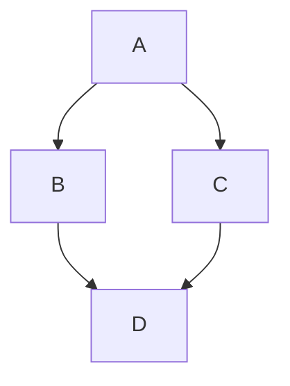
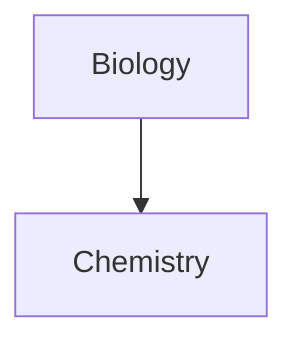

# Mermaid: площадки рендера

Сверено по Mermaid 12.1.0. Общие правила — [mermaid.md](mermaid.md). Здесь — что делает с диаграммой каждая площадка: рисует ли она сама или через приложение, в какой форме встраивать, какую версию Mermaid площадка называет и какие ограничения меняют результат. Основание — документация самих площадок; факты из исходного кода или дистрибутива площадки помечены «по исходному коду площадки, в документации не указано».

---

## Сводка

| Площадка | Рендер | Форма встраивания | Версия Mermaid в документации площадки |
|---|---|---|---|
| GitHub | сама | блок ```` ```mermaid ````; файлы `.mermaid`, `.mmd` | не названа; проверка — блок `info` |
| GitLab | сама | блок ```` ```mermaid ```` | «GitLab supports Mermaid version 11.» |
| Azure DevOps | сама, в вики | `::: mermaid` … `:::` или блок ```` ```mermaid ```` | не названа |
| Obsidian | сама | блок ```` ```mermaid ```` | не названа |
| VS Code | сама, с 1.121 | блок ```` ```mermaid ```` в предпросмотре Markdown | не названа |
| Notion | сама | блок кода с языком Mermaid | не названа |
| Joplin | сама | блок ```` ```mermaid ```` | не названа |
| Gitea | сама | блок ```` ```mermaid ```` в Markdown | не названа |
| Forgejo | сама | блок ```` ```mermaid ```` в Markdown | не названа |
| Docusaurus | через официальную тему `@docusaurus/theme-mermaid` | блок ```` ```mermaid ```` | не названа |
| Material for MkDocs | после настройки `pymdownx.superfences` | блок ```` ```mermaid ```` | не названа |
| Hugo | своего шаблона нет | свой шаблон блока кода | не фиксирована |
| Typora | после включения в настройках | блок ```` ```mermaid ```` | не названа |
| IDE JetBrains | через встроенный плагин Mermaid | блок ```` ```mermaid ```` | не названа |
| Confluence | нет, только приложения Marketplace | по приложению | — |
| Jira | нет, только приложения Marketplace | по приложению | — |
| Bitbucket | нет | — | — |
| FigJam | инструмент `generate_diagram` | код Mermaid в вызове инструмента | — |

---

## GitHub

Документация: https://docs.github.com/en/get-started/writing-on-github/working-with-advanced-formatting/creating-diagrams и https://docs.github.com/en/repositories/working-with-files/using-files/working-with-non-code-files#displaying-mermaid-files-on-github

- Рендер свой: «Diagram rendering is available in GitHub Issues, GitHub Discussions, pull requests, wikis, and Markdown files.»
- Форма: «To create a Mermaid diagram, add Mermaid syntax inside a fenced code block with the `mermaid` language identifier.» Отдельные файлы: «Commit the file as you would normally using a `.mermaid` or `.mmd` extension.»

````text
Here is a simple flow chart:


````

- Версия: документация её не называет и предлагает проверить: «To ensure GitHub supports your Mermaid syntax, check the Mermaid version currently in use.»

````text
```mermaid
  info
```
````

- Ограничения из документации: «You may observe errors if you run a third-party Mermaid plugin when using Mermaid syntax on GitHub.» Известные проблемы: «Sequence diagram charts frequently render with additional padding below the chart, with more padding added as the chart size increases.»; «Actor nodes with popover menus do not work as expected within sequence diagram charts.»; «Not all charts are a11y compliant.»
- Диагностика: «If your chart does not render at all, verify that it contains valid Mermaid Markdown syntax by checking your chart with the [Mermaid live editor](https://mermaid.live/edit).»
- `securityLevel: "antiscript"` (по исходному коду площадки, в документации не указано) — что разрешает этот уровень, в том числе `click`, — [mermaid-config.md](mermaid-config.md).

## GitLab

Документация: https://docs.gitlab.com/user/markdown/

- Рендер свой, форма — блок `mermaid`: «To generate a diagram or flowchart, write your text inside the `mermaid` block:»

````markdown

````

- Версия: «GitLab supports Mermaid version 11.» Конструкции, появившиеся в Mermaid 12, на GitLab не рассчитывать.
- Дерево файлов: «Support for `treeView-beta` diagrams [introduced](https://gitlab.com/gitlab-org/gitlab/-/issues/612879) in GitLab 19.4.»
- Собственные установки: «On GitLab Self-Managed, if you configured a `Cross-Origin-Resource-Policy` header with `same-site` or `same-origin`, Mermaid diagrams silently fail to render. To resolve this, use `cross-origin` instead.»
- Лимиты нагрузки (по исходному коду площадки, в документации не указано): исходник одной диаграммы — до 2000 символов, на странице — до 50 блоков `mermaid`, в цепочке связей — до 30 знаков `&`; при превышении вместо диаграммы — предупреждение «Warning: Displaying this diagram might cause performance issues on this page.» с кнопкой «Display».
- Диаграмма рисуется в изолированном фрейме с `securityLevel: 'strict'` (по исходному коду площадки, в документации не указано): при `strict` функция `click` отключена ([mermaid-config.md](mermaid-config.md)).

## Azure DevOps

Документация: https://learn.microsoft.com/en-us/azure/devops/project/wiki/markdown-guidance?view=azure-devops

- Рендер свой, в вики: «To add a Mermaid diagram to a wiki page, you can use either of these formats: The `:::` container syntax with the `mermaid` keyword. A standard fenced code block with the `mermaid` language identifier.»

```md
::: mermaid
sequenceDiagram
    Christie->>Josh: Hello Josh, how are you?
    Josh-->>Christie: Great!
    Christie->>Josh: See you later!
:::
```

- Поддерживаемые типы: Sequence diagrams, Gantt charts, Flowcharts, Class diagram, State diagram, User Journey, Pie chart, Requirements diagram, Gitgraph diagrams, Entity Relationship diagrams, Timeline diagrams.
- Подмножество синтаксиса: «Azure DevOps provides **limited syntax support** for the Mermaid diagram types. Unsupported syntax includes most HTML tags, Font Awesome, `flowchart` syntax (use `graph` element instead), LongArrow `---->`, and more.»
- «Internet Explorer doesn't support Mermaid.»

## Obsidian

Документация: https://obsidian.md/help/advanced-syntax

- Рендер свой: «To add a Mermaid diagram, create a `mermaid` code block.»
- Внутренние ссылки — класс `internal-link`: «You can create internal links in your diagrams by attaching the `internal-link` class to your nodes.»

````md

````

- Ограничения: «Internal links from diagrams don't show up in the Graph view.»; «If you use special characters in your note names, you need to put the note name in double quotes.»
- `securityLevel: "strict"` (по дистрибутиву площадки, в документации не указано).

## VS Code

Документация: https://code.visualstudio.com/docs/languages/markdown#_mermaid-diagram-rendering

- Рендер свой с версии 1.121 (https://code.visualstudio.com/updates/v1_121): «VS Code's built-in Markdown preview renders [Mermaid](https://mermaid.js.org) diagrams in `mermaid` fenced code blocks.» По заметкам к выпуску — также в Markdown-ячейках блокнотов и в чатах.
- Большие диаграммы можно двигать и масштабировать в предпросмотре; пункт контекстного меню «Copy Diagram Source» копирует исходник.
- По исходному коду площадки, в документации не указано: лимит исходника — настройка `markdown-mermaid.maxTextSize` (по умолчанию `50000`); тема диаграммы берётся из настроек `markdown-mermaid.lightModeTheme` и `markdown-mermaid.darkModeTheme` (по умолчанию `vscode` — тема по цветовой схеме редактора).

## Notion

Документация: https://www.notion.com/releases/2021-12-23 и https://developers.notion.com/reference/block

- Рендер свой, в блоке кода: «Just select `Mermaid` in the language dropdown at the top left of any code block to get started. Once you've written your code, use the second dropdown at the top left to see a live `Preview` of your chart, or select `Split` to see your code and chart together.»
- В API блоков значение `"mermaid"` входит в перечень языков блока `code`.
- Текущая страница справки о блоках кода Mermaid не упоминает; поддержка описана журналом релизов и документацией API.

## Joplin

Документация: https://joplinapp.org/help/apps/markdown

- Рендер свой: «To add such a graph, wrap the Mermaid script inside a "```mermaid" code block».
- Ограничение: «Note that Mermaid graphs are always rendered on a white background regardless of the current theme.»

## Gitea и Forgejo

Документация: https://docs.gitea.com/administration/config-cheat-sheet и https://forgejo.org/docs/latest/admin/config-cheat-sheet/

- Рендер свой: в таблице сравнения Gitea строка «Mermaid diagrams in Markdown» отмечена «✓» (https://docs.gitea.com/installation/comparison/); синтаксис и ограничения в пользовательской документации не описаны.
- Лимит исходника — настройка `MERMAID_MAX_SOURCE_CHARACTERS`: у Gitea по умолчанию 50000, у Forgejo — 5000.
- Gitea рисует с `securityLevel: 'strict'` (по исходному коду площадки, в документации не указано).

## Docusaurus

Документация: https://docusaurus.io/docs/markdown-features/diagrams

- Рендер через официальную тему: «Enable Mermaid functionality by adding plugin `@docusaurus/theme-mermaid` and setting `markdown.mermaid` to `true` in your `docusaurus.config.js`.»

```js title="docusaurus.config.js"
export default {
  markdown: {
    mermaid: true,
  },
  themes: ['@docusaurus/theme-mermaid'],
};
```

- Раскладка зависит от версии Docusaurus: в 3.10.2 — «The `dagre` layout engine is supported by default in Docusaurus.» и ELK — по отдельной установке `@mermaid-js/layout-elk`; в следующей версии — «The `elk` layout engine is bundled and used by default for supported diagram types.» Если раскладка важна — задать `layout` явно.

## Material for MkDocs

Документация: https://squidfunk.github.io/mkdocs-material/reference/diagrams/

- Рендер после настройки:

``` yaml
markdown_extensions:
  - pymdownx.superfences:
      custom_fences:
        - name: mermaid
          class: mermaid
          format: !!python/name:pymdownx.superfences.fence_code_format
```

- Ограничения: «While all Mermaid.js features should work out-of-the-box, Material for MkDocs will currently only adjust the fonts and colors for flowcharts, sequence diagrams, class diagrams, state diagrams and entity relationship diagrams.»; круговые, Ганта, путь пользователя, git-граф и требования «are not officially supported by Material for MkDocs».

## Hugo

Документация: https://gohugo.io/content-management/diagrams/

- Своего шаблона нет: «Hugo does not provide a built-in template for Mermaid diagrams. Create your own using a code block render hook». Шаблон из документации — файл `layouts/_markup/render-codeblock-mermaid.html` и подключение в `layouts/baseof.html`:

```go-html-template
<pre class="mermaid">
  {{ .Inner | htmlEscape | safeHTML }}
</pre>
{{ .Page.Store.Set "hasMermaid" true }}
```

```go-html-template
{{ if .Store.Get "hasMermaid" }}
  <script type="module">
    import mermaid from 'https://cdn.jsdelivr.net/npm/mermaid/dist/mermaid.esm.min.mjs';
    mermaid.initialize({ startOnLoad: true });
  </script>
{{ end }}
```

## Typora

Документация: https://support.typora.io/Draw-Diagrams-With-Markdown/

- Рендер после включения: «please enable Diagrams in Preferences Panel → Markdown section».
- Ограничения: «diagram features are not supported when exporting Markdown into other file formats in the current version»; «if you export a document with themes other than the currently used one, some mermaid options will not be applied to exported HTML / PDF / Images.»
- Документация Typora предлагает директиву `%%{init: [options]}%%` в первой строке диаграммы; в Mermaid директивы устарели ([mermaid.md](mermaid.md)).

## IDE JetBrains

Документация: https://www.jetbrains.com/help/idea/markdown.html

- «The Markdown editor can render diagrams defined with Mermaid and PlantUML. This is disabled by default and requires additional steps.» и «This functionality relies on the Mermaid plugin, which is bundled and enabled in IntelliJ IDEA by default.»
- ЕСЛИ диаграмма в редакторе не отрисовалась -> включить рендер диаграмм в настройках Markdown и проверить, что плагин Mermaid не отключён.

## Confluence, Jira, Bitbucket

Своего рендера Mermaid нет — диаграммы отрисовывают только приложения Marketplace.

- Confluence (https://support.atlassian.com/confluence-cloud/docs/insert-the-code-block-macro/): на странице макроса блока кода Mermaid не упоминается. Приложение от Atlassian Labs — «Mermaid diagrams viewer» для Confluence Cloud (https://marketplace.atlassian.com/apps/1232887/mermaid-diagrams-viewer): «This app allows you to display a mermaid diagram on a Confluence page, using mermaid source code from any code block placed at the same page.» Порядок по описанию приложения: блок кода с синтаксисом Mermaid на странице, затем макрос, найденный по `/` и слову «mermaid». Есть и приложение команды Mermaid — «Mermaid Chart for Confluence».
- Jira (https://support.atlassian.com/jira-software-cloud/docs/markdown-and-keyboard-shortcuts/): Mermaid в документации не упоминается; приложение команды Mermaid — «Mermaid for Jira».
- Bitbucket (https://support.atlassian.com/bitbucket-cloud/docs/readme-content/): Mermaid в документации не упоминается; Markdown — Python-Markdown с расширениями «codehilite, tables, def_list, del, footnotes, headerid, sane_lists, abbr, fenced_code, toc, wikilinks».
- ЕСЛИ диаграмма нужна в Confluence, Jira или Bitbucket и приложение не установлено -> вставить картинку, отрисованную заранее (mermaid.live или `mmdc`), а исходник Mermaid сохранить блоком кода.

## FigJam

Диаграмму из кода Mermaid в FigJam создаёт инструмент `generate_diagram` Figma MCP; он поддерживает не все типы. Процедура — в скилле skill-figma-mcp.
