# Mermaid: диаграмма последовательности и ZenUML

Сверено по Mermaid 12.1.0. Общие правила — встраивание, объявление, комментарии, frontmatter, экранирование, умолчания Mermaid 12, общие ловушки — в [mermaid.md](mermaid.md).

---

## Диаграмма последовательности (`sequenceDiagram`)

Документация: https://mermaid.js.org/syntax/sequenceDiagram.html

### Ключевое слово и статус

- `sequenceDiagram`.
- Статус: стабильный. «A Sequence diagram is an interaction diagram that shows how processes operate with one another and in what order.»

### Минимальный пример

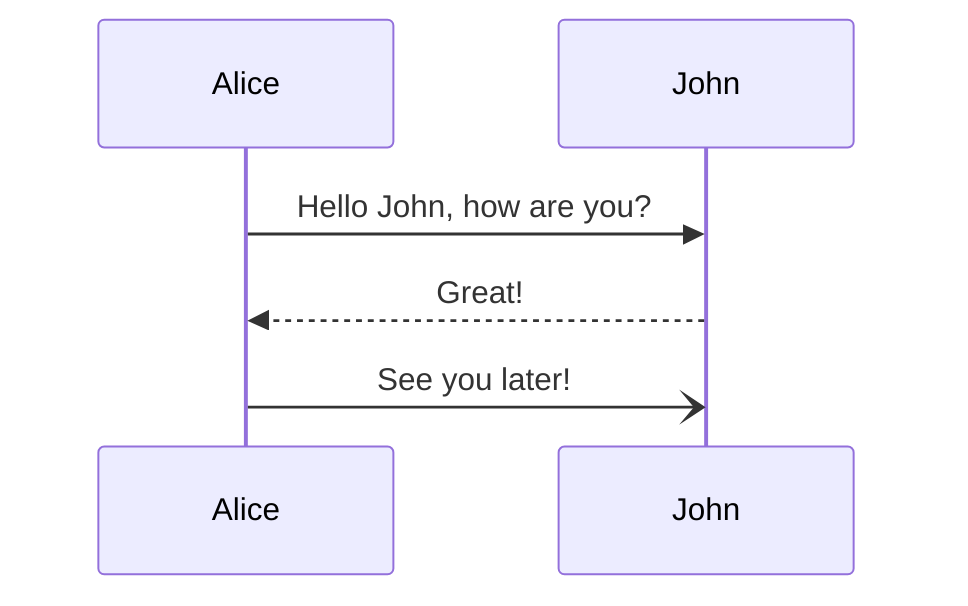

Пример со страницы, который собирает частые конструкции — нумерацию, актора, псевдонимы, активацию, заметку:

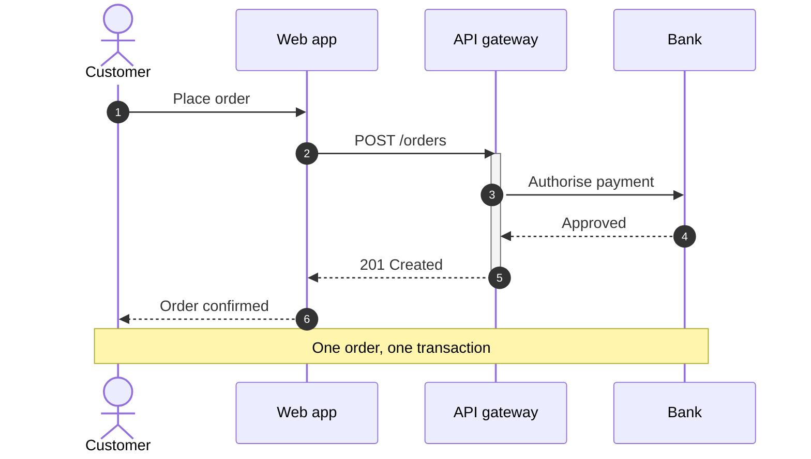

### Синтаксис

**Участники.** Участник объявляется неявно — первым упоминанием в сообщении, порядок отрисовки — порядок появления. Явное `participant` задаёт порядок слева направо независимо от порядка сообщений:

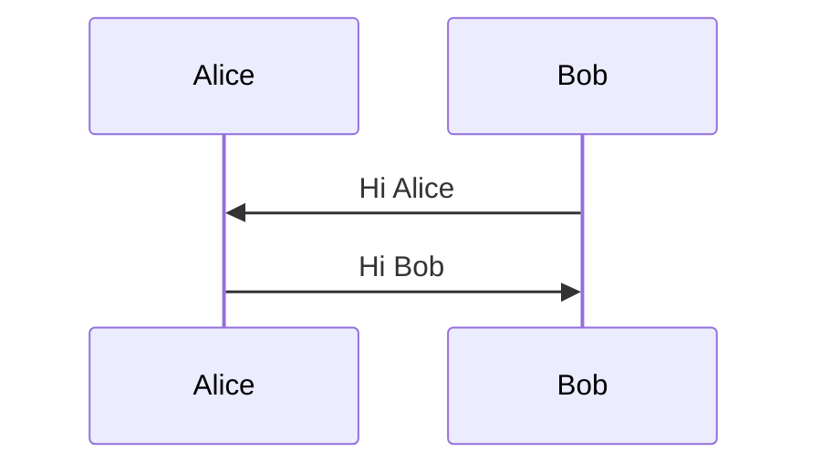

**Акторы** — `actor` рисует фигурку человека вместо прямоугольника:

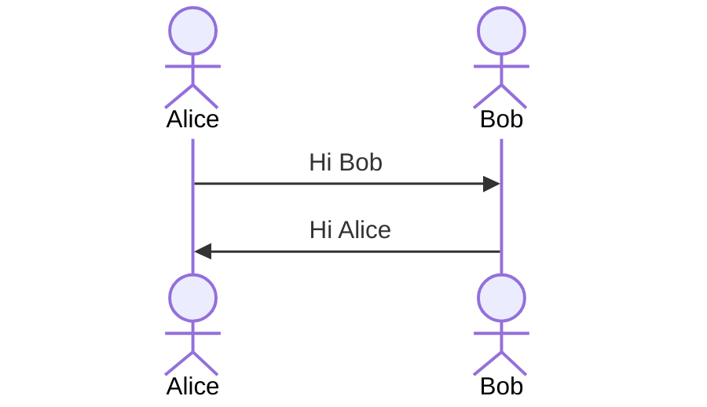

**Стереотипы участников** — JSON-объект после имени: `participant Имя@{ "type" : "<тип>" }`, типы `boundary`, `control`, `entity`, `database`, `collections`, `queue`. По журналу изменений типы участников появились в 11.11.0.

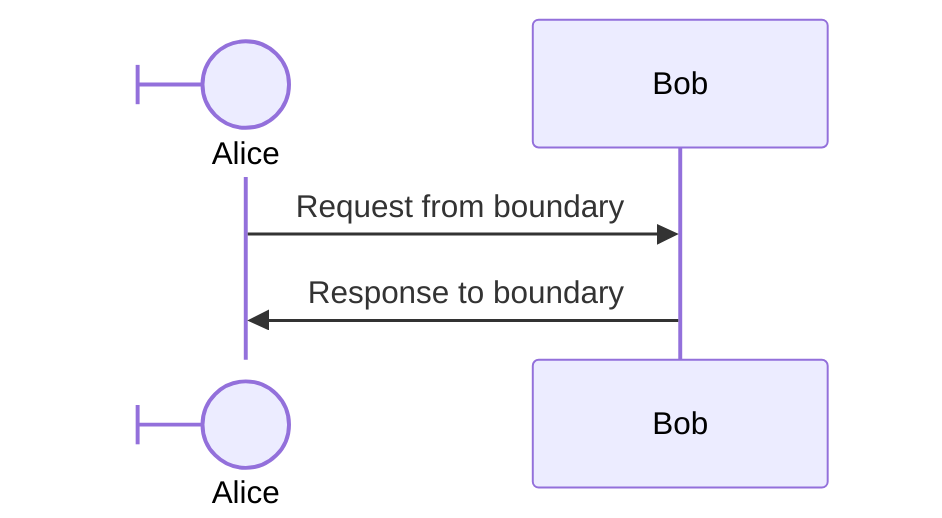

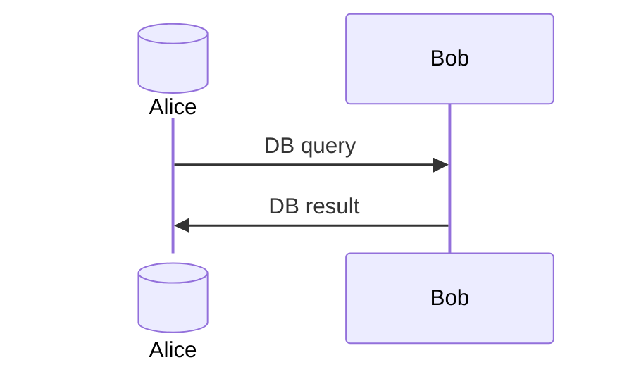

**Псевдонимы**: «Aliases can be defined in two ways: using external syntax with the `as` keyword, or inline within the configuration object.»

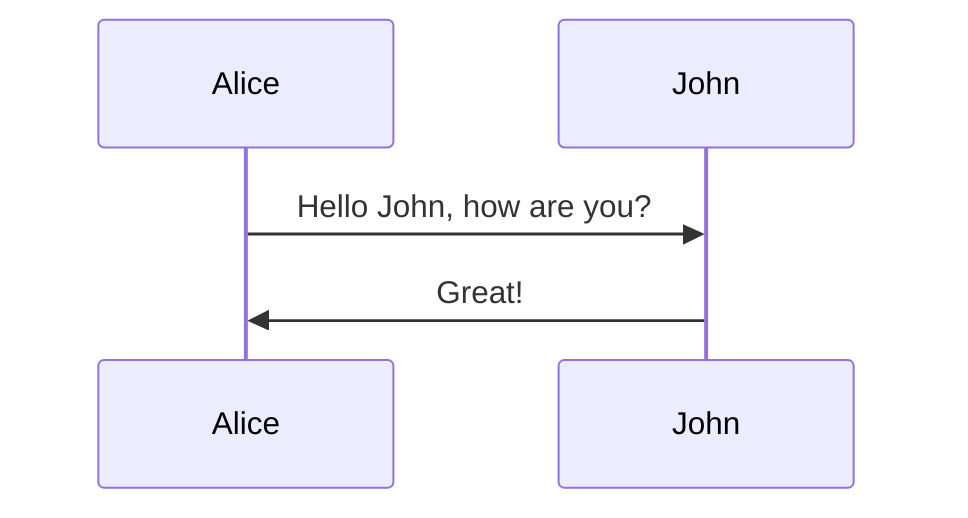

Внешний псевдоним вместе со стереотипом:

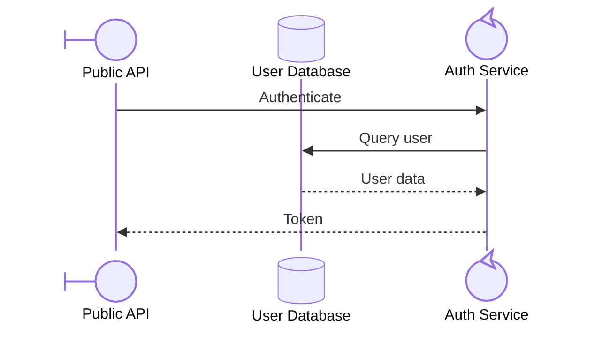

Встроенный псевдоним — поле `"alias"` в JSON-объекте:

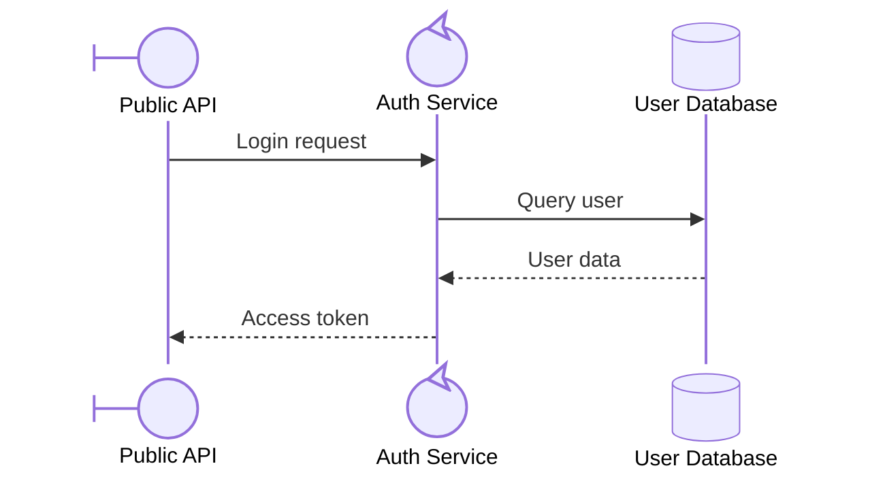

Если заданы оба, побеждает внешний: «When both inline alias (in the configuration object) and external alias (using `as` keyword) are provided, the **external alias takes precedence**».

**Создание и уничтожение участников (v10.3.0+)** — `create` или `destroy` перед сообщением: «Create directives support actor/participant distinction and aliases. The sender or the recipient of a message can be destroyed but only the recipient can be created.»

```text
create participant B
A --> B: Hello
```

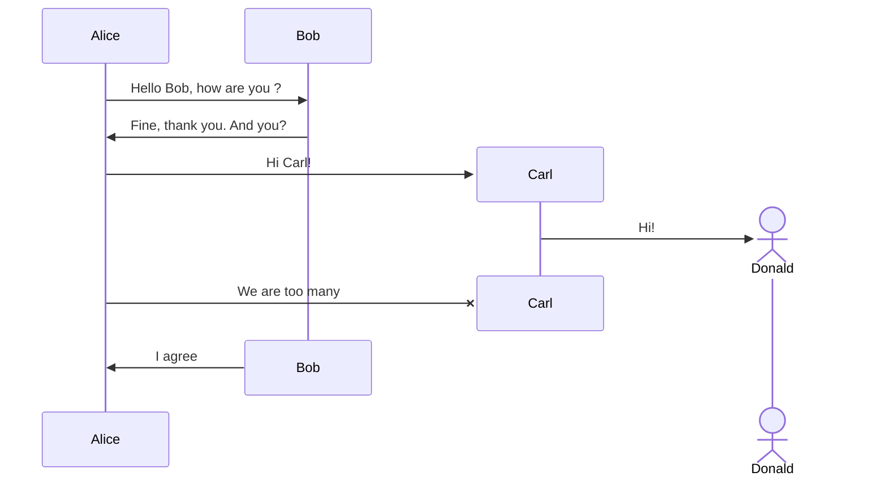

Ошибка «The destroyed participant **participant-name** does not have an associated destroying message after its declaration. Please check the sequence diagram.», которая не уходит после исправления кода, лечится версией Mermaid v10.7.0+.

**Группы участников** — `box … end`; цвет (по умолчанию прозрачный) и подпись необязательны: «For colored boxes, the color value must be placed **before** the optional description.»

```text
box Aqua Group Description
... actors ...
end
box Group without description
... actors ...
end
box rgb(33,66,99)
... actors ...
end
box rgba(33,66,99,0.5)
... actors ...
end
box hsl(10, 40%, 90%)
... actors ...
end
box hsla(10, 40%, 90%, 0.5)
... actors ...
end
```

Если название группы совпадает с названием цвета: «If your group name is a color you can force the color to be transparent:»

```text
box transparent Aqua
... actors ...
end
```

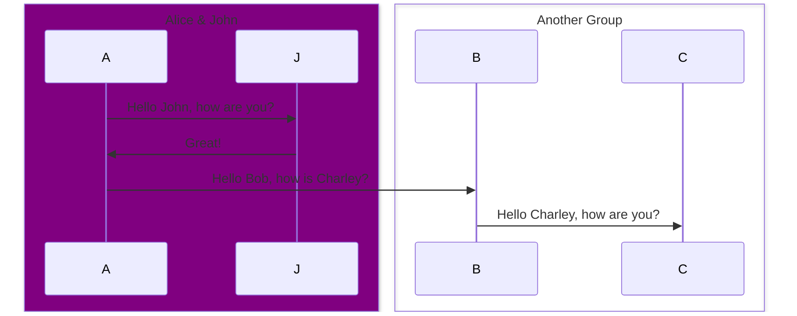

**Сообщения.** Общая форма:

```text
[Actor][Arrow][Actor]:Message text
```

Стандартные стрелки — дословно:

| Type | Description |
|---|---|
| `->` | Solid line without arrow |
| `-->` | Dotted line without arrow |
| `->>` | Solid line with arrowhead |
| `-->>` | Dotted line with arrowhead |
| `<<->>` | Solid line with bidirectional arrowheads (v11.0.0+) |
| `<<-->>` | Dotted line with bidirectional arrowheads (v11.0.0+) |
| `-x` | Solid line with a cross at the end |
| `--x` | Dotted line with a cross at the end |
| `-)` | Solid line with an open arrow at the end (async) |
| `--)` | Dotted line with a open arrow at the end (async) |

**Полустрелки** — по журналу изменений с 11.13.0 (на странице — v11.12.3+). «Both solid and dotted variants are available by increasing the number of dashes (`-` → `--`).» Формы — по грамматике диаграммы, потому что таблица на странице записывает обратную нижнюю полустрелку и обратную нижнюю полустрелку-штрих одинаково (по исходному коду Mermaid, https://github.com/mermaid-js/mermaid/tree/develop/packages/mermaid/src/diagrams/sequence/parser):

- `-|\` сплошная, `--|\` пунктирная — top half arrowhead;
- `-|/` и `--|/` — bottom half arrowhead;
- `/|-` и `/|--` — reverse top half arrowhead;
- `\|-` и `\|--` — reverse bottom half arrowhead;
- `-\\` и `--\\` — top stick half arrowhead;
- `-//` и `--//` — bottom stick half arrowhead;
- `//-` и `//--` — reverse top stick half arrowhead;
- `\\-` и `\\--` — reverse bottom stick half arrowhead.

**Подключение к центру линии жизни** — по журналу изменений с 11.13.0 (на странице — v11.12.3+). `()` у стрелки со стороны получателя, отправителя или обеих: «This is useful to represent messages or signals that connect to a central point, rather than from one actor directly to another.»

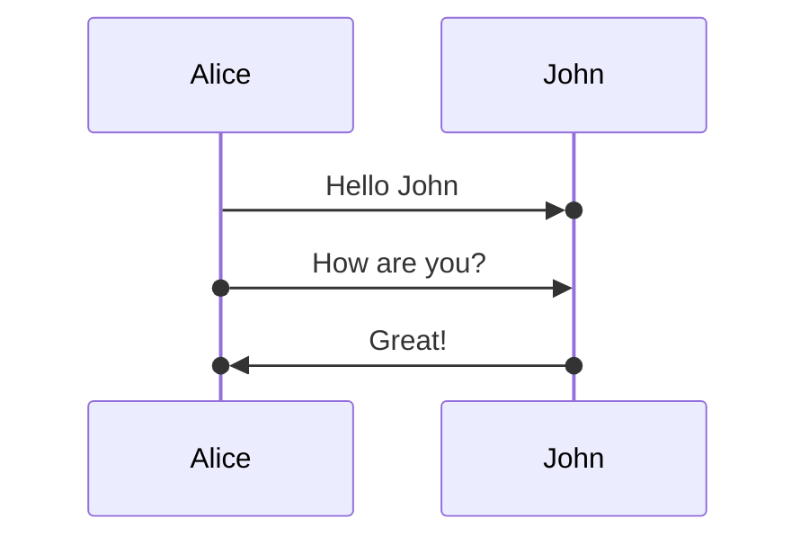

**Активации** — `activate` / `deactivate` или суффикс `+` / `-` у стрелки; активации одного участника могут накладываться:

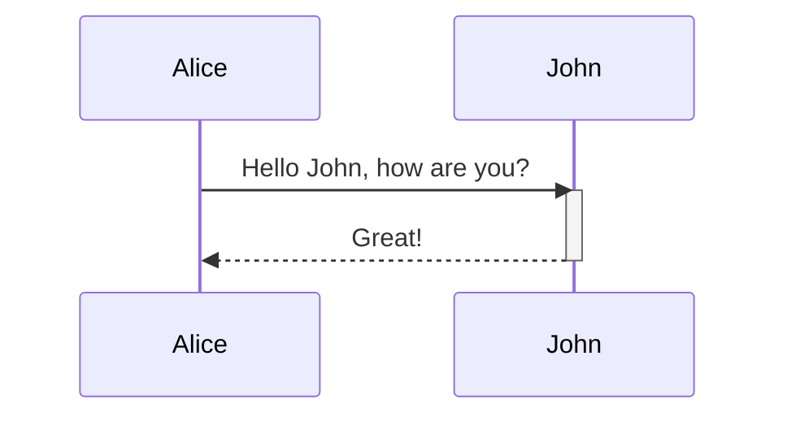

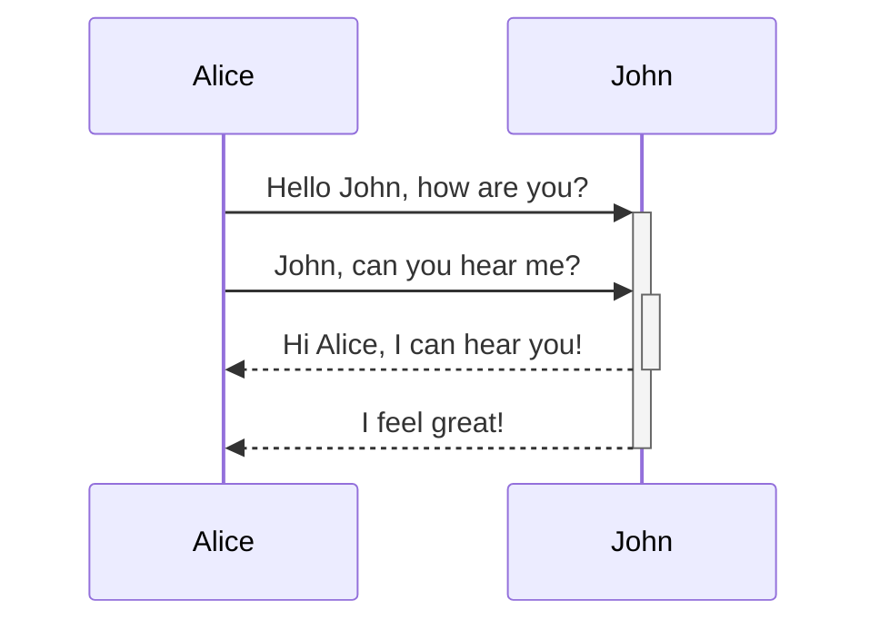

**Заметки** — `Note [ right of | left of | over ] [Actor]: Text in note content`; над двумя участниками — `over A,B`:

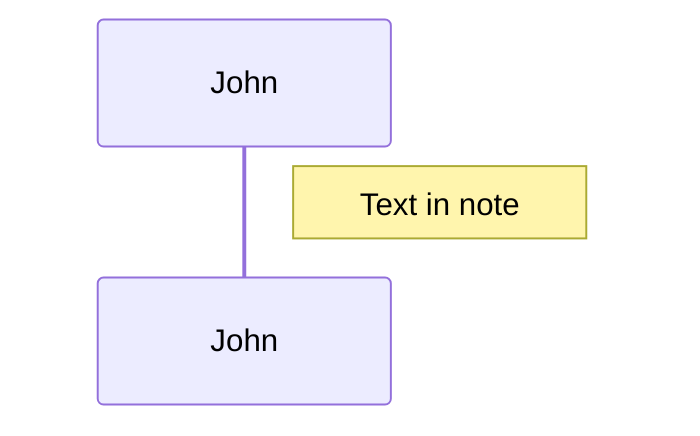

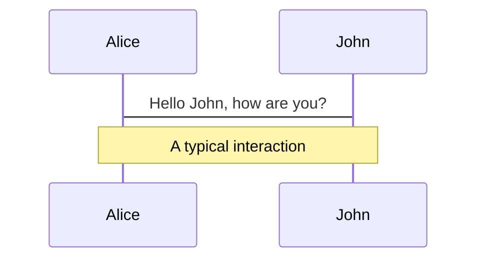

**Переносы строк** — `<br/>` в сообщении и заметке; в имени участника — только через псевдоним: «Line breaks in Actor names requires aliases:»

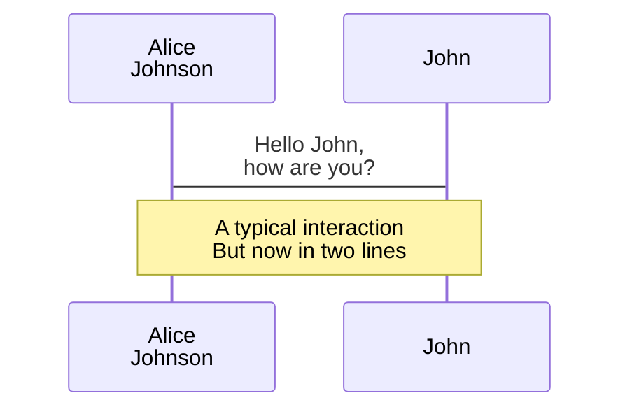

**Циклы:**

```text
loop Loop text
... statements ...
end
```

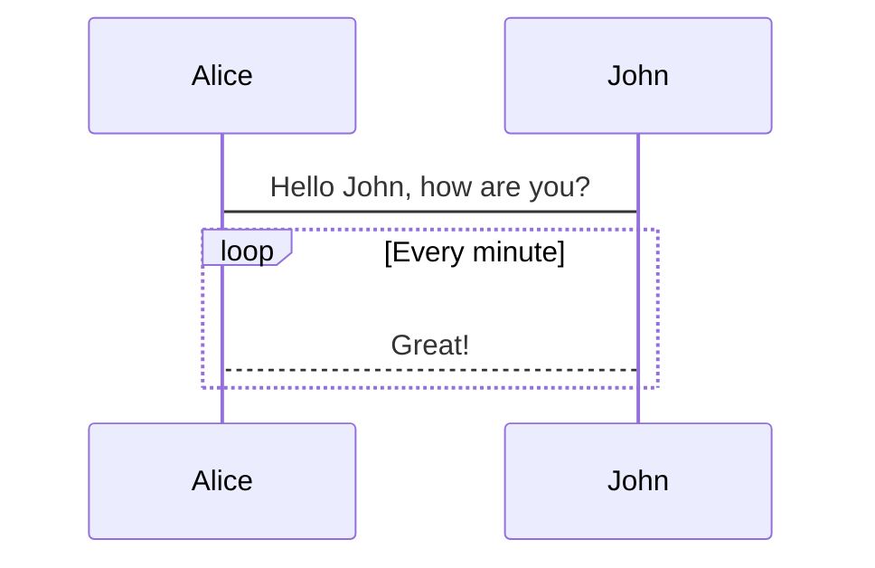

**Альтернативы `alt` и необязательный блок `opt`:**

```text
alt Describing text
... statements ...
else
... statements ...
end
```

```text
opt Describing text
... statements ...
end
```

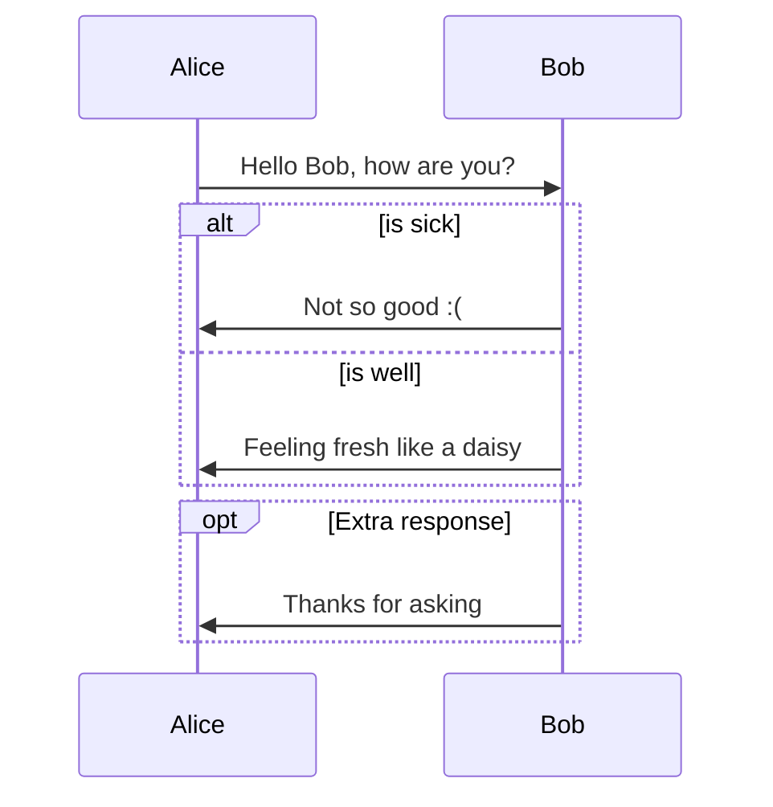

**Параллельные действия** — `par … and … end`, блоки вкладываются:

```text
par [Action 1]
... statements ...
and [Action 2]
... statements ...
and [Action N]
... statements ...
end
```

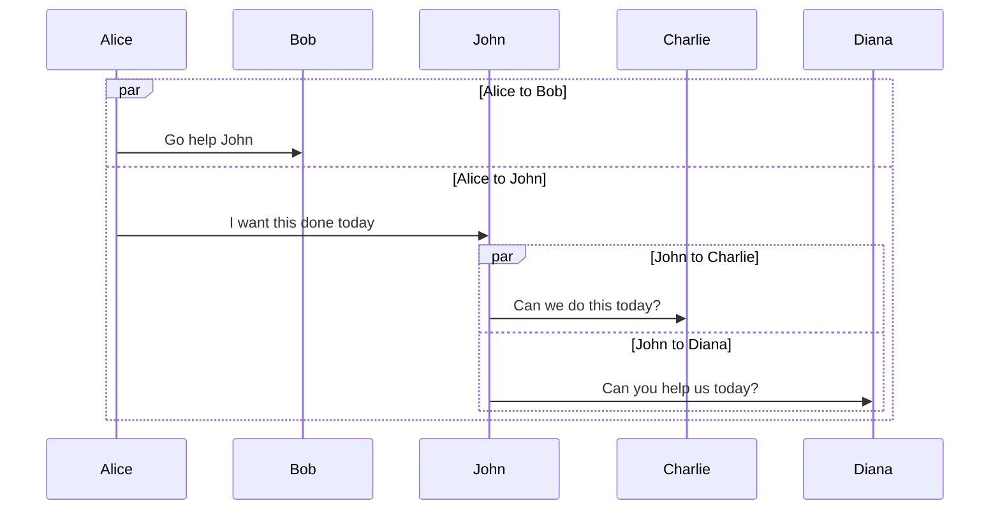

**Критическая область:** «It is possible to show actions that must happen automatically with conditional handling of circumstances.» Варианты `option` необязательны; блок вкладывается, как `par`.

```text
critical [Action that must be performed]
... statements ...
option [Circumstance A]
... statements ...
option [Circumstance B]
... statements ...
end
```

```mermaid
sequenceDiagram
    critical Establish a connection to the DB
        Service-->DB: connect
    option Network timeout
        Service-->Service: Log error
    option Credentials rejected
        Service-->Service: Log different error
    end
```

**Прерывание:** «It is possible to indicate a stop of the sequence within the flow (usually used to model exceptions).»

```text
break [something happened]
... statements ...
end
```

```mermaid
sequenceDiagram
    Consumer-->API: Book something
    API-->BookingService: Start booking process
    break when the booking process fails
        API-->Consumer: show failure
    end
    API-->BillingService: Start billing process
```

**Подсветка фона** — `rect … end`: «The colors are defined using rgb and rgba syntax.» Блоки `rect` вкладываются.

```text
rect rgba(0, 0, 255, .1)
... content ...
end
```

```mermaid
sequenceDiagram
    participant Alice
    participant John

    rect rgb(191, 223, 255)
    note right of Alice: Alice calls John.
    Alice->>+John: Hello John, how are you?
    rect rgb(200, 150, 255)
    Alice->>+John: John, can you hear me?
    John-->>-Alice: Hi Alice, I can hear you!
    end
    John-->>-Alice: I feel great!
    end
    Alice ->>+ John: Did you want to go to the game tonight?
    John -->>- Alice: Yeah! See you there.

```

**Коды сущностей**: «Because semicolons can be used instead of line breaks to define the markup, you need to use `#59;` to include a semicolon in message text.»

```mermaid
sequenceDiagram
    A->>B: I #9829; you!
    B->>A: I #9829; you #infin; times more!
```

**Нумерация сообщений** — оператор `autonumber`; начальное значение и шаг (v11.15.0+): «Both the starting value and increment value can include decimals up to the hundredths place.»

```mermaid
sequenceDiagram
    autonumber
    Alice->>John: Hello John, how are you?
    loop HealthCheck
        John->>John: Fight against hypochondria
    end
    Note right of John: Rational thoughts!
    John-->>Alice: Great!
    John->>Bob: How about you?
    Bob-->>John: Jolly good!
```

```text
autonumber <start> <increment>
```

**Меню участников** — всплывающее меню со ссылками:

```text
link <actor>: <link-label> @ <link-url>
```

```mermaid
sequenceDiagram
    participant Alice
    participant John
    link Alice: Dashboard @ https://dashboard.contoso.com/alice
    link Alice: Wiki @ https://wiki.contoso.com/alice
    link John: Dashboard @ https://dashboard.contoso.com/john
    link John: Wiki @ https://wiki.contoso.com/john
    Alice->>John: Hello John, how are you?
    John-->>Alice: Great!
    Alice-)John: See you later!
```

Расширенная форма — JSON:

```text
links <actor>: <json-formatted link-name link-url pairs>
```

```mermaid
sequenceDiagram
    participant Alice
    participant John
    links Alice: {"Dashboard": "https://dashboard.contoso.com/alice", "Wiki": "https://wiki.contoso.com/alice"}
    links John: {"Dashboard": "https://dashboard.contoso.com/john", "Wiki": "https://wiki.contoso.com/john"}
    Alice->>John: Hello John, how are you?
    John-->>Alice: Great!
    Alice-)John: See you later!
```

**Формулы (v10.9.0+)** — между `$$`, синтаксис формулы — LaTeX (https://mermaid.js.org/config/math.html):

```mermaid
sequenceDiagram
    autonumber
    participant 1 as $$\alpha$$
    participant 2 as $$\beta$$
    1->>2: Solve: $$\sqrt{2+2}$$
    2-->>1: Answer: $$2$$
    Note right of 2: $$\sqrt{2+2}=\sqrt{4}=2$$
```

**Конструкции грамматики без описания на странице.** По исходному коду Mermaid, на странице документации не описано: распознаются ключевые слова `par_over`, `properties`, `details`, `title`, `accTitle`, `accDescr`, `autonumber off`, префиксы `wrap:` / `nowrap:` в тексте строки (https://github.com/mermaid-js/mermaid/tree/develop/packages/mermaid/src/diagrams/sequence/parser). Их поведение не описано — использовать только после проверки целевым рендером.

### Стили и классы

`classDef`, `class`, `style` и `:::` для этого типа на странице не описаны. Оформление — CSS-классы сайта и переменные темы ([mermaid-config.md](mermaid-config.md)); цвет групп и фона задают `box` и `rect`.

### Доступность

`accTitle` и `accDescr` — как в общем правиле; пример со страницы доступности:

```mermaid
   sequenceDiagram
      accTitle: My Sequence Diagram
      accDescr: My Sequence Diagram Description

      Alice->>John: Hello John, how are you?
      John-->>Alice: Great!
      Alice-)John: See you later!
```

### Ключи `config`, которые задаёт автор

Раздел `sequence:` во frontmatter, по схеме конфигурации:

| Ключ | По умолчанию | Что задаёт |
|---|---|---|
| `mirrorActors` | `true` | повторять участников под диаграммой |
| `showSequenceNumbers` | `false` | нумерация сообщений |
| `wrap` | `false` | автоперенос текста |
| `wrapPadding` | `10` | отступ при автопереносе |
| `hideUnusedParticipants` | `false` | скрывать участников без сообщений |
| `rightAngles` | `false` | сообщение самому себе — прямыми углами вместо дуги |
| `messageAlign` | `center` | выравнивание многострочного сообщения: `left`, `center`, `right` |
| `noteAlign` | `'center'` | выравнивание текста заметок |
| `actorMargin` | `50` | расстояние между участниками |
| `width` | `150` | ширина прямоугольника участника |
| `height` | `65` | высота прямоугольника участника |
| `messageMargin` | `35` | расстояние между сообщениями |
| `boxMargin` | `10` | отступ вокруг блоков `loop` |
| `boxTextMargin` | `5` | отступ текста в блоках `loop`, `alt`, `opt` |
| `noteMargin` | `10` | отступ вокруг заметок |
| `activationWidth` | `10` | ширина прямоугольника активации |
| `diagramMarginX` | `50` | поля слева и справа |
| `diagramMarginY` | `10` | поля сверху и снизу |
| `forceMenus` | `false` | меню участников видны всегда |
| `actorFontSize`, `noteFontSize`, `messageFontSize` | `14`, `14`, `16` | размер шрифта участника, заметки, сообщения |

### Ловушки

- Слово `end` и шестнадцатеричный цвет в `box` — [mermaid.md](mermaid.md).
- Цвет в `box` ставится перед подписью.
- Создать можно только получателя сообщения, уничтожить — отправителя или получателя.
- Перенос строки в имени участника — только через псевдоним.
- Точка с запятой в тексте — `#59;`, символ `#` — `#35;`.
- ЕСЛИ важно, повторяются ли участники под диаграммой -> задать `mirrorActors` явно: таблица на странице и схема конфигурации называют разное значение по умолчанию.
- ЕСЛИ площадка старше 12.1.0 -> не ставить пробел между именем участника и `@{ … }`: по журналу изменений пробел допустим только с 12.1.0.

---

## ZenUML (`zenuml`)

Документация: https://mermaid.js.org/syntax/zenuml.html

### Ключевое слово и статус

- `zenuml`.
- Внешняя диаграмма: работает только там, где сайт зарегистрировал плагин `@mermaid-js/mermaid-zenuml`. «Zenuml uses the experimental lazy loading & async rendering features which could change in the future.»
- Синтаксис другой: «Note that ZenUML uses a different syntax than the original Sequence Diagram in mermaid.»

### Минимальный пример

```mermaid
zenuml
    title Demo
    Alice->John: Hello John, how are you?
    John->Alice: Great!
    Alice->John: See you later!
```

### Синтаксис

**Участники** — неявно первым упоминанием или явно именем на отдельной строке; явное объявление задаёт порядок:

```mermaid
zenuml
    title Declare participant (optional)
    Bob
    Alice
    Alice->Bob: Hi Bob
    Bob->Alice: Hi Alice
```

**Аннотаторы** — символ вместо прямоугольника, например `@Actor`, `@Database`; полный перечень на странице дан только картинкой:

```mermaid
zenuml
    title Annotators
    @Actor Alice
    @Database Bob
    Alice->Bob: Hi Bob
    Bob->Alice: Hi Alice
```

**Псевдонимы:**

```mermaid
zenuml
    title Aliases
    A as Alice
    J as John
    A->J: Hello John, how are you?
    J->A: Great!
```

**Сообщения.** Синхронное — как блокирующий вызов метода, с параметрами и вложением через `{}`:

```mermaid
zenuml
    title Sync message
    A.SyncMessage
    A.SyncMessage(with, parameters) {
      B.nestedSyncMessage()
    }
```

Асинхронное — «Fire an event and forget about it.»:

```mermaid
zenuml
    title Async message
    Alice->Bob: How are you?
```

Создание — `new`:

```mermaid
zenuml
    new A1
    new A2(with, parameters)
```

Ответ — присвоение результата переменной, `return` или аннотатор `@return` / `@reply` перед асинхронным сообщением; «The third way `@return` is rarely used, but it is useful when you want to return to one level up.»

```mermaid
zenuml
    // 1. assign a variable from a sync message.
    a = A.SyncMessage()

    // 1.1. optionally give the variable a type
    SomeType a = A.SyncMessage()

    // 2. use return keyword
    A.SyncMessage() {
    return result
    }

    // 3. use @return or @reply annotator on an async message
    @return
    A->B: result
```

```mermaid
zenuml
    title Reply message
    Client->A.method() {
      B.method() {
        if(condition) {
          return x1
          // return early
          @return
          A->Client: x11
        }
      }
      return x2
    }
```

**Вложенность:** «Sync messages and Creation messages are naturally nestable with `{}`.»

```mermaid
zenuml
    A.method() {
      B.nested_sync_method()
      B->C: nested async message
    }
```

**Циклы** — ключевые слова `while`, `for`, `forEach`, `foreach`, `loop`:

```zenuml
while(condition) {
    ...statements...
}
```

```mermaid
zenuml
    Alice->John: Hello John, how are you?
    while(true) {
      John->Alice: Great!
    }
```

**Альтернативы:**

```zenuml
if(condition1) {
    ...statements...
} else if(condition2) {
    ...statements...
} else {
    ...statements...
}
```

```mermaid
zenuml
    Alice->Bob: Hello Bob, how are you?
    if(is_sick) {
      Bob->Alice: Not so good :(
    } else {
      Bob->Alice: Feeling fresh like a daisy
    }
```

**Необязательный фрагмент:**

```zenuml
opt {
  ...statements...
}
```

```mermaid
zenuml
    Alice->Bob: Hello Bob, how are you?
    Bob->Alice: Not so good :(
    opt {
      Bob->Alice: Thanks for asking
    }
```

**Параллельность:**

```zenuml
par {
  statement1
  statement2
  statement3
}
```

```mermaid
zenuml
    par {
        Alice->Bob: Hello guys!
        Alice->John: Hello guys!
    }
```

**Исключения** — `try` / `catch` / `finally`:

```mermaid
zenuml
    try {
      Consumer->API: Book something
      API->BookingService: Start booking process
    } catch {
      API->Consumer: show failure
    } finally {
      API->BookingService: rollback status
    }
```

### Стили и классы

На странице не описаны.

### Комментарии

Комментарий — `//`, а не `%%`: «It is possible to add comments to a sequence diagram with `// comment` syntax. Comments will be rendered above the messages or fragments. Comments on other places are ignored. Markdown is supported.»

```mermaid
zenuml
    // a comment on a participant will not be rendered
    BookService
    // a comment on a message.
    // **Markdown** is supported.
    BookService.getBook()
```

### Ключи `config`, которые задаёт автор

В схеме конфигурации раздела для ZenUML нет, на странице параметры не описаны.

### Ловушки

- ЕСЛИ документация площадки не подтверждает плагин ZenUML -> писать `sequenceDiagram`, а не `zenuml`.
- Синтаксис `sequenceDiagram` в ZenUML не переносится: стрелки, блоки и комментарии другие.
- Комментарий к участнику не выводится.
