# Mermaid: архитектура, C4, пакет, интеллект-карта, дерево каталогов, Исикава

Сверено по Mermaid 12.1.0. Общие правила — встраивание, объявление, комментарии, frontmatter, экранирование, умолчания Mermaid 12, общие ловушки — в [mermaid.md](mermaid.md).

---

## Диаграмма архитектуры (`architecture-beta`)

Документация: https://mermaid.js.org/syntax/architecture.html

### Ключевое слово и статус

- `architecture-beta`.
- Статус: beta (суффикс `-beta`). Появилась в v11.1.0. «In the context of mermaid-js, the architecture diagram is used to show the relationship between services and resources commonly found within the Cloud or CI/CD deployments.»

### Минимальный пример


### Синтаксис

Строительные блоки — группы, сервисы, рёбра, узлы-развилки. «For supporting components, icons are declared by surrounding the icon name with `()`, while labels are declared by surrounding the text with `[]`.» Порядок объявлений свободный, но идентификатор объявляется раньше, чем на него ссылаются.

**Группы:**

```
group {group id}({icon name})[{title}] (in {parent id})?
```

```
group private_api(cloud)[Private API] in public_api
```

**Сервисы:**

```
service {service id}({icon name})[{title}] (in {parent id})?
```

```
service database1(database)[My Database] in private_api
```

**Рёбра** — сторона сервиса `L`, `R`, `T`, `B` через двоеточие; стрелка — `<` перед левой стороной и/или `>` после правой:

```
{serviceId}{{group}}?:{T|B|L|R} {<}?--{>}? {T|B|L|R}:{serviceId}{{group}}?
```

```
db:T -- L:server
```

```
subnet:R --> L:gateway
```

**Рёбра из групп** — модификатор `{group}` выводит ребро из границы группы сервиса: «It's important to note that `groupId`s cannot be used for specifying edges and the `{group}` modifier can only be used for services within a group.»

```
service server[Server] in groupOne
service subnet[Subnet] in groupTwo

server{group}:B --> T:subnet{group}
```

**Выравнивание соседей (v11.16.0+)** — `align row` (одна строка) или `align column` (один столбец); участники уже объявлены, их не меньше двух, каждая директива на своей строке. «Use **`align column`** when the members connect to a common downstream node _via the same horizontal port pair_ (e.g. all use `R --> L:mcp`).» «Use **`align row`** when the members connect to a common downstream node _via the same vertical port pair_ (e.g. all use `B --> T:proc`).»

```
align row {idA} {idB} {idC} ...
align column {idA} {idB} ...
```

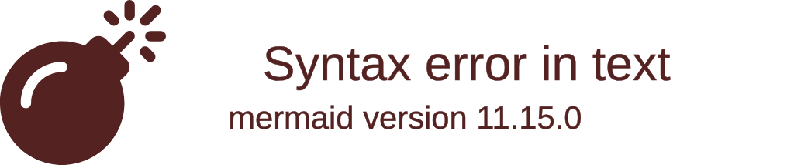

Сетка — пары `align row` и `align column`: «`align row` only pins the y-coordinate of its members. To produce a clean grid where columns also align across tiers, pair each `align row` with one or more `align column` directives.»

**Узлы-развилки:** «Junctions are a special type of node which acts as a potential 4-way split between edges.»

```
junction {junction id} (in {parent id})?
```

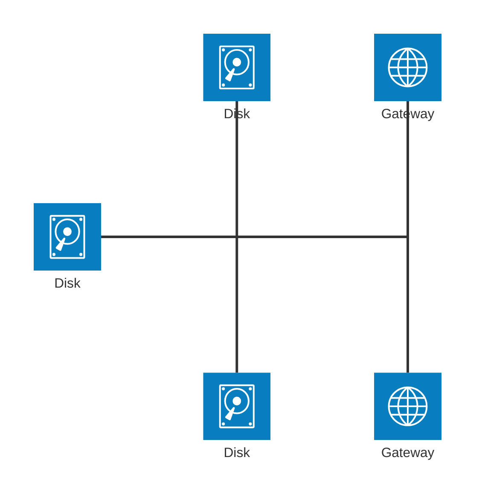

**Иконки** — встроенные `cloud`, `database`, `disk`, `internet`, `server`; другие — из пакета иконок, который зарегистрировал сайт, в формате `name:icon-name`:

```mermaid
architecture-beta
    group api(logos:aws-lambda)[API]

    service db(logos:aws-aurora)[Database] in api
    service disk1(logos:aws-glacier)[Storage] in api
    service disk2(logos:aws-s3)[Storage] in api
    service server(logos:aws-ec2)[Server] in api

    db:L -- R:server
    disk1:T -- B:server
    disk2:T -- B:db
```

**Конструкции грамматики без описания на странице.** По исходному коду Mermaid, на странице документации не описано: подпись на ребре формой `-[подпись]-` между сторонами, иконка и подпись у группы и сервиса необязательны, в начале диаграммы допускаются `title`, `accTitle`, `accDescr`, комментарий — `%%` (https://github.com/mermaid-js/mermaid/tree/develop/packages/parser/src/language/architecture).

Общего направления диаграммы нет: направление задают стороны рёбер и директивы `align`.

### Стили и классы

На странице не описаны.

### Ключи `config`, которые задаёт автор

Раздел `architecture:`:

| Ключ | По умолчанию | Что задаёт |
|---|---|---|
| `randomize` (v11.14.0+) | `false` | случайные начальные позиции узлов |
| `seed` (по журналу изменений — 11.16.0) | `1` | зерно раскладки; `0` — недетерминированная |
| `nodeSeparation` (v11.15.0+) | `75` | минимальное расстояние между соседями в группе |
| `idealEdgeLengthMultiplier` (v11.15.0+) | `1.5` | множитель длины рёбер внутри группы |
| `edgeElasticity` (v11.15.0+) | `0.45` | упругость рёбер внутри группы, 0–1 |
| `numIter` (v11.15.0+) | `2500` | число итераций раскладки |
| `padding` | `40` | отступ |
| `iconSize` | `80` | размер иконок |
| `fontSize` | `16` | размер шрифта |

```
---
config:
  architecture:
    idealEdgeLengthMultiplier: 3
---
architecture-beta
    service a(server)[A]
    service b(server)[B]
    service c(server)[C]
    a:R --> L:b
    b:R --> L:c
```

### Ловушки

- Конфликт `align` с направлением рёбер ломает отрисовку: «if the diagram contains `a:L --> R:b` (which places `a` to the right of `b`), then `align row a b` will conflict with that edge direction and the layout engine will fail to render. Use `align row b a` instead, or remove the conflicting edge.»
- «`randomize: false` alone is not enough to guarantee identical renders … Use the `seed` option (described below) to lock the layout fully.»
- Длинная однословная подпись при малом `iconSize` не помещается в строку.

---

## Диаграммы C4 (`C4Context`)

Документация: https://mermaid.js.org/syntax/c4.html

### Ключевое слово и статус

- Пять видов: `C4Context`, `C4Container`, `C4Component`, `C4Dynamic`, `C4Deployment`.
- Статус: experimental — «C4 Diagram: This is an experimental diagram for now. The syntax and properties can change in future releases. Proper documentation will be provided when the syntax is stable.» «Mermaid's C4 diagram syntax is compatible with plantUML.» Правила написания — документ C4-PlantUML (https://github.com/plantuml-stdlib/C4-PlantUML/blob/master/README.md).

### Минимальный пример

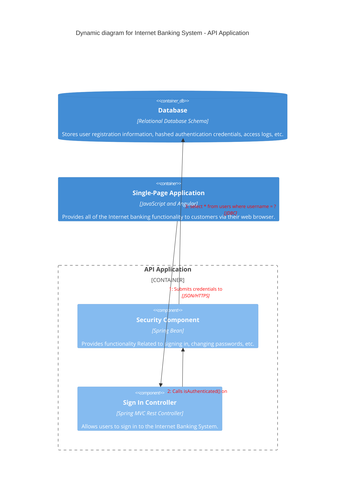

### Синтаксис

Поддерживаемые (`[x]`) и неподдерживаемые (`[ ]`) макросы — дословно со страницы:

```text
- [ ] sprite

- [ ] tags

- [ ] link

- [ ] Legend

- [x] System Context
  - [x] Person(alias, label, ?descr, ?sprite, ?tags, $link)
  - [x] Person_Ext
  - [x] System(alias, label, ?descr, ?sprite, ?tags, $link)
  - [x] SystemDb
  - [x] SystemQueue
  - [x] System_Ext
  - [x] SystemDb_Ext
  - [x] SystemQueue_Ext
  - [x] Boundary(alias, label, ?type, ?tags, $link)
  - [x] Enterprise_Boundary(alias, label, ?tags, $link)
  - [x] System_Boundary

- [x] Container diagram
  - [x] Container(alias, label, ?techn, ?descr, ?sprite, ?tags, $link)
  - [x] ContainerDb
  - [x] ContainerQueue
  - [x] Container_Ext
  - [x] ContainerDb_Ext
  - [x] ContainerQueue_Ext
  - [x] Container_Boundary(alias, label, ?tags, $link)

- [x] Component diagram
  - [x] Component(alias, label, ?techn, ?descr, ?sprite, ?tags, $link)
  - [x] ComponentDb
  - [x] ComponentQueue
  - [x] Component_Ext
  - [x] ComponentDb_Ext
  - [x] ComponentQueue_Ext

- [x] Dynamic diagram
  - [x] RelIndex(index, from, to, label, ?tags, $link)

- [x] Deployment diagram
  - [x] Deployment_Node(alias, label, ?type, ?descr, ?sprite, ?tags, $link)
  - [x] Node(alias, label, ?type, ?descr, ?sprite, ?tags, $link): short name of Deployment_Node()
  - [x] Node_L(alias, label, ?type, ?descr, ?sprite, ?tags, $link): left aligned Node()
  - [x] Node_R(alias, label, ?type, ?descr, ?sprite, ?tags, $link): right aligned Node()

- [x] Relationship Types
  - [x] Rel(from, to, label, ?techn, ?descr, ?sprite, ?tags, $link)
  - [x] BiRel (bidirectional relationship)
  - [x] Rel_U, Rel_Up
  - [x] Rel_D, Rel_Down
  - [x] Rel_L, Rel_Left
  - [x] Rel_R, Rel_Right
  - [x] Rel_Back
  - [x] RelIndex \* Compatible with C4-PlantUML syntax, but ignores the index parameter. The sequence number is determined by the order in which the rel statements are written.

- [ ] Custom tags/stereotypes support and skin param updates
  - [ ] AddElementTag(tagStereo, ?bgColor, ?fontColor, ?borderColor, ?shadowing, ?shape, ?sprite, ?techn, ?legendText, ?legendSprite): Introduces a new element tag. The styles of the tagged elements are updated and the tag is displayed in the calculated legend.
  - [ ] AddRelTag(tagStereo, ?textColor, ?lineColor, ?lineStyle, ?sprite, ?techn, ?legendText, ?legendSprite): Introduces a new Relationship tag. The styles of the tagged relationships are updated and the tag is displayed in the calculated legend.
  - [x] UpdateElementStyle(elementName, ?bgColor, ?fontColor, ?borderColor, ?shadowing, ?shape, ?sprite, ?techn, ?legendText, ?legendSprite): This call updates the default style of the elements (component, ...) and creates no additional legend entry.
  - [x] UpdateRelStyle(from, to, ?textColor, ?lineColor, ?offsetX, ?offsetY): This call updates the default relationship colors and creates no additional legend entry. Two new parameters, offsetX and offsetY, are added to set the offset of the original position of the text.
  - [ ] RoundedBoxShape(): This call returns the name of the rounded box shape and can be used as ?shape argument.
  - [ ] EightSidedShape(): This call returns the name of the eight sided shape and can be used as ?shape argument.
  - [ ] DashedLine(): This call returns the name of the dashed line and can be used as ?lineStyle argument.
  - [ ] DottedLine(): This call returns the name of the dotted line and can be used as ?lineStyle argument.
  - [ ] BoldLine(): This call returns the name of the bold line and can be used as ?lineStyle argument.
  - [x] UpdateLayoutConfig(?c4ShapeInRow, ?c4BoundaryInRow): New. This call updates the default c4ShapeInRow(4) and c4BoundaryInRow(2).
```

Параметры с `?` задаются по порядку или по имени с `$`:

```text
UpdateRelStyle(customerA, bankA, "red", "blue", "-40", "60")
UpdateRelStyle(customerA, bankA, $offsetX="-40", $offsetY="60", $lineColor="blue", $textColor="red")
UpdateRelStyle(customerA, bankA, $offsetY="60")

```

**Раскладка** не автоматическая: «The position of shapes is adjusted by changing the order in which statements are written.» Операторы `Lay_U`, `Lay_D`, `Lay_L`, `Lay_R` поддержаны не будут; число фигур в строке и границ — `UpdateLayoutConfig`. Направление отдельной связи — `Rel_U`, `Rel_D`, `Rel_L`, `Rel_R`, `Rel_Back`.

Пример диаграммы контекста — вложенные границы, `BiRel`, стили:

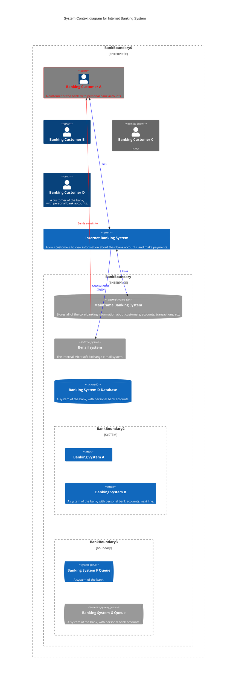

«As above, "Banking Customer A" is red because the example restyles it with `UpdateElementStyle`, not because that is the default appearance of a `Person`.»

### Стили и классы

«C4 diagram is fixed style, such as css color, so different css is not provided under different skins.» Оформление — только `UpdateElementStyle` и `UpdateRelStyle`; `classDef`, `style`, `:::` не описаны.

### Ключи `config`, которые задаёт автор

Раздел `c4:`: `c4ShapeInRow` (`4`), `c4BoundaryInRow` (`2`), `wrap` (`true`), `wrapPadding` (`10`), `c4ShapeMargin` (`50`), `c4ShapePadding` (`20`), `width` (`216`) и `height` (`60`) — размер фигуры человека, `boxMargin` (`10`), `diagramMarginX` (`50`), `diagramMarginY` (`10`). Перенос текста: «Since v11.17.1, C4 diagrams wrap by default and can be disabled by either setting wrap or c4.wrap to false.»

```yaml
---
config:
  c4:
    wrap: false
---
```

### Ловушки

- «updateElementStyle and UpdateElementStyle are written in the diagram last part. updateElementStyle is inconsistent with the original definition and updates the style of the relationship, including the offset of the text label relative to the original position.»
- `RelIndex` игнорирует индекс: номер определяется порядком строк.
- Не поддерживаются sprite, tags, link, Legend, `AddElementTag`, `AddRelTag`, функции форм и линий.

---

## Диаграмма пакета (`packet`)

Документация: https://mermaid.js.org/syntax/packet.html

### Ключевое слово и статус

- `packet`; по исходному коду Mermaid, на странице документации не описано: принимается и `packet-beta` (https://github.com/mermaid-js/mermaid/tree/develop/packages/parser/src/language/packet).
- Статус: стабильный, из beta выведена в 11.9.0. Появилась в v11.0.0. «A packet diagram is a visual representation used to illustrate the structure and contents of a network packet.»

### Минимальный пример

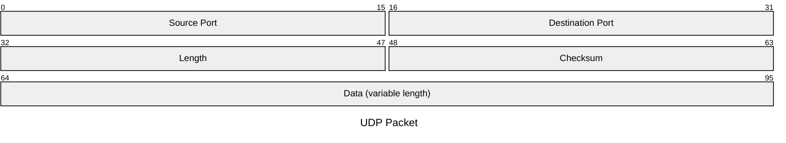

### Синтаксис

Поле — `start: "Block name"` (один бит) или `start-end: "Block name"` (несколько бит); поле по числу бит (v11.7.0+) — `+<count>`, отсчитывается от конца предыдущего поля; формы смешиваются:

```
packet
+1: "Block name" %% Single-bit block
+8: "Block name" %% 8-bit block
9-15: "Manually set start and end, it's fine to mix and match"
... More Fields ...
```

- «**Ranges**: Each line after the title represents a different field in the packet. The range (e.g., `0-15`) indicates the bit positions in the packet.»
- «**Field Description**: A brief description of what the field represents, enclosed in quotes.»
- Заголовок — `title` в теле или `title:` во frontmatter.

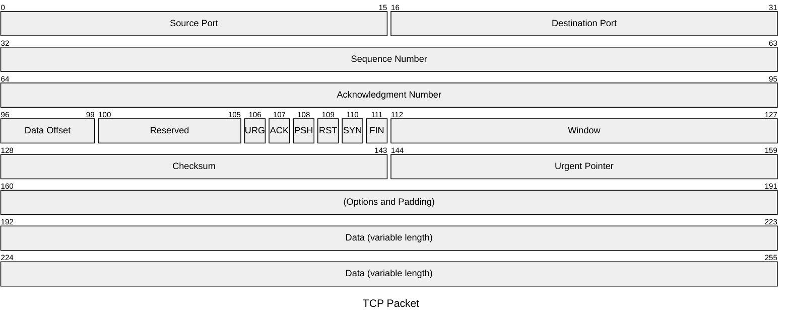

**Порядок нумерации бит (v12.0.0+)** — `bitOrder: descending` зеркально отражает каждую строку: «Only the drawing is mirrored. Fields are still declared lowest bit first (`0-7`, never `7-0`) and keep their width».

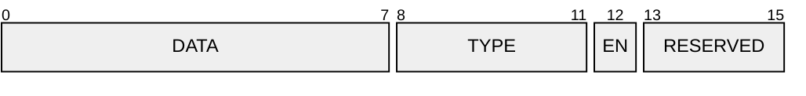

По исходному коду Mermaid, на странице документации не описано: подпись поля допускается и в одинарных кавычках, грамматика принимает `accTitle` и `accDescr`; комментарий `%%` можно ставить в конце строки поля (https://github.com/mermaid-js/mermaid/tree/develop/packages/parser/src/language/packet).

### Стили и классы

Не описаны. Переменные темы диаграммы пакета не работают: раздел о них на странице скрыт комментарием «Theme variables are not currently working due to a mermaid bug.»

### Ключи `config`, которые задаёт автор

Раздел `packet:`: `rowHeight` (`32`), `bitWidth` (`32`), `bitsPerRow` (`32`), `showBits` (`true`), `bitOrder` (`ascending` или `descending`), `paddingX` (`5`), `paddingY` (`5`).

### Ловушки

- Поле объявляется от младшего бита к старшему: `0-7`, а не `7-0`.
- Переменные темы не задавать — не применяются.

---

## Интеллект-карта (`mindmap`)

Документация: https://mermaid.js.org/syntax/mindmap.html

### Ключевое слово и статус

- `mindmap`.
- Статус: experimental — «The syntax is stable except for the icon integration which is the experimental part.» «From version 9.4.0 this diagram is included in mermaid but use lazy loading in order to keep the size of mermaid down.»

### Минимальный пример

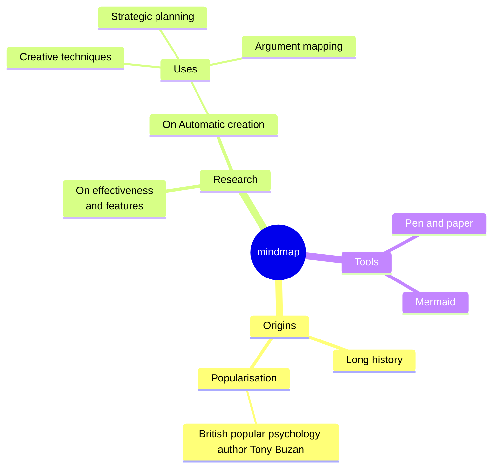

### Синтаксис

Иерархия — отступами:

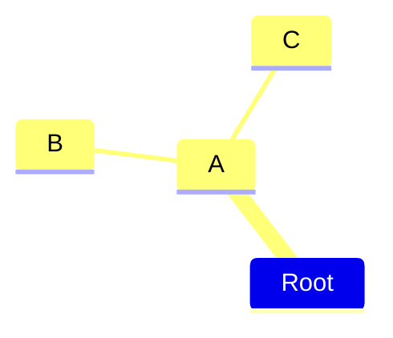

**Формы** — как у узлов блок-схемы: «Where possible we try/will try to keep the same shapes as for flowcharts, even though they are not all supported from the start.» `id[...]` — квадрат, `id(...)` — скруглённый квадрат, `id((...))` — круг, `id))...((` — «взрыв», `id)...(` — облако, `id{{...}}` — шестиугольник, текст без скобок — форма по умолчанию.

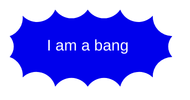

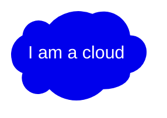

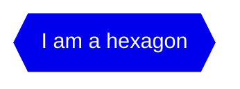

**Иконки** — `::icon(<классы>)` на строке под узлом; шрифты иконок подключает сайт: «_This is not something a diagram author can do but has to be done with the site administrator or the integrator_.»

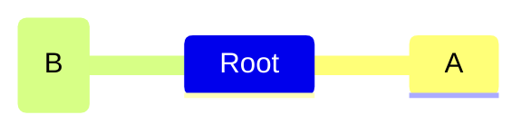

**Неясные отступы** — значим не абсолютный отступ, а сравнение с предыдущими строками; родителем становится ближайший узел с меньшим отступом:


**Markdown-строки** — жирный и курсив, автоперенос:

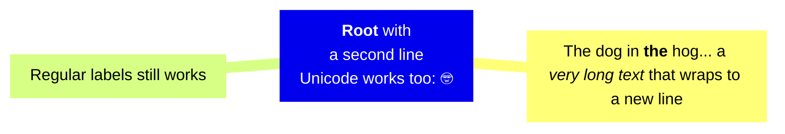

**Раскладка Tidy Tree** — «Mermaid also supports a Tidy Tree layout for mindmaps.» Работает, только если сайт установил пакет `@mermaid-js/layout-tidy-tree`: «The Tidy Tree Layout engine will not be available in all providers that support mermaid by default.»

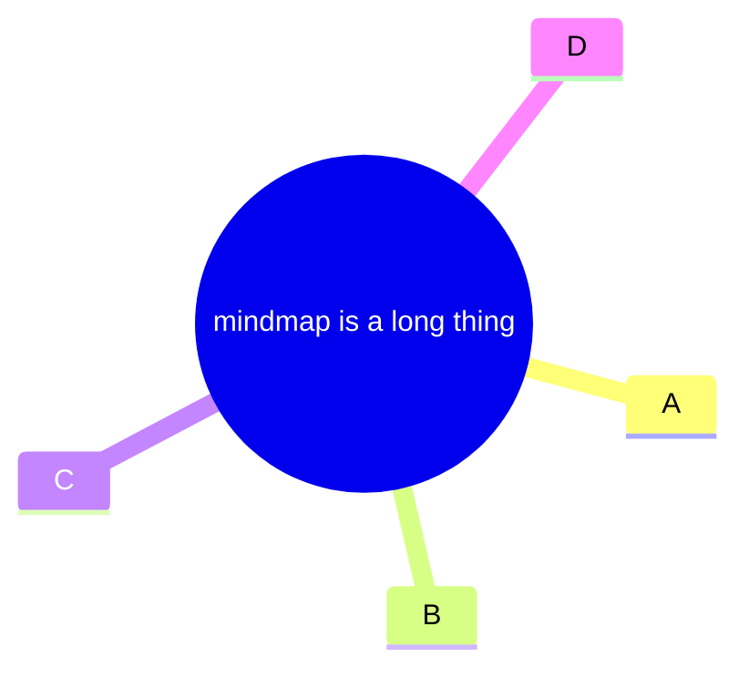

### Стили и классы

Классы — `:::` на строке под узлом, несколько через пробел; «_These classes need to be supplied by the site administrator._»

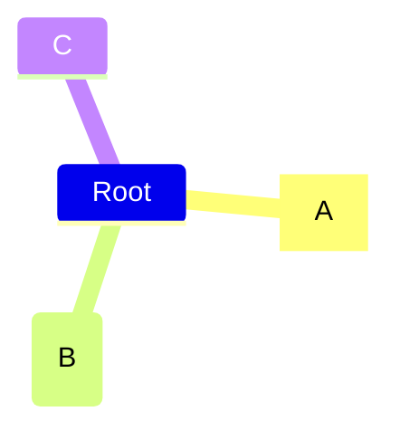

### Ключи `config`, которые задаёт автор

Раздел `mindmap:`: `layoutAlgorithm` (`"cose-bilkent"`), `padding` (`10`), `maxNodeWidth` (`200`). Раскладка — ключ верхнего уровня `layout`.

### Ловушки

- Иконки и классы требуют шрифтов и CSS на стороне сайта.
- Не все формы блок-схемы поддерживаются.
- ЕСЛИ площадка не подтверждает пакет tidy-tree -> не задавать `layout: tidy-tree`.

---

## Дерево каталогов (`treeView-beta`)

Документация: https://mermaid.js.org/syntax/treeView.html

### Ключевое слово и статус

- `treeView-beta`, регистр значим.
- Статус: beta (суффикс `-beta`). Появилась в v11.14.0. «A TreeView diagram is used to represent hierarchical data in the form of a directory-like structure, with file/folder icons, connector lines, and optional annotations.»

### Минимальный пример

```text
treeView-beta
    my-project/
        src/
            index.js
        package.json
        README.md
```

### Синтаксис

- Структура — только отступами или символами псевдографики.
- Каталог — завершающий `/` в подписи, выводится жирным.
- Подпись с пробелами — в кавычках.

```text
treeView-beta
    "my project"
        "folder with spaces"
            "file.js"
```

**Псевдографика:** «The parser auto-detects the format — no extra keyword or config is needed.» Стандартные `├──`, `└──`, `│` и жирные `┣━━`, `┗━━`, `┃`:


**Аннотации** — `:::класс` (встроенный класс `highlight`), видимое описание после `##`, значок `icon(…)`; комбинируются в любом порядке:

```mermaid
treeView-beta
    my-project/
        src/
            App.tsx :::highlight icon(logos:react) ## main component
            index.js ## entry point
        .env ## environment variables
        Dockerfile
        package.json
```

**Значки** по умолчанию скрыты; `showIcons: true` включает встроенные `file` и `folder`; соответствия «имя файла / расширение → значок» задают `filenameIcons` и `extensionIcons`; `icon(none)` скрывает значок узла. «Explicit icons always render, even when `showIcons` is off»

```mermaid
---
config:
  treeView:
    showIcons: true
    defaultIconPack: material-icon-theme
    filenameIcons:
      Dockerfile: docker
    extensionIcons:
      .ts: typescript
      .tsx: react-ts
      .txt: none
---
treeView-beta
    src/
        App.tsx
        utils.ts
    Dockerfile
    notes.txt
    README.md
```

«**Note** Icon packs are not bundled with Mermaid — they must be registered with `registerIconPacks` by the site embedding the diagram. … An unregistered icon renders as a question mark.»

**Юникод и эмодзи:** «Labels are rendered exactly as written — unicode characters and consecutive spaces are preserved.»

```mermaid
treeView-beta
    🚀 rocket-app/
        📦 packages/
            🎨 ui/
            🛠️ utils/
        🧪 tests/
        📝 README.md
        ⚙️ config.yaml
```

### Стили и классы

`:::className`, встроенный класс `highlight`; переменные темы — в `themeVariables.treeView`:

| Property         | Description                                               | Default Value        |
| ---------------- | --------------------------------------------------------- | -------------------- |
| labelFontSize    | Font size of the label                                    | '16px'               |
| labelColor       | Color of the label                                        | 'black'              |
| lineColor        | Color of the line                                         | 'black'              |
| iconColor        | Color of icons (applies to icons that use `currentColor`) | '#546e7a'            |
| descriptionColor | Color of `##` description text                            | '#6a9955'            |
| highlightBg      | Highlight background fill                                 | rgba(255,193,7,0.15) |
| highlightStroke  | Highlight border stroke                                   | #ffc107              |

```mermaid
---
config:
    treeView:
        rowIndent: 80
        lineThickness: 3
    themeVariables:
        treeView:
            labelFontSize: '20px'
            labelColor: '#FF0000'
            lineColor: '#00FF00'
---
treeView-beta
    "packages"
        "mermaid"
            "src"
        "parser"
```

### Комментарии

`%%` — невидимый комментарий:

```text
treeView-beta
    %% Generated files — do not edit
    src/
        generated/
        index.js
```

### Ключи `config`, которые задаёт автор

Раздел `treeView:` — дословно со страницы:

| Property        | Description                                                                      | Default Value |
| --------------- | -------------------------------------------------------------------------------- | ------------- |
| rowIndent       | Indentation for each row                                                         | 10            |
| paddingX        | Horizontal padding of row                                                        | 5             |
| paddingY        | Vertical padding of row                                                          | 5             |
| lineThickness   | Thickness of the line                                                            | 1             |
| showIcons       | Whether to show the default file/folder icons (explicit `icon()` always renders) | false         |
| defaultIconPack | Registered iconify pack used to resolve unprefixed icon references               | ''            |
| filenameIcons   | Filename → icon map for file-type icons                                          | {}            |
| extensionIcons  | Extension → icon map for file-type icons                                         | {}            |

### Ловушки

- Табуляция разворачивается в пробелы; номера строк в ошибке разбора относятся к исходному тексту.
- Значки из пакетов работают, только если сайт зарегистрировал пакет; иначе — вопросительный знак.

---

## Диаграмма Исикавы (`ishikawa-beta`)

Документация: https://mermaid.js.org/syntax/ishikawa.html

### Ключевое слово и статус

- `ishikawa-beta`; по исходному коду Mermaid, на странице документации не описано: принимается и `ishikawa`, без учёта регистра (https://github.com/mermaid-js/mermaid/tree/develop/packages/mermaid/src/diagrams).
- Статус: beta — «This is a new diagram type in Mermaid. Its syntax may evolve in future versions.» Версия появления: v11.12.3 по странице, 11.13.0 по журналу изменений.
- «Ishikawa diagrams are used to represent causes of a specific event (or a problem). They are also known as fishbone diagrams, herringbone diagrams or cause-and-effect diagrams.»

### Минимальный пример

```mermaid
ishikawa-beta
    Blurry Photo
    Process
        Out of focus
        Shutter speed too slow
        Protective film not removed
        Beautification filter applied
    User
        Shaky hands
    Equipment
        LENS
            Inappropriate lens
            Damaged lens
            Dirty lens
        SENSOR
            Damaged sensor
            Dirty sensor
    Environment
        Subject moved too quickly
        Too dark
```

### Синтаксис

- «The first line is the event (problem) of the diagram.»
- «Subsequent lines are causes of the event.»
- «"Fishbone" structure is indicated by indentation.»

По исходному коду Mermaid, на странице документации не описано: строка с `%%` разбирается как пустая (https://github.com/mermaid-js/mermaid/tree/develop/packages/mermaid/src/diagrams).

### Ключи `config`, которые задаёт автор

Раздел `ishikawa:`: `diagramPadding` (`20`), `useMaxWidth` (`false`).

### Ловушки

- Первая строка после ключевого слова — всегда событие; структура — только отступами.
