# Mermaid: диаграмма Ганта, временная шкала, путь пользователя, git-граф, канбан

Сверено по Mermaid 12.1.0. Общие правила — встраивание, объявление, комментарии, frontmatter, экранирование, умолчания Mermaid 12, общие ловушки — в [mermaid.md](mermaid.md).

---

## Диаграмма Ганта (`gantt`)

Документация: https://mermaid.js.org/syntax/gantt.html

### Ключевое слово и статус

- `gantt`.
- Статус: стабильный. Каждая задача — непрерывная полоса слева направо, ось X — время, ось Y — задачи.

### Минимальный пример

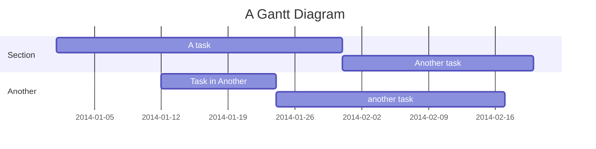

### Синтаксис

Полный пример со страницы:

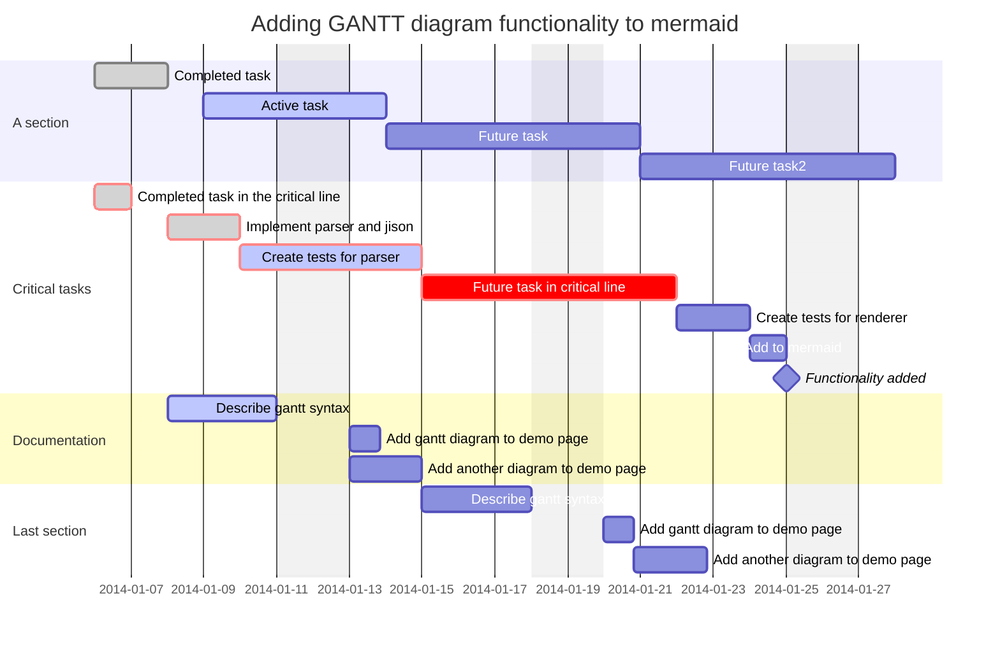

**Задачи.** «Tasks are by default sequential. A task start date defaults to the end date of the preceding task.» «A colon, `:`, separates the task title from its metadata. Metadata items are separated by a comma, `,`. Valid tags are `active`, `done`, `crit`, and `milestone`. Tags are optional, but if used, they must be specified first.» Пятый тег — `vert` (вертикальный маркер, ниже). После тегов:

- один элемент — конец задачи: дата или длительность;
- два элемента — начало (дата в формате `dateFormat` или `after <otherTaskID> …`) и конец;
- три элемента — идентификатор задачи, начало и конец.

Формы метаданных — дословно:

| Metadata syntax | Start date | End date | ID |
|---|---|---|---|
| `<taskID>, <startDate>, <endDate>` | `startdate` as interpreted using `dateformat` | `endDate` as interpreted using `dateformat` | `taskID` |
| `<taskID>, <startDate>, <length>` | `startdate` as interpreted using `dateformat` | Start date + `length` | `taskID` |
| `<taskID>, after <otherTaskId>, <endDate>` | End date of previously specified task `otherTaskID` | `endDate` as interpreted using `dateformat` | `taskID` |
| `<taskID>, after <otherTaskId>, <length>` | End date of previously specified task `otherTaskID` | Start date + `length` | `taskID` |
| `<taskID>, <startDate>, until <otherTaskId>` | `startdate` as interpreted using `dateformat` | Start date of previously specified task `otherTaskID` | `taskID` |
| `<taskID>, after <otherTaskId>, until <otherTaskId>` | End date of previously specified task `otherTaskID` | Start date of previously specified task `otherTaskID` | `taskID` |
| `<startDate>, <endDate>` | `startdate` as interpreted using `dateformat` | `enddate` as interpreted using `dateformat` | n/a |
| `<startDate>, <length>` | `startdate` as interpreted using `dateformat` | Start date + `length` | n/a |
| `after <otherTaskID>, <endDate>` | End date of previously specified task `otherTaskID` | `enddate` as interpreted using `dateformat` | n/a |
| `after <otherTaskID>, <length>` | End date of previously specified task `otherTaskID` | Start date + `length` | n/a |
| `<startDate>, until <otherTaskId>` | `startdate` as interpreted using `dateformat` | Start date of previously specified task `otherTaskID` | n/a |
| `after <otherTaskId>, until <otherTaskId>` | End date of previously specified task `otherTaskID` | Start date of previously specified task `otherTaskID` | n/a |
| `<endDate>` | End date of preceding task | `enddate` as interpreted using `dateformat` | n/a |
| `<length>` | End date of preceding task | Start date + `length` | n/a |
| `until <otherTaskId>` | End date of preceding task | Start date of previously specified task `otherTaskID` | n/a |

«Support for keyword `until` was added in (v10.9.0+).» После `after` и `until` можно перечислить несколько задач:

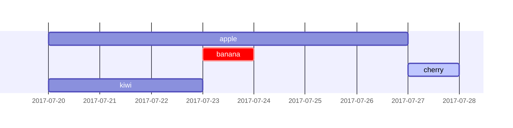

**Длительность** — число и единица: `ms`, `s`, `m`, `h`, `d`, `w`, `M` (месяцы), `y`. «Decimal values are also supported (e.g., `1.5d`). Invalid duration tokens (e.g., `3dX`) will be ignored and the task will default to zero duration.»

**Заголовок** `title` — необязательный. **Секция** — `section <имя>`, имя обязательно.

**Исключения:** «The `excludes` is an _optional_ attribute that accepts specific dates in YYYY-MM-DD format, days of the week ("sunday") or "weekends", but not the word "weekdays".» Исключённые дни внутри задачи удлиняют её вправо, а не дают разрыв; между задачами, идущими подряд, исключённые дни остаются пустым местом. Строк `excludes` может быть несколько:

```text
gantt
    dateFormat DD-MM-YYYY
    excludes weekends
    %% week 7 is winter break
    excludes 10-02-2025 11-02-2025 12-02-2025 13-02-2025 14-02-2025
    %% workers holiday 1 maj
    excludes 01-05-2025
```

**Выходные (v11.0.0+)** — `weekend friday` или `weekend saturday`; по умолчанию суббота и воскресенье:

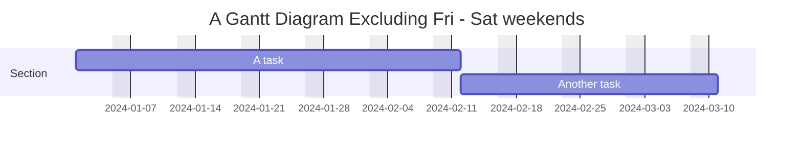

**Вехи** — тег `milestone`; положение — «_initial date_+_duration_/2»:

```mermaid
gantt
    dateFormat HH:mm
    axisFormat %H:%M
    Initial milestone : milestone, m1, 17:49, 2m
    Task A : 10m
    Task B : 5m
    Final milestone : milestone, m2, 18:08, 4m
```

**Вертикальные маркеры** — тег `vert`: «Unlike milestones, vertical markers don’t take up a row.»

```mermaid
gantt
    dateFormat HH:mm
    axisFormat %H:%M
    Initial vert : vert, v1, 17:30, 2m
    Task A : 3m
    Task B : 8m
    Final vert : vert, v2, 17:58, 4m
```

**Даты.** «`dateFormat` defines the format of the date **input** of your gantt elements. How these dates are represented in the rendered chart **output** are defined by `axisFormat`.» Входной формат — токены Day.js (https://day.js.org/docs/en/parse/string-format/), по умолчанию `YYYY-MM-DD`:

| Input | Example | Description |
|---|---|---|
| `YYYY` | 2014 | 4 digit year |
| `YY` | 14 | 2 digit year |
| `Q` | 1..4 | Quarter of year. Sets month to first month in quarter. |
| `M MM` | 1..12 | Month number |
| `MMM MMMM` | January..Dec | Month name in locale set by `dayjs.locale()` |
| `D DD` | 1..31 | Day of month |
| `Do` | 1st..31st | Day of month with ordinal |
| `DDD DDDD` | 1..365 | Day of year |
| `X` | 1410715640.579 | Unix timestamp |
| `x` | 1410715640579 | Unix ms timestamp |
| `H HH` | 0..23 | 24 hour time |
| `h hh` | 1..12 | 12 hour time used with `a A`. |
| `a A` | am pm | Post or ante meridiem |
| `m mm` | 0..59 | Minutes |
| `s ss` | 0..59 | Seconds |
| `S` | 0..9 | Tenths of a second |
| `SS` | 0..99 | Hundreds of a second |
| `SSS` | 0..999 | Thousandths of a second |
| `Z ZZ` | +12:00 | Offset from UTC as +-HH:mm, +-HHmm, or Z |

Формат оси — строки d3-time-format (https://github.com/d3/d3-time-format/tree/v4.0.0#locale_format):

```markdown
axisFormat %Y-%m-%d
```

| Format | Definition |
|---|---|
| %a | abbreviated weekday name |
| %A | full weekday name |
| %b | abbreviated month name |
| %B | full month name |
| %c | date and time, as "%a %b %e %H:%M:%S %Y" |
| %d | zero-padded day of the month as a decimal number \[01,31] |
| %e | space-padded day of the month as a decimal number \[ 1,31]; equivalent to %\_d |
| %H | hour (24-hour clock) as a decimal number \[00,23] |
| %I | hour (12-hour clock) as a decimal number \[01,12] |
| %j | day of the year as a decimal number \[001,366] |
| %m | month as a decimal number \[01,12] |
| %M | minute as a decimal number \[00,59] |
| %L | milliseconds as a decimal number \[000, 999] |
| %p | either AM or PM |
| %S | second as a decimal number \[00,61] |
| %U | week number of the year (Sunday as the first day of the week) as a decimal number \[00,53] |
| %w | weekday as a decimal number \[0(Sunday),6] |
| %W | week number of the year (Monday as the first day of the week) as a decimal number \[00,53] |
| %x | date, as "%m/%d/%Y" |
| %X | time, as "%H:%M:%S" |
| %y | year without century as a decimal number \[00,99] |
| %Y | year with century as a decimal number |
| %Z | time zone offset, such as "-0700" |
| %% | a literal "%" character |

**Деления оси (v10.3.0+)** — `tickInterval`; недельные деления начинаются с воскресенья, день начала меняет `weekday`:

```markdown
tickInterval 1day
```

```javascript
/^([1-9][0-9]*)(millisecond|second|minute|hour|day|week|month)$/;
```

```mermaid
gantt
  tickInterval 1week
  weekday monday
```

**Компактный режим** — несколько задач в одной строке, включается во frontmatter:

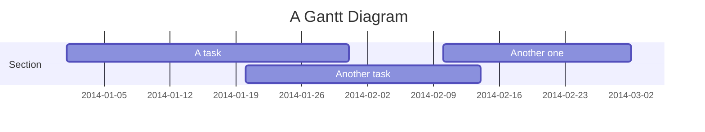

**Ключевые слова без описания на странице.** По исходному коду Mermaid, на странице документации не описано: лексер распознаёт `includes`, `inclusiveEndDates`, `topAxis`, `accDescription` и работает без учёта регистра (https://github.com/mermaid-js/mermaid/tree/develop/packages/mermaid/src/diagrams/gantt/parser).

### Стили и классы

`classDef`, `class`, `:::`, `style` на странице не описаны; оформление — CSS-классы сайта. Маркер текущей даты — `todayMarker` со стилем или `off`:

```text
todayMarker stroke-width:5px,stroke:#0f0,opacity:0.5
```

```text
todayMarker off
```

### Комментарии и взаимодействие

Комментарий — на отдельной строке:


`click` привязывает к задаче функцию или ссылку, которая открывается в текущей вкладке; работает при `securityLevel='loose'`, отключён при `strict` ([mermaid-config.md](mermaid-config.md)):

```text
click taskId call callback(arguments)
click taskId href URL
```

### Доступность

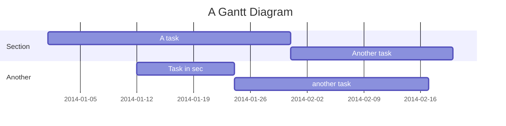

### Ключи `config`, которые задаёт автор

Раздел `gantt:`, по схеме конфигурации:

| Ключ | По умолчанию | Что задаёт |
|---|---|---|
| `barHeight` | `20` | высота полос |
| `barGap` | `4` | промежуток между задачами |
| `topPadding` | `50` | отступ между заголовком, осью и диаграммой |
| `leftPadding`, `rightPadding` | `75`, `75` | место под имена секций |
| `gridLineStartPadding` | `35` | начало линий сетки по вертикали |
| `fontSize`, `sectionFontSize` | `11`, `11` | размер шрифта задач и секций |
| `numberSectionStyles` | `4` | число чередующихся стилей секций |
| `axisFormat` | `"%Y-%m-%d"` | формат дат на оси |
| `tickInterval` | — | шаг делений оси |
| `topAxis` | `false` | подписи дат и сверху |
| `displayMode` | `""` | `compact` — компактный режим |
| `weekday` | `"sunday"` | день начала недельных делений |

### Ловушки

- ЕСЛИ задача ссылается на другую -> писать `after <id>`: пункт страницы упоминает `later <taskID>`, но такого ключевого слова в примерах и грамматике нет.
- Теги задачи — первыми в метаданных; имя секции обязательно.
- Неверный токен длительности молча даёт нулевую длительность; неподдерживаемое значение `tickInterval` (например `1decade`) молча игнорируется.
- `excludes` не принимает слово `weekdays`.
- `title` во frontmatter игнорируется, если заголовок задан в самой диаграмме.

---

## Временная шкала (`timeline`)

Документация: https://mermaid.js.org/syntax/timeline.html

### Ключевое слово и статус

- `timeline`, `timeline LR` или `timeline TD` (направление — v11.14.0+): «`LR`: Left to right (default)», «`TD`: Top top down.»
- Статус: experimental — «The syntax is stable except for the icon integration which is the experimental part.» Синтаксис иконок на странице не описан.

### Минимальный пример

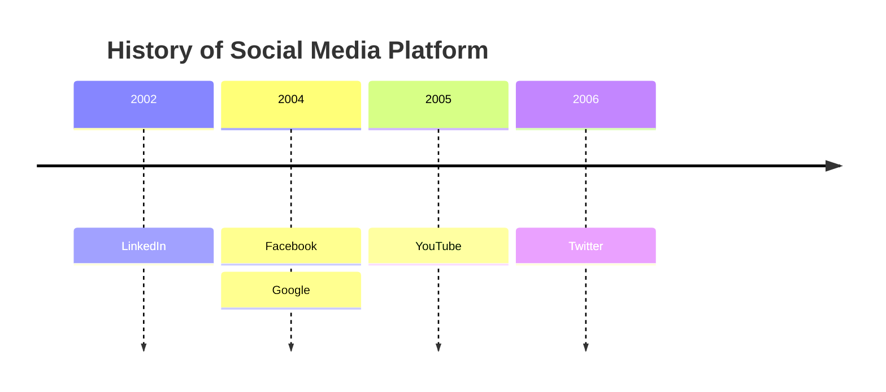

### Синтаксис

`timeline`, необязательная строка `title`, затем период, двоеточие, событие. Событий у периода несколько — через двоеточие в той же строке или на следующих строках, начинающихся с двоеточия:

```json
{time period} : {event}
```

```json
{time period} : {event} : {event}
```

```json
{time period} : {event}
              : {event}
              : {event}
```

«**NOTE**: Both time period and event are simple text, and not limited to numbers.» Первый период — слева, последний — справа; первое событие периода — сверху.

**Секции** — `section <название>`: «All subsequent time periods will be placed in this section until a new section is defined.» «If no section is defined, all time periods will be placed in the default section.»

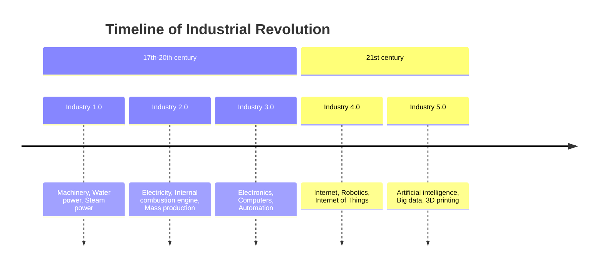

**Перенос текста** — длинный текст переносится сам, принудительно — `<br>`. **Направление:**

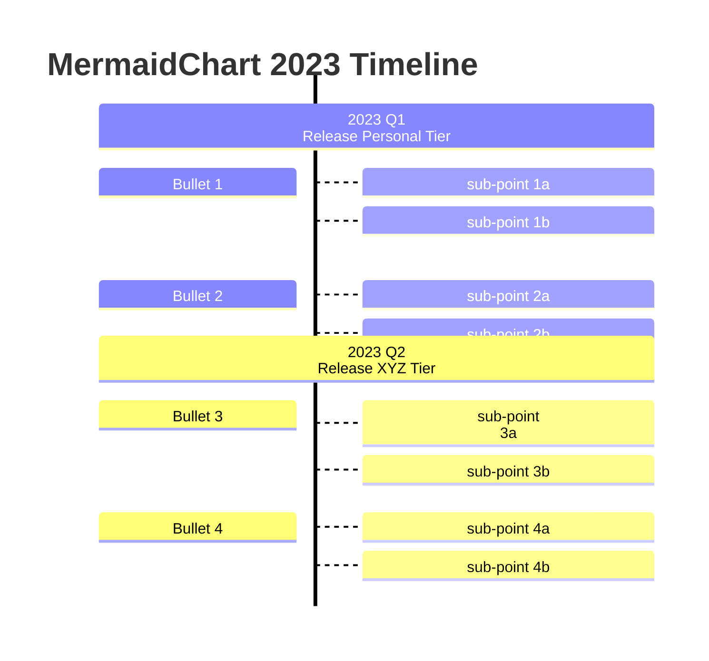

### Стили и классы

`classDef`, `style`, `class`, `:::` не описаны. Без секций каждый период получает свою цветовую схему; `disableMulticolor: true` даёт всем одну:

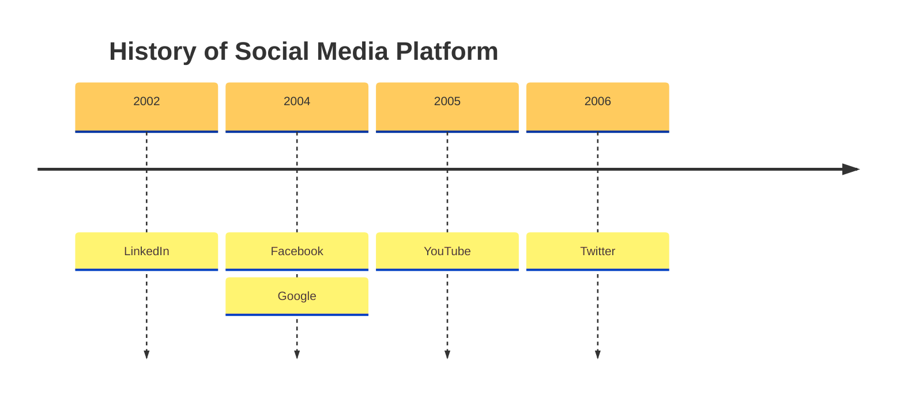

Переменные темы `cScale0`–`cScale11` — фон, `cScaleLabel0`–`cScaleLabel11` — цвет текста: «Mermaid allows you to set unique colors for up-to 12 sections». «In case you have more than 12 sections, the color scheme will start to repeat.»

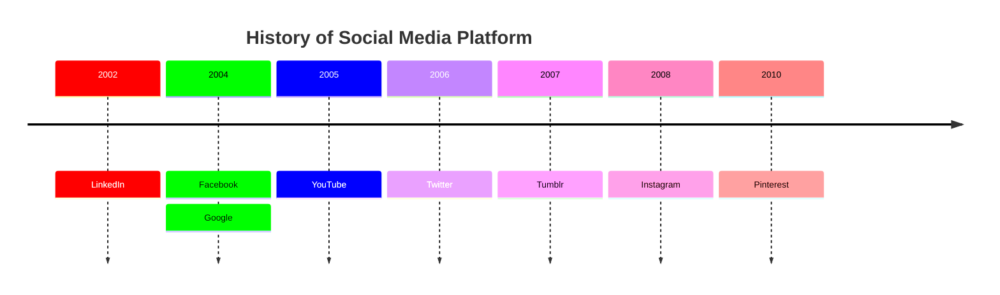

### Комментарии и доступность

По исходному коду Mermaid, на странице документации не описано: строки с `%%` пропускаются, в грамматике есть правило комментария от `#` до конца строки, период — текст без `#` и `:`; грамматика принимает `accTitle`, `accDescr` и `accDescr { … }` (https://github.com/mermaid-js/mermaid/tree/develop/packages/mermaid/src/diagrams/timeline/parser).

### Ключи `config`, которые задаёт автор

Раздел `timeline:`: `disableMulticolor` (по умолчанию `false`), `leftMargin` (`150`), `width` (`150`), `height` (`50`), `diagramMarginX` (`50`), `diagramMarginY` (`10`).

### Ловушки

- ЕСЛИ нужно отключить многоцветность -> писать ключ `disableMulticolor`, как в примерах и схеме, а не `disableMultiColor` из текста страницы.
- ЕСЛИ в периоде нужен символ `#` или двоеточие -> переформулировать без них: по исходному коду Mermaid период — текст без `#` и `:`. В заголовках, секциях и событиях `#` по журналу изменений допустим с 11.0.0.
- Больше 12 секций — цвета повторяются.

---

## Путь пользователя (`journey`)

Документация: https://mermaid.js.org/syntax/userJourney.html

### Ключевое слово и статус

- `journey`.
- Статус: стабильный. «User journeys describe at a high level of detail exactly what steps different users take to complete a specific task within a system, application or website.»

### Минимальный пример

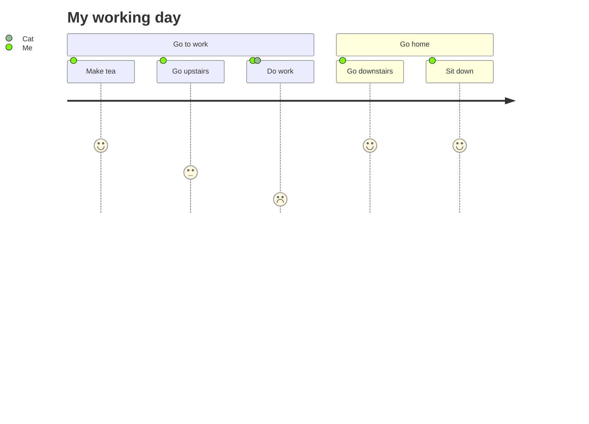

### Синтаксис

- «Each user journey is split into sections, these describe the part of the task the user is trying to complete.»
- «Tasks syntax is `Task name: <score>: <comma separated list of actors>`»
- «Score is a number between 1 and 5, inclusive.»

### Комментарии и доступность

По исходному коду Mermaid, на странице документации не описано: пропускаются строки с `%%` и текст от `#` до конца строки (https://github.com/mermaid-js/mermaid/tree/develop/packages/mermaid/src/diagrams/user-journey/parser).


### Ключи `config`, которые задаёт автор

Раздел `journey:`: `leftMargin` (`150`), `maxLabelWidth` (`360`), `taskMargin` (`50`), `titleColor` (`''`), `titleFontSize` (`'4ex'`). Переменные темы `fillType0`–`fillType7` — [mermaid-config.md](mermaid-config.md).

### Ловушки

- Оценка — только от 1 до 5.
- Символ `#` в тексте задачи начинает комментарий.

---

## Git-граф (`gitGraph`)

Документация: https://mermaid.js.org/syntax/gitgraph.html

### Ключевое слово и статус

- `gitGraph`; также `gitGraph:` и с ориентацией `gitGraph LR:`, `gitGraph TB:`, `gitGraph BT:`. Регистр значим: страница в тексте пишет `gitgraph`, но распознаётся `gitGraph`.
- Статус: стабильный. Команды отрисовываются в порядке появления; граф начинается с ветки `main`, она же текущая.

### Минимальный пример

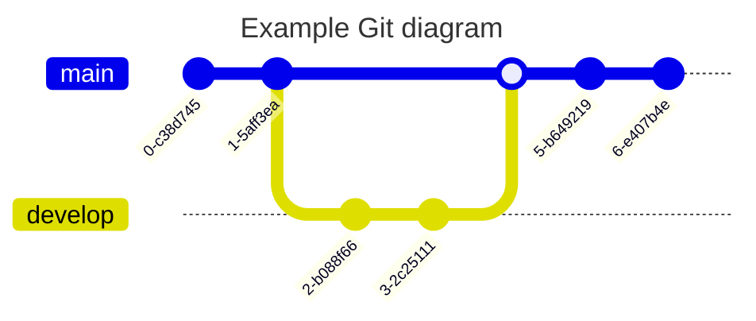

### Синтаксис

**Коммит** — `commit`; атрибуты `id: "…"`, `type:` (`NORMAL` — по умолчанию, `REVERSE`, `HIGHLIGHT`), `tag: "…"` в любом наборе и порядке:

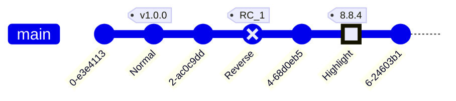

**Ветка** — `branch <имя>`, создаётся и становится текущей: «The name has to be unique and cannot be that of an existing branch. A branch name that could be confused for a keyword must be quoted within `""`. Usage examples: `branch develop`, `branch "cherry-pick"`»

**Переключение** — `checkout <имя>`; «NOTE: `checkout` and `switch` can be used interchangeably.»

**Слияние** — `merge <ветка>` в текущую; у `merge` те же атрибуты `id`, `tag`, `type`: «you can only merge two separate branches, and cannot merge a branch with itself.»

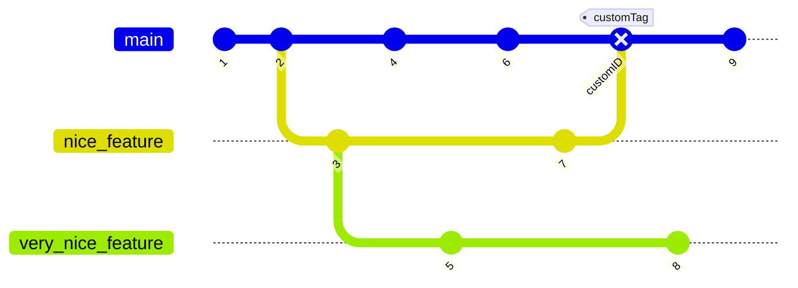

**Перенос коммита** — `cherry-pick id: "…"`; для коммита слияния обязателен `parent:`. Правила — дословно:

> 1. You need to provide the `id` for an existing commit to be cherry-picked. If given commit id does not exist it will result in an error. For this, make use of the `commit id:$value` format of declaring commits. See the examples from above.
> 2. The given commit must not exist on the current branch. The cherry-picked commit must always be a different branch than the current branch.
> 3. Current branch must have at least one commit, before you can cherry-pick, otherwise it will cause an error is throw.
> 4. When cherry-picking a merge commit, providing a parent commit ID is mandatory. If the parent attribute is omitted or an invalid parent commit ID is provided, an error will be thrown.
> 5. The specified parent commit must be an immediate parent of the merge commit being cherry-picked.

```mermaid
    gitGraph
        commit id: "ZERO"
        branch develop
        branch release
        commit id:"A"
        checkout main
        commit id:"ONE"
        checkout develop
        commit id:"B"
        checkout main
        merge develop id:"MERGE"
        commit id:"TWO"
        checkout release
        cherry-pick id:"MERGE" parent:"B"
        commit id:"THREE"
        checkout develop
        commit id:"C"
```

**Сообщение коммита.** По исходному коду Mermaid, на странице git-графа не описано: у `commit` есть атрибут `msg:`, а строка без ключа тоже становится сообщением; у `cherry-pick` допустим `tag:`; строки — в двойных или одинарных кавычках (https://github.com/mermaid-js/mermaid/tree/develop/packages/parser/src/language/gitGraph). Пример со страницы примеров:

```mermaid
gitGraph:
    commit "Ashish"
    branch newbranch
    checkout newbranch
    commit id:"1111"
    commit tag:"test"
    checkout main
    commit type: HIGHLIGHT
    commit
    merge newbranch
    commit
    branch b2
    commit
```

**Порядок веток** — `order:` после имени ветки:

> - Main branch is always shown first as it has default order value of `0`. (unless its order is modified and changed from `0` using the `mainBranchOrder` keyword in the config)
> - Next, All branches without an `order` are shown in the order of their appearance in the diagram code.
> - Next, All branches with an `order` are shown in the order of their `order` value.

```mermaid
---
config:
  logLevel: 'debug'
  theme: 'base'
  gitGraph:
    showBranches: true
    showCommitLabel: true
    mainBranchOrder: 2
---
      gitGraph
      commit
      branch test1 order: 3
      branch test2
      branch test3
      branch test4 order: 1

```

**Ориентация (v10.3.0+)** — `LR:` слева направо (по умолчанию), `TB:` сверху вниз, `BT:` снизу вверх (v11.0.0+):

```mermaid
    gitGraph TB:
       commit
       commit
       branch develop
       commit
       commit
       checkout main
       commit
       commit
       merge develop
       commit
       commit
```

**Параллельные коммиты (v10.8.0+):** «Commits in Mermaid display temporal information in gitgraph by default. … You can turn this off by enabling the `parallelCommits` flag.»

```mermaid
---
config:
  gitGraph:
    parallelCommits: true
---
gitGraph:
  commit
  branch develop
  commit
  commit
  checkout main
  commit
  commit
```

### Стили и классы

`classDef`, `style`, `class`, `:::` не описаны и в грамматике отсутствуют; оформление — темы и переменные темы. Переменные со страницы:

| Переменная | Что задаёт (по странице) | Раздел страницы |
|---|---|---|
| `git0` … `git7` | цвет ветки: `git0` — первой, `git1` — второй и т. д. | Customizing branch colors |
| `gitBranchLabel0` … `gitBranchLabel7` | цвет подписи ветки | Customizing branch label colors |
| `commitLabelColor` | цвет текста подписи коммита | Customizing Commit colors |
| `commitLabelBackground` | цвет фона подписи коммита | Customizing Commit colors |
| `commitLabelFontSize` | размер шрифта подписи коммита | Customizing Commit Label Font Size |
| `tagLabelFontSize` | размер шрифта подписи тега | Customizing Tag Label Font Size |
| `tagLabelColor` | цвет текста тега | Customizing Tag colors |
| `tagLabelBackground` | цвет фона тега | Customizing Tag colors |
| `tagLabelBorder` | цвет рамки тега | Customizing Tag colors |
| `gitInv0` … `gitInv7` | цвет выделенного коммита (`HIGHLIGHT`) на соответствующей ветке | Customizing Highlight commit colors |

«Mermaid supports the theme variables to override the default values for **up to 8 branches** … After this threshold of 8 branches, the theme variables are reused in the cyclic manner».

```mermaid
---
config:
  logLevel: 'debug'
  theme: 'default'
  themeVariables:
      'git0': '#ff0000'
      'git1': '#00ff00'
      'git2': '#0000ff'
      'git3': '#ff00ff'
      'git4': '#00ffff'
      'git5': '#ffff00'
      'git6': '#ff00ff'
      'git7': '#00ffff'
---
       gitGraph
       commit
       branch develop
       commit tag:"v1.0.0"
       commit
       checkout main
       commit type: HIGHLIGHT
       commit
       merge develop
       commit
       branch featureA
       commit

```

### Комментарии и доступность

По исходному коду Mermaid, на странице документации не описано: комментарий — `%%`, грамматика принимает `title`, `accTitle`, `accDescr`.

```mermaid
  gitGraph
      accTitle: My GitGraph Accessibility Title
      accDescr: My GitGraph Accessibility Description

     commit
     commit
     branch develop
     checkout develop
     commit
     commit
     checkout main
     merge develop
     commit
     commit

```

### Ключи `config`, которые задаёт автор

Раздел `gitGraph:` — дословно со страницы, плюс `rotateCommitLabel` (по умолчанию `true`; `false` — подписи горизонтально):

> - `showBranches` : Boolean, default is `true`. If set to `false`, the branches are not shown in the diagram.
> - `showCommitLabel` : Boolean, default is `true`. If set to `false`, the commit labels are not shown in the diagram.
> - `mainBranchName` : String, default is `main`. The name of the default/root branch.
> - `mainBranchOrder` : Position of the main branch in the list of branches. default is `0`, meaning, by default `main` branch is the first in the order.
> - `parallelCommits`: Boolean, default is `false`. If set to `true`, commits x distance away from the parent are shown at the same level in the diagram.

### Ловушки

- Ключевое слово — `gitGraph` с заглавной `G`.
- `checkout` и `merge` на несуществующую ветку — ошибка; слить ветку с самой собой нельзя.
- Имя ветки, похожее на ключевое слово, — в кавычках.
- Переменные темы веток действуют для 8 веток, дальше повторяются по кругу.

---

## Канбан (`kanban`)

Документация: https://mermaid.js.org/syntax/kanban.html

### Ключевое слово и статус

- `kanban`.
- Статус: стабильный; по журналу изменений появился в 11.4.0. «A Kanban diagram in Mermaid starts with the kanban keyword, followed by the definition of columns (stages) and tasks within those columns.»

### Минимальный пример

```mermaid
kanban
  column1[Column Title]
    task1[Task Description]
```

### Синтаксис

**Колонка** — уникальный идентификатор и заголовок в квадратных скобках; **задача** — под колонкой с отступом, идентификатор и описание в квадратных скобках:

```text
columnId[Column Title]
```

```text
taskId[Task Description]
```

**Метаданные задачи** — `@{ … }`; поддерживаемые ключи:

```text
•	assigned: Specifies who is responsible for the task.
•	ticket: Links the task to a ticket or issue number.
•	priority: Indicates the urgency of the task. Allowed values: 'Very High', 'High', 'Low' and 'Very Low'
```

```mermaid
kanban
todo[Todo]
  id3[Update Database Function]@{ ticket: MC-2037, assigned: 'knsv', priority: 'High' }
```

Полный пример — колонка без идентификатора, колонка и задача только из скобок, метаданные, ссылка на тикет через `ticketBaseUrl`:

```mermaid
---
config:
  kanban:
    ticketBaseUrl: 'https://mermaidchart.atlassian.net/browse/#TICKET#'
---
kanban
  Todo
    [Create Documentation]
    docs[Create Blog about the new diagram]
  [In progress]
    id6[Create renderer so that it works in all cases. We also add some extra text here for testing purposes. And some more just for the extra flare.]
  id9[Ready for deploy]
    id8[Design grammar]@{ assigned: 'knsv' }
  id10[Ready for test]
    id4[Create parsing tests]@{ ticket: MC-2038, assigned: 'K.Sveidqvist', priority: 'High' }
    id66[last item]@{ priority: 'Very Low', assigned: 'knsv' }
  id11[Done]
    id5[define getData]
    id2[Title of diagram is more than 100 chars when user duplicates diagram with 100 char]@{ ticket: MC-2036, priority: 'Very High'}
    id3[Update DB function]@{ ticket: MC-2037, assigned: knsv, priority: 'High' }

  id12[Can't reproduce]
    id3[Weird flickering in Firefox]
```

### Ключи `config`, которые задаёт автор

Раздел `kanban:` — `ticketBaseUrl` (по умолчанию `""`): «The `ticketBaseUrl` sets the base URL to the external system and #TICKET# is replaced with the ticket value from task metadata to create a valid link.» По схеме конфигурации есть ещё `padding` (`8`) и `sectionWidth` (`200`).

### Ловушки

- «Remember that proper indentation is crucial; tasks must be indented under their parent columns to maintain the correct structure.»
- `priority` — только 'Very High', 'High', 'Low', 'Very Low'; значения `Medium` нет.
- Идентификаторы делать уникальными, как требует страница.
