# Mermaid: диаграммы классов, состояний, ER, требований, вариантов использования

Сверено по Mermaid 12.1.0. Общие правила — встраивание, объявление, комментарии, frontmatter, экранирование, умолчания Mermaid 12, общие ловушки — в [mermaid.md](mermaid.md).

---

## Диаграмма классов (`classDiagram`)

Документация: https://mermaid.js.org/syntax/classDiagram.html

### Ключевое слово и статус

- `classDiagram`.
- Статус: стабильный. По журналу изменений с 11.17.0 рисуется единым рендерером.

### Минимальный пример

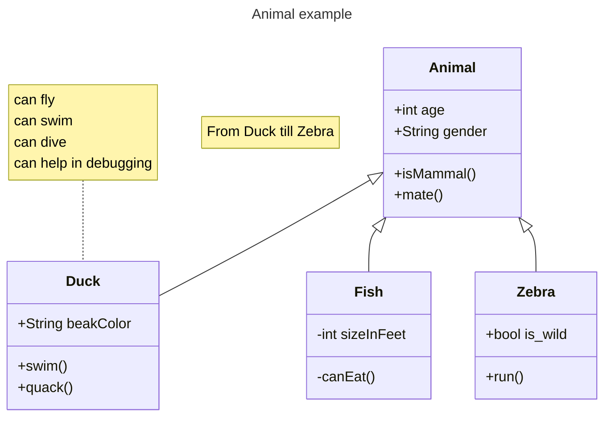

### Синтаксис

**Класс** — три отсека: имя (может содержать аннотацию), атрибуты, операции.

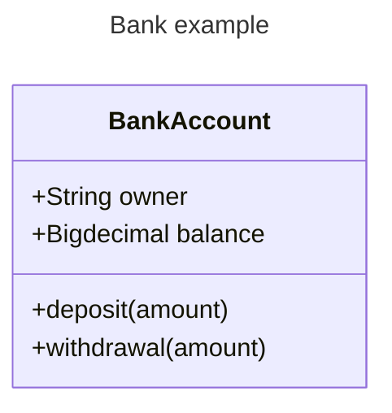

**Объявление** — ключевым словом `class` или связью, которая объявляет оба класса. «Naming convention: a class name should be composed only of alphanumeric characters (including unicode), underscores, and dashes (-).»

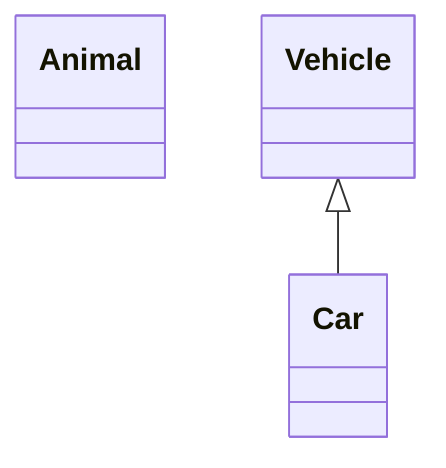

**Подпись класса** — в `["…"]`; спецсимволы в имени — в обратных апострофах:

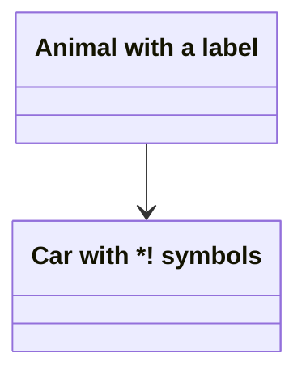

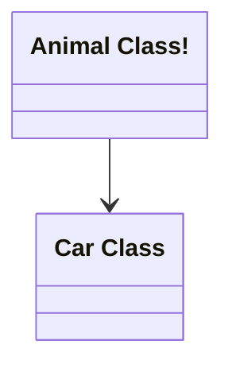

**Члены класса.** «The ones with `()` are treated as functions/methods, and all others as attributes.» Через двоеточие — по одному на строку, или группой в фигурных скобках:

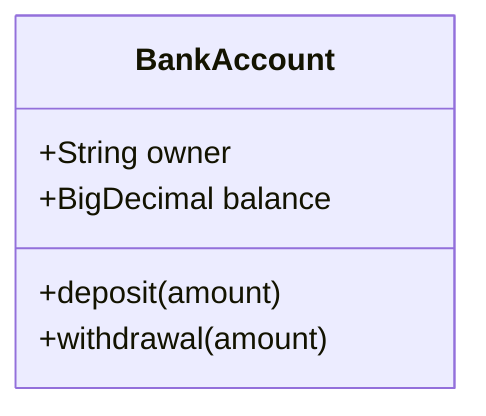


**Тип возвращаемого значения** — после закрывающей скобки: «note: there must be a space between the final `)` and the return type».

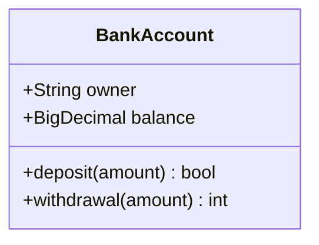

**Обобщённые типы** — в тильдах `~`: «**Nested** type declarations such as `List<List<int>>` are supported, though generics that include a comma are currently not supported. (such as `List<List<K, V>>`)»

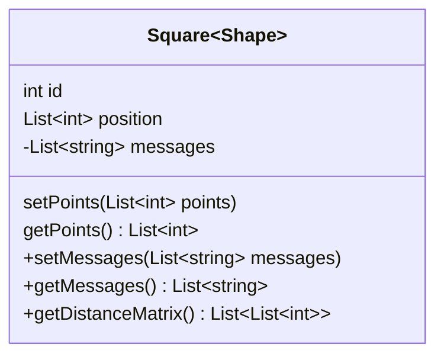

**Видимость** — префикс перед именем члена:

| Обозначение | Значение (дословно) |
|---|---|
| `+` | Public |
| `-` | Private |
| `#` | Protected |
| `~` | Package/Internal |

Классификаторы метода — после `()` или после типа возвращаемого значения; поля — в самом конце:

- `*` Abstract e.g.: `someAbstractMethod()*` or `someAbstractMethod() int*`
- `$` Static e.g.: `someStaticMethod()$` or `someStaticMethod() String$`
- `$` Static e.g.: `String someField$`

**Связи.** Общая форма:

```text
[classA][Arrow][ClassB]
```

| Type | Description |
|---|---|
| `<\|--` | Inheritance |
| `*--` | Composition |
| `o--` | Aggregation |
| `-->` | Association |
| `--` | Link (Solid) |
| `..>` | Dependency |
| `..\|>` | Realization |
| `..` | Link (Dashed) |

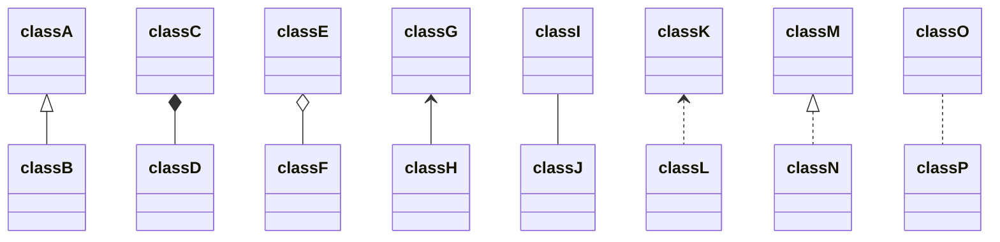

Наконечник можно поставить с другой стороны; подпись связи — после двоеточия:

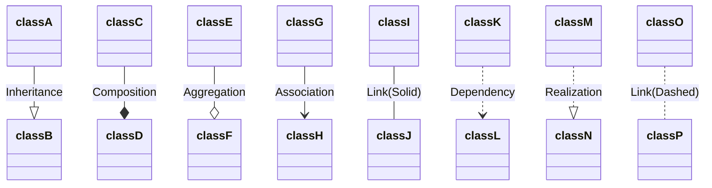

```text
[classA][Arrow][ClassB]:LabelText
```

**Двусторонние связи** — `[Relation Type][Link][Relation Type]`; Relation Type — `<|` наследование, `*` композиция, `o` агрегация, `>` или `<` ассоциация, `|>` реализация; Link — `--` сплошная, `..` пунктирная:

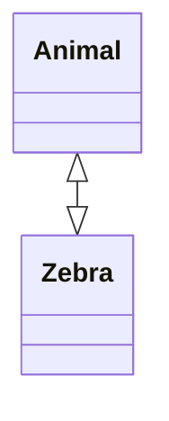

**Интерфейс-«леденец»** — `bar ()-- foo` или `foo --() bar`: «Note: Each interface that is defined is unique and is meant to not be shared between classes / have multiple edges connecting to it.»

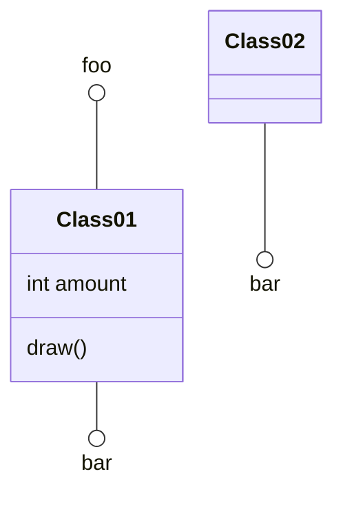

**Пространства имён:**

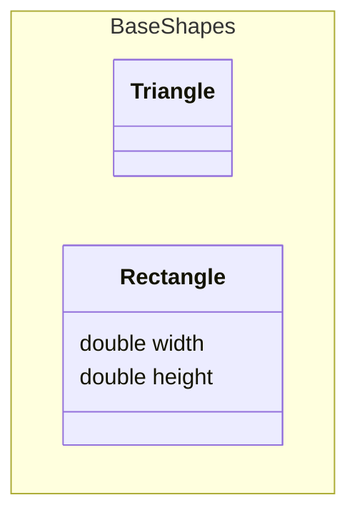

Подпись пространства имён (v11.15.0+): «The label replaces the namespace name in the rendered diagram, while the name is still used internally for relationships and nesting.»

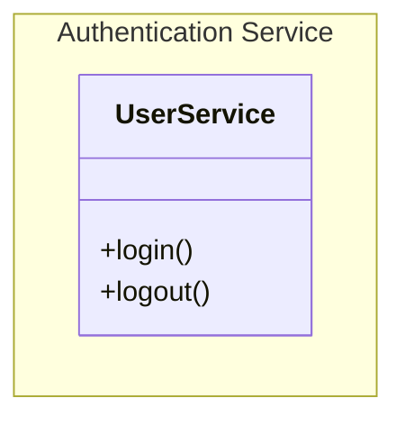

Вложенные пространства имён (v11.15.0+) — через точку или вложением блоков: «Both approaches can be combined. Dot notation like `namespace A.B.C` will automatically create namespaces `A` and `A.B` as parents if they don't already exist.»

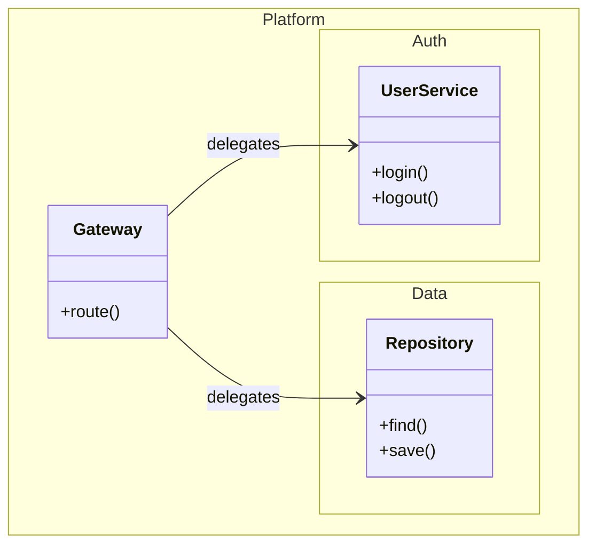

Компактная отрисовка — `hierarchicalNamespaces: false`: «only namespaces the user explicitly declares are drawn — each as a single flat box labelled with its fully-qualified name.»

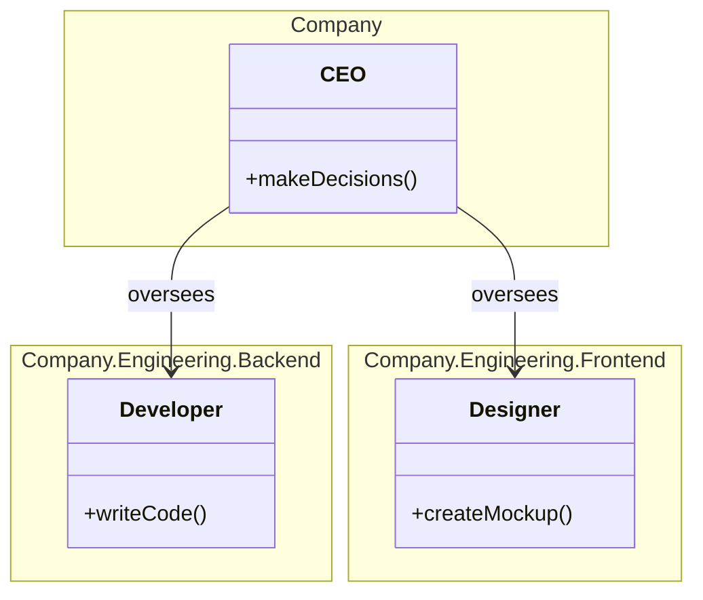

**Кардинальность** — в кавычках у конца связи; варианты дословно:

- `1` Only 1
- `0..1` Zero or One
- `1..*` One or more
- `*` Many
- `n` n (where n>1)
- `0..n` zero to n (where n>1)
- `1..n` one to n (where n>1)

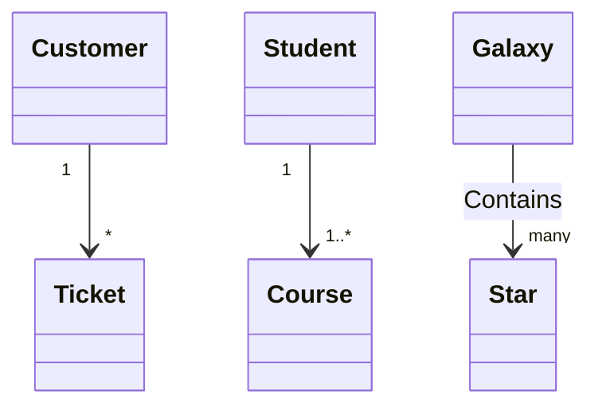

**Аннотации** — между `<<` и `>>`: в строке объявления, отдельной строкой или внутри блока:

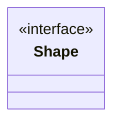

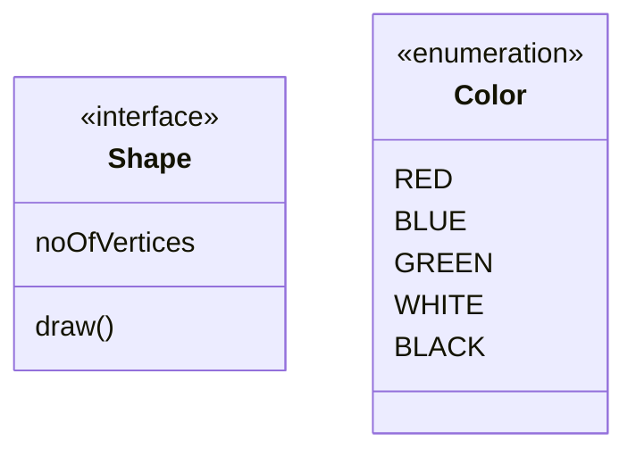

**Направление** — `direction`:

```mermaid
classDiagram
  direction RL
  class Student {
    -idCard : IdCard
  }
  class IdCard{
    -id : int
    -name : string
  }
  class Bike{
    -id : int
    -name : string
  }
  Student "1" --o "1" IdCard : carries
  Student "1" --o "1" Bike : rides
```

**Заметки** — общая `note "…"` и к классу `note for <CLASS NAME> "…"`:

```mermaid
classDiagram
    note "This is a general note"
    note for MyClass "This is a note for a class"
    class MyClass{
    }
```

**Взаимодействие** — `link`, `callback`, `click`; объявляются после всех классов; работают при `securityLevel='loose'` и не работают при `strict` ([mermaid-config.md](mermaid-config.md)):

```text
action className "reference" "tooltip"
click className call callback() "tooltip"
click className href "url" "tooltip"
```

```mermaid
classDiagram
class Shape
link Shape "https://www.github.com" "This is a tooltip for a link"
class Shape2
click Shape2 href "https://www.github.com" "This is a tooltip for a link"
```

### Стили и классы

`style` для одного узла: «Note that notes and namespaces cannot be styled individually but do support themes.»

```mermaid
classDiagram
  class Animal
  class Mineral
  style Animal fill:#f9f,stroke:#333,stroke-width:4px
  style Mineral fill:#bbf,stroke:#f66,stroke-width:2px,color:#fff,stroke-dasharray: 5 5
```

`classDef` — как в общем правиле; назначение класса — `cssClass` или `:::`:

```text
cssClass "nodeId1,nodeId2" className;
```

```mermaid
classDiagram
    class Animal:::someclass {
        -int sizeInFeet
        -canEat()
    }
    classDef someclass fill:#f96
```

Класс `default`: «If a class is named default it will be applied to all nodes. Specific styles and classes should be defined afterwards to override the applied default styling.»

```mermaid
classDiagram
  class Animal:::pink
  class Mineral

  classDef default fill:#f96,color:red
  classDef pink color:#f9f
```

Классы CSS сайта назначаются тем же `:::`, но «cssClasses cannot be added using this shorthand method at the same time as a relation statement.»

### Комментарии

Только на отдельной строке: «Comments need to be on their own line, and must be prefaced with `%%` (double percent signs).»

### Доступность

```mermaid
   classDiagram
      accTitle: My Class Diagram
      accDescr: My Class Diagram Description

      Vehicle <|-- Car
```

### Ключи `config`, которые задаёт автор

Раздел `class:`:

| Ключ | По умолчанию | Что задаёт |
|---|---|---|
| `hideEmptyMembersBox` | `false` | скрыть пустой отсек членов |
| `hierarchicalNamespaces` | `true` | вложенные пространства имён рисуются вложенными блоками |
| `nodeSpacing`, `rankSpacing` | не заданы | расстояния между узлами и уровнями |
| `diagramPadding` | `20` | отступ вокруг диаграммы |
| `padding` | `5` | внутренний отступ |
| `titleTopMargin` | `25` | отступ над заголовком |

```mermaid
---
  config:
    class:
      hideEmptyMembersBox: true
---
classDiagram
  class Duck
```

### Ловушки

- Обобщённые типы с запятой не поддерживаются; обобщённый тип — не часть имени класса, два класса с одним именем и разными типами невозможны.
- Между `)` и типом возвращаемого значения — пробел.
- Действия `link`, `callback`, `click` — отдельными строками после объявления всех классов.
- Класс `default` определять до конкретных классов, конкретные — после него.

---

## Диаграмма состояний (`stateDiagram-v2`)

Документация: https://mermaid.js.org/syntax/stateDiagram.html

### Ключевое слово и статус

- `stateDiagram-v2`; также `stateDiagram` — на странице подписан «Older renderer:».
- Статус: стабильный. «The syntax tries to be compliant with the syntax used in plantUml as this will make it easier for users to share diagrams between mermaid and plantUml.»

### Минимальный пример

```mermaid
---
title: Simple sample
---
stateDiagram-v2
    [*] --> Still
    Still --> [*]

    Still --> Moving
    Moving --> Still
    Moving --> Crash
    Crash --> [*]
```

### Синтаксис

**Состояния** — только идентификатор, `state "описание" as id` или `id : описание`:

```mermaid
stateDiagram-v2
    stateId
```

```mermaid
stateDiagram-v2
    state "This is a state description" as s2
```

```mermaid
stateDiagram-v2
    s2 : This is a state description
```

**Переходы** — `-->`, подпись после двоеточия; необъявленные состояния создаются по переходу:

```mermaid
stateDiagram-v2
    s1 --> s2: A transition
```

**Начало и конец** — `[*]`; направление перехода определяет, начальное оно или конечное:

```mermaid
stateDiagram-v2
    [*] --> s1
    s1 --> [*]
```

**Составные состояния** — `state <id> { … }`, вложенность многоуровневая:

```mermaid
stateDiagram-v2
    [*] --> First
    state First {
        [*] --> second
        second --> [*]
    }

    [*] --> NamedComposite
    NamedComposite: Another Composite
    state NamedComposite {
        [*] --> namedSimple
        namedSimple --> [*]
        namedSimple: Another simple
    }
```

```mermaid
stateDiagram-v2
    [*] --> First
    First --> Second
    First --> Third

    state First {
        [*] --> fir
        fir --> [*]
    }
    state Second {
        [*] --> sec
        sec --> [*]
    }
    state Third {
        [*] --> thi
        thi --> [*]
    }
```

**Выбор** — `<<choice>>`:

```mermaid
stateDiagram-v2
    state if_state <<choice>>
    [*] --> IsPositive
    IsPositive --> if_state
    if_state --> False: if n < 0
    if_state --> True : if n >= 0
```

**Развилка и слияние** — `<<fork>>`, `<<join>>`:

```mermaid
   stateDiagram-v2
    state fork_state <<fork>>
      [*] --> fork_state
      fork_state --> State2
      fork_state --> State3

      state join_state <<join>>
      State2 --> join_state
      State3 --> join_state
      join_state --> State4
      State4 --> [*]
```

**Заметки** — `note right of` / `note left of`; многострочная закрывается `end note`, однострочная — через двоеточие:

```mermaid
    stateDiagram-v2
        State1: The state with a note
        note right of State1
            Important information! You can write
            notes.
        end note
        State1 --> State2
        note left of State2 : This is the note to the left.
```

**Параллельность** — разделитель `--` внутри составного состояния: «As in plantUml you can specify concurrency using the -- symbol.»

```mermaid
stateDiagram-v2
    [*] --> Active

    state Active {
        [*] --> NumLockOff
        NumLockOff --> NumLockOn : EvNumLockPressed
        NumLockOn --> NumLockOff : EvNumLockPressed
        --
        [*] --> CapsLockOff
        CapsLockOff --> CapsLockOn : EvCapsLockPressed
        CapsLockOn --> CapsLockOff : EvCapsLockPressed
        --
        [*] --> ScrollLockOff
        ScrollLockOff --> ScrollLockOn : EvScrollLockPressed
        ScrollLockOn --> ScrollLockOff : EvScrollLockPressed
    }
```

**Направление** — `direction`, в том числе внутри составного состояния:

```mermaid
stateDiagram
    direction LR
    [*] --> A
    A --> B
    B --> C
    state B {
      direction LR
      a --> b
    }
    B --> D
```

**Пробелы в имени состояния** — объявить идентификатор с описанием и дальше пользоваться идентификатором:

```mermaid
stateDiagram
    classDef yourState font-style:italic,font-weight:bold,fill:white

    yswsii: Your state with spaces in it
    [*] --> yswsii:::yourState
    [*] --> SomeOtherState
    SomeOtherState --> YetAnotherState
    yswsii --> YetAnotherState
    YetAnotherState --> [*]
```

По журналу изменений `click` поддерживается в диаграмме состояний с 11.7.0; на странице синтаксис не описан.

### Стили и классы

`classDef` — имя стиля и пары «свойство:значение» через запятую; применение — `class` (список состояний через запятую) или `:::`:

```txt
class [one or more state names, separated by commas] [name of a style defined with classDef]
```

```mermaid
   stateDiagram
   direction TB

   accTitle: This is the accessible title
   accDescr: This is an accessible description

   classDef notMoving fill:white
   classDef movement font-style:italic
   classDef badBadEvent fill:#f00,color:white,font-weight:bold,stroke-width:2px,stroke:yellow

   [*]--> Still
   Still --> [*]
   Still --> Moving
   Moving --> Still
   Moving --> Crash
   Crash --> [*]

   class Still notMoving
   class Moving, Crash movement
   class Crash badBadEvent
   class end badBadEvent
```

```txt
[state]:::[style name]
```

```mermaid
stateDiagram
   direction TB

   accTitle: This is the accessible title
   accDescr: This is an accessible description

   classDef notMoving fill:white
   classDef movement font-style:italic;
   classDef badBadEvent fill:#f00,color:white,font-weight:bold,stroke-width:2px,stroke:yellow

   [*] --> Still:::notMoving
   Still --> [*]
   Still --> Moving:::movement
   Moving --> Still
   Moving --> Crash:::movement
   Crash:::badBadEvent --> [*]
```

Ограничения `classDef` — дословно: «1. Cannot be applied to start or end states 2. Cannot be applied to or within composite states».

### Комментарии

`%%` — на отдельной строке или в конце инструкции: «They can be on their own line or at the end of a statement.»

```mermaid
stateDiagram-v2
    [*] --> Still
    Still --> [*]
%% this is a comment
    Still --> Moving
    Moving --> Still %% another comment
    Moving --> Crash
    Crash --> [*]
```

### Ключи `config`, которые задаёт автор

Раздел `state:`: `layout` (по умолчанию `'elk'`), `wrappingWidth` (`120`), `minNodeWidth` (`120`), `nodeSpacing` и `rankSpacing` (не заданы), `padding` (`8`), `titleTopMargin` (`25`).

### Ловушки

- «_You cannot define transitions between internal states belonging to different composite states_»
- ЕСЛИ нужно стилизовать начальное или конечное состояние -> проверить результат целевым рендером: страница говорит, что `classDef` к ним не применяется, и тут же — что `:::` «includes the start and end states».
- Комментарий — только `%%`: по журналу изменений с 11.15.0 строка с одним `%` комментарием не считается.
- По журналу изменений с 11.15.0 `end note` закрывает заметку, только если стоит на новой строке.

---

## ER-диаграмма (`erDiagram`)

Документация: https://mermaid.js.org/syntax/entityRelationshipDiagram.html

### Ключевое слово и статус

- `erDiagram`.
- Статус: на странице пометок нет; во введении документации — «experimental». «Mermaid uses the most popular crow's foot notation.»

### Минимальный пример

```mermaid
---
title: Order example
---
erDiagram
    CUSTOMER ||--o{ ORDER : places
    ORDER ||--|{ LINE-ITEM : contains
    CUSTOMER }|..|{ DELIVERY-ADDRESS : uses
```

### Синтаксис

**Инструкция:** «Mermaid syntax for ER diagrams is compatible with PlantUML, with an extension to label the relationship.»

```text
    <first-entity> [<relationship> <second-entity> : <relationship-label>]
```

«Only the `first-entity` part of a statement is mandatory. … If any other parts of a statement are specified, then all parts are mandatory.» Имена: «Names support any unicode characters and can include spaces if surrounded by double quotes (e.g. "name with space").» Подпись связи — с точки зрения первой сущности; подписи с двух сторон не поддерживаются.

Юникод и Markdown в именах:

```mermaid
erDiagram
    "This ❤ Unicode"
```

```mermaid
erDiagram
    "This **is** _Markdown_"
```

**Кардинальность:** «In each cardinality marker there are two characters. The outermost character represents a maximum value, and the innermost character represents a minimum value.»

| Value (left) | Value (right) | Meaning |
|:---:|:---:|---|
| `\|o` | `o\|` | Zero or one |
| `\|\|` | `\|\|` | Exactly one |
| `}o` | `o{` | Zero or more (no upper limit) |
| `}\|` | `\|{` | One or more (no upper limit) |

Словесные псевдонимы:

| Value (left) | Value (right) | Alias for |
|:---:|:---:|---|
| one or zero | one or zero | Zero or one |
| zero or one | zero or one | Zero or one |
| one or more | one or more | One or more |
| one or many | one or many | One or more |
| many(1) | many(1) | One or more |
| 1+ | 1+ | One or more |
| zero or more | zero or more | Zero or more |
| zero or many | zero or many | Zero or more |
| many(0) | many(0) | Zero or more |
| 0+ | 0+ | Zero or more |
| only one | only one | Exactly one |
| 1 | 1 | Exactly one |

**Идентифицирующая связь** — `--` (псевдоним `to`), неидентифицирующая — `..` (псевдоним `optionally to`):

```mermaid
erDiagram
    CAR ||--o{ NAMED-DRIVER : allows
    PERSON }o..o{ NAMED-DRIVER : is
```

```mermaid
erDiagram
    CAR 1 to zero or more NAMED-DRIVER : allows
    PERSON many(0) optionally to 0+ NAMED-DRIVER : is
```

**Атрибуты** — блок `{ }` с парами `type name`: «The `type` values must begin with an alphabetic character and may contain digits, hyphens, underscores, parentheses and square brackets. The `name` values follow a similar format to `type`, but may start with an asterisk as another option to indicate an attribute is a primary key.»

```mermaid
erDiagram
    CUSTOMER ||--o{ ORDER : places
    CUSTOMER {
        string name
        string custNumber
        string sector
    }
    ORDER ||--|{ LINE-ITEM : contains
    ORDER {
        int orderNumber
        string deliveryAddress
    }
    LINE-ITEM {
        string productCode
        int quantity
        float pricePerUnit
    }
```

Необязательный тип (v11.16.0+): «Attribute `type` values may end with `?` to indicate an optional or nullable type.»

```mermaid
erDiagram
    PERSON {
        string firstName
        string? middleName
        string lastName
    }
```

**Ключи и комментарии атрибутов:** «Keys can be `PK`, `FK` or `UK`, for Primary Key, Foreign Key or Unique Key (markdown formatting and unicode is not supported for keys). To specify multiple key constraints on a single attribute, separate them with a comma (e.g., `PK, FK`). A `comment` is defined by double quotes at the end of an attribute. Comments themselves cannot have double-quote characters in them.»

```mermaid
erDiagram
    CAR ||--o{ NAMED-DRIVER : allows
    CAR {
        string registrationNumber PK
        string make
        string model
        string[] parts
    }
    PERSON ||--o{ NAMED-DRIVER : is
    PERSON {
        string driversLicense PK "The license #"
        string(99) firstName "Only 99 characters are allowed"
        string lastName
        string phone UK
        int age
    }
    NAMED-DRIVER {
        string carRegistrationNumber PK, FK
        string driverLicence PK, FK
    }
    MANUFACTURER only one to zero or more CAR : makes
```

**Псевдонимы сущностей** — в квадратных скобках, выводятся вместо имени:

```mermaid
erDiagram
    p[Person] {
        string firstName
        string lastName
    }
    a["Customer Account"] {
        string email
    }
    p ||--o| a : has
```

**Направление** — `direction` со значениями `TB`, `BT`, `RL`, `LR`:

```mermaid
erDiagram
    direction LR
    CUSTOMER ||--o{ ORDER : places
    CUSTOMER {
        string name
        string custNumber
        string sector
    }
    ORDER ||--|{ LINE-ITEM : contains
    ORDER {
        int orderNumber
        string deliveryAddress
    }
    LINE-ITEM {
        string productCode
        int quantity
        float pricePerUnit
    }
```

**Подграфы (v11.17.0+)** — группируют сущности, связи и вложенные подграфы:

```mermaid
erDiagram
    subgraph title1
        CUSTOMER
        CUSTOMER {
            string name
            string custNumber
            string sector
        }
    end
    subgraph title2
        CAR ||--o{ NAMED-DRIVER : allows
        subgraph title3
            PERSON
            PERSON {
                string firstName
                string lastName
                int age
            }
        end
    end
```

Идентификатор и заголовок: одно слово — и то и другое; несколько слов — в кавычках; явно — `subgraph id1 [title 1]`. «Subgraphs are always referenced by their id, never by their title.» Идентификатор с пробелами в связи пишется в кавычках: `"Customer Domain" ||--o{ ORDER : contains`.

```mermaid
erDiagram
    subgraph id1 [title 1]
        CUSTOMER
    end
```

Связи с подграфами и направление внутри подграфа:

```mermaid
erDiagram
    direction LR
    subgraph TOP
        direction TB
        subgraph B1
            direction RL
            I1 ||--|| F1 : links
        end
        subgraph B2
            direction BT
            I2 ||--|| F2 : links
        end
    end
    A ||--|| TOP : links
    TOP ||--|| B : links
    B1 ||--|| B2 : links
```

### Стили и классы

`style`, `classDef`, `class`, `:::` — в том числе в инструкции связи; несколько классов — через запятую:

```mermaid
erDiagram
    id1||--||id2 : label
    style id1 fill:#f9f,stroke:#333,stroke-width:4px
    style id2 fill:#bbf,stroke:#f66,stroke-width:2px,color:#fff,stroke-dasharray: 5 5
```

```text
    class nodeId1,nodeId2 className1,className2
```

```text
    nodeId:::className1,className2
```

```mermaid
erDiagram
    CAR {
        string registrationNumber
        string make
        string model
    }
    PERSON {
        string firstName
        string lastName
        int age
    }
    PERSON:::foo ||--|| CAR : owns
    PERSON o{--|| HOUSE:::bar : has

    classDef default fill:#f9f,stroke-width:4px
    classDef foo stroke:#f00
    classDef bar stroke:#0f0
    classDef foobar stroke:#00f
```

«**Note:** Custom styles from style or other class statements take priority and will overwrite the default styles.»

### Доступность

```mermaid
   erDiagram
      accTitle: My Entity Relationship Diagram
      accDescr: My Entity Relationship Diagram Description

    CUSTOMER ||--o{ ORDER : places
    ORDER ||--|{ LINE-ITEM : contains
    CUSTOMER }|..|{ DELIVERY-ADDRESS : uses

```

### Ключи `config`, которые задаёт автор

Раздел `er:`. Раскладка по умолчанию ELK: «The default layout is the ELK (Eclipse Layout Kernel) layout, which suits larger and more-complex diagrams.»

| Ключ | По умолчанию | Что задаёт |
|---|---|---|
| `layoutDirection` | `TB` | направление раскладки |
| `minEntityWidth` | `100` | минимальная ширина сущности |
| `minEntityHeight` | `75` | минимальная высота сущности |
| `entityPadding` | `15` | внутренний отступ сущности |
| `nodeSpacing` | `140` | расстояние между узлами |
| `rankSpacing` | `80` | расстояние между уровнями |
| `stroke` | `gray` | цвет линий и рамок |
| `fill` | `honeydew` | заливка сущностей |
| `fontSize` | `12` | размер шрифта |
| `diagramPadding` | `20` | отступ вокруг диаграммы |

```mermaid
---
title: Order example
config:
    layout: dagre
---
erDiagram
    CUSTOMER ||--o{ ORDER : places
    ORDER ||--|{ LINE-ITEM : contains
    CUSTOMER }|..|{ DELIVERY-ADDRESS : uses
```

### Ловушки

- Если в инструкции есть что-то кроме первой сущности — обязательны все части.
- Имена с пробелами — только в двойных кавычках.
- В ключах `PK`, `FK`, `UK` Markdown и юникод не поддерживаются; в комментарии атрибута двойных кавычек быть не может.
- Подграф — по идентификатору, не по заголовку.

---

## Диаграмма требований (`requirementDiagram`)

Документация: https://mermaid.js.org/syntax/requirementDiagram.html

### Ключевое слово и статус

- `requirementDiagram`.
- Статус: стабильный. «The modeling specs follow those defined by SysML v1.6.»

### Минимальный пример

```mermaid
    requirementDiagram

    requirement test_req {
    id: 1
    text: the test text.
    risk: high
    verifymethod: test
    }

    element test_entity {
    type: simulation
    }

    test_entity - satisfies -> test_req
```

### Синтаксис

Три вида компонентов: требование, элемент, связь. Пользовательский текст — в кавычках или без них: «both `id: "here is an example"` and `id: here is an example` are both valid.»

**Требование:**

```text
<type> user_defined_name {
    id: user_defined_id
    text: user_defined text
    risk: <risk>
    verifymethod: <method>
}
```

| Keyword | Options |
|---|---|
| Type | requirement, functionalRequirement, interfaceRequirement, performanceRequirement, physicalRequirement, designConstraint |
| Risk | Low, Medium, High |
| VerificationMethod | Analysis, Inspection, Test, Demonstration |

**Элемент:** «The element feature is intended to be lightweight but allow requirements to be connected to portions of other documents.»

```text
element user_defined_name {
    type: user_defined_type
    docref: user_defined_ref
}
```

**Markdown** — в кавычках там, где допускается пользовательский текст:

```mermaid
requirementDiagram

requirement "__test_req__" {
    id: 1
    text: "*italicized text* **bold text**"
    risk: high
    verifymethod: test
}
```

**Связь** — `{name of source} - <type> -> {name of destination}` или `{name of destination} <- <type> - {name of source}`; типы `contains`, `copies`, `derives`, `satisfies`, `verifies`, `refines`, `traces`. Пример, который по словам страницы «uses all features of the diagram»:

```mermaid
    requirementDiagram

    requirement test_req {
    id: 1
    text: the test text.
    risk: high
    verifymethod: test
    }

    functionalRequirement test_req2 {
    id: 1.1
    text: the second test text.
    risk: low
    verifymethod: inspection
    }

    performanceRequirement test_req3 {
    id: 1.2
    text: the third test text.
    risk: medium
    verifymethod: demonstration
    }

    interfaceRequirement test_req4 {
    id: 1.2.1
    text: the fourth test text.
    risk: medium
    verifymethod: analysis
    }

    physicalRequirement test_req5 {
    id: 1.2.2
    text: the fifth test text.
    risk: medium
    verifymethod: analysis
    }

    designConstraint test_req6 {
    id: 1.2.3
    text: the sixth test text.
    risk: medium
    verifymethod: analysis
    }

    element test_entity {
    type: simulation
    }

    element test_entity2 {
    type: word doc
    docRef: reqs/test_entity
    }

    element test_entity3 {
    type: "test suite"
    docRef: github.com/all_the_tests
    }


    test_entity - satisfies -> test_req2
    test_req - traces -> test_req2
    test_req - contains -> test_req3
    test_req3 - contains -> test_req4
    test_req4 - derives -> test_req5
    test_req5 - refines -> test_req6
    test_entity3 - verifies -> test_req5
    test_req <- copies - test_entity2
```

**Направление** — `direction` со значениями `TB` (по умолчанию), `BT`, `LR`, `RL`:

```mermaid
requirementDiagram

direction LR

requirement test_req {
    id: 1
    text: the test text.
    risk: high
    verifymethod: test
}

element test_entity {
    type: simulation
}

test_entity - satisfies -> test_req
```

### Стили и классы

`style`, `classDef`, класс `default`, `class` и `:::`: «(The only exception is the shorthand syntax `:::` which can assign multiple classes but only to one requirement or element at a time).»

```mermaid
requirementDiagram

requirement test_req {
    id: 1
    text: styling example
    risk: low
    verifymethod: test
}

element test_entity {
    type: simulation
}

style test_req fill:#ffa,stroke:#000, color: green
style test_entity fill:#f9f,stroke:#333, color: blue
```

```mermaid
requirementDiagram

requirement test_req:::important {
    id: 1
    text: "class styling example"
    risk: low
    verifymethod: test
}

element test_entity {
    type: simulation
}

classDef important font-weight:bold

class test_entity important
style test_entity fill:#f9f,stroke:#333
```

### Доступность

```mermaid
  requirementDiagram
      accTitle: My Requirement Diagram
      accDescr: My Requirement Diagram Description

       requirement test_req {
  id: 1
  text: the test text.
  risk: high
  verifymethod: test
  }

  element test_entity {
  type: simulation
  }

  test_entity - satisfies -> test_req

```

### Ключи `config`, которые задаёт автор

Раздел `requirement:`. Ключи схемы (`rect_fill`, `text_color`, `rect_border_size`, `rect_border_color`, `rect_min_width`, `rect_min_height`, `fontSize`, `rect_padding`, `line_height`) описаний в схеме не имеют.

### Ловушки

- Текст без кавычек: «The parser will fail if another keyword is detected.»
- ЕСЛИ пишется риск, метод проверки или ссылка на документ -> писать как в примерах страницы: `risk: high`, `verifymethod: test` строчными, `docRef` — таблица и грамматика на странице записывают их иначе, а какой регистр обязателен, страница не говорит.

---

## Диаграмма вариантов использования (`usecase-beta`)

Документация: https://mermaid.js.org/syntax/usecase.html

### Ключевое слово и статус

- `usecase-beta`: «Mermaid's exact syntax keyword is the single token `usecase-beta`».
- Статус: beta (суффикс `-beta`). Появилась в 12.0.0.
- «Use case diagrams show how actors interact with a system and its use cases. Start a diagram with the `usecase-beta` keyword. Put each statement on its own physical line.»
- Направление — `direction` со значениями `TD`, `TB`, `BT`, `LR`, `RL`.

### Минимальный пример

```mermaid
usecase-beta
direction LR
actor Customer("Customer")
systemBoundary "Order system"
  Checkout("Place order")
end
Customer --> Checkout
```

### Синтаксис

**Актёры и варианты использования.** Идентификаторы — `[A-Za-z0-9_]+`, могут начинаться с цифры; «Identifiers are diagram-wide and are shared by actors, use cases, boundaries, JSON nodes, and explicit edges.» Вариант в круглых скобках — эллипс, в квадратных — прямоугольник. Объявление строкой в кавычках получает идентификатор, где каждый символ, не являющийся символом слова, заменён на `_`. Необъявленный конец связи становится эллиптическим вариантом использования. «Actors are never inferred from their position in a relationship and require an `actor` declaration somewhere in the diagram.»

```mermaid
usecase-beta
Customer --> Login
actor Customer
actor Admin("Main administrator")
Login("Sign in")
Report[Generate report]
"Reset password"
Admin --> Report
```

**Варианты актёров** — обычный, `type: hollow`, `type: awesome`, иконка `icon: "<имя>"` из зарегистрированного сайтом пакета. «Actor metadata accepts only `type`, `icon`, and `business`. An icon cannot be combined with a non-normal `type` or with `business: true`.»

```mermaid
usecase-beta
actor Normal("Normal actor")
actor Hollow("Hollow actor")@{ type: hollow }
actor Awesome("Awesome actor")@{ type: awesome }
actor Icon("Registered icon")@{ icon: "fa:user" }
actor Fallback("Missing icon fallback")@{ icon: "not-registered:user" }
Normal --> Manage
Hollow --> Manage
Awesome --> Manage
Icon --> Manage
Fallback --> Manage
```

**Бизнес-элементы и стереотипы** — `business: true` у обычного или полого актёра и у эллиптического варианта; один стереотип `<<…>>` после метаданных и перед `:::`. «Stereotypes provide visible semantics but do not create CSS classes or automatic stereotype selectors. Use classes or direct styles to control their appearance.»

```mermaid
usecase-beta
actor SalesAgent("Sales agent")@{ business: true } <<Employee>>
actor Broker@{ type: hollow, business: true }
Quote("Prepare quote")@{ business: true } <<Core>>
Archive[Archive quote] <<Record>>
SalesAgent --> Quote
Broker --> Quote
Quote --> Archive
```

**Подписи** — без кавычек внутри скобок, простая строка, Markdown-строка. Подпись без кавычек — одна физическая строка. Зарезервированы: «the delimiters `(`, `)`, `[`, `]`, `{`, and `}`, the quote characters `"` and `'`, and the sequences `--`, `-->`, `<--`, `--o`, `--x`, `--|>`, `..>`, `:::`, `@{`, and `<<`. A lone `-`, `.`, `:`, `@`, `<`, or `>` is ordinary text. Quote the label when a reserved character has to appear in it.» Коды сущностей: «Common codes include `#quot;`, `#39;`, `#40;`, `#41;`, `#91;`, `#93;`, and `#96;`. Plain strings do not process backslash escapes.»

```mermaid
usecase-beta
actor Reviewer("`*Reviewer*`")
Literal("**Literal markers**")
Formatted("`**Formatted label**
with a physical line break`")
Quoted("Show #quot;quoted#quot; text")
Reviewer -- "`opens **form**`" --> Formatted
Reviewer --> Literal
Reviewer --> Quoted
```

**Строки и комментарии** — каждый оператор на своей физической строке; `%%` — комментарий на всю строку. «`%%` inside a string is label data. `//` and `#` are not comments. A semicolon is not a statement separator. Any token after a complete statement on the same physical line is an error.»

```mermaid
usecase-beta
%% Actors are declared explicitly.
actor User

%% Each relationship is a separate statement.
User --> Login
Login --> Dashboard
```

**Границы системы** — `systemBoundary … end`; порядок суффиксов «`systemBoundary <id><title>@{ … }:::<classes>`»; тип по умолчанию `rect`, `type: package` рисует вкладку заголовка. «Boundaries are one level deep. Their contents can contain only actor and use case declarations, blank lines, and `%%` comments. … An actor or use case can belong to at most one boundary.»

```mermaid
usecase-beta
systemBoundary sb1["Payment service"]@{ type: package }:::system
  actor Clerk("Payment clerk")
  Authorize("Authorize payment")
  Receipt[Create receipt]
end
Clerk --> Authorize
Authorize --> Receipt
classDef system stroke:#4b4b7a
```

**Ассоциации** — `-->`, `<--`, `--`, `--o`, `o--`, `--x`, `x--`; подпись со словами `include` или `extend` остаётся ассоциацией:

```mermaid
usecase-beta
actor User
actor Support
Start
Finish
User --> Start
Start <-- Support
Start -- Finish
User --o Start
Start o-- Support
User --x Finish
Finish x-- Support
```

**Включение, расширение, обобщение** — `..> : include`, `..> : extend`, `--|>`: «Include and extend require use case endpoints. Generalization requires two actors or two use cases.»

```mermaid
usecase-beta
actor Admin
actor Person
Checkout
Payment
ApplyCoupon
Admin --|> Person
Checkout ..> : include Payment
ApplyCoupon ..> : extend Checkout
ApplyCoupon --|> Checkout
```

**Идентификаторы рёбер, стили, анимация, длина** — идентификатор и `@` прямо перед оператором; `animate: true`, `animation: fast` / `slow`, `animate: false`; лишние дефисы удлиняют точечные и безмаркерные ассоциации: «The two-dash form has `minlen = 1`; three dashes give `minlen = 2`, and each additional dash adds one.» «Circle, cross, include, extend, and generalization operators have fixed length and reject extra dashes.»

```mermaid
usecase-beta
actor Customer
Checkout
Payment
Customer opens@-- "starts checkout" ---> Checkout
Checkout payment@..> : include Payment
classDef emphasized stroke:#d33,stroke-width:3px
class opens,payment emphasized
style opens stroke:#06c,stroke-width:4px
opens@{ animation: fast }
payment@{ animate: false }
```

**Заметки** — `note for <цель> "<текст>"`, цель может быть объявлена позже; заметка — обычный узел, «adding a note can move the other elements.» «Notes cannot target JSON nodes, boundaries, edges, or other notes.»

```mermaid
usecase-beta
note for Login "`Requires an **active session**`"
note for User "Starts the workflow"
actor User
Login("Sign in")
User --> Login
```

**JSON-таблицы** — `json <Id>@{ … }` на верхнем уровне, тело — строгий JSON-объект. «JSON declarations must stay at the top level. Arrays and scalar values are not valid roots.» «JSON nodes can use only point, reversed-point, or markerless solid associations.»

```mermaid
usecase-beta
Inspect("Inspect payload")
json Payload@{
  "2": "second in source",
  "1": "first after 2",
  "enabled": true,
  "count": 3,
  "missing": null,
  "colors": ["Red", "Green"],
  "address": { "city": "Oslo" },
  "items": [{ "name": "Book" }],
  "emptyObject": {},
  "emptyArray": []
}:::data
Inspect --> Payload
classDef data stroke:#3572a5
style Payload stroke-width:2px
```

### Стили и классы

`classDef`, `class`, `style` и суффикс `:::` у актёров, вариантов, границ, JSON-узлов и явных рёбер. «CSS declarations are comma-separated `property:value` items. Use `\,` for a literal comma in a value. Semicolons are rejected. Style precedence is theme variables, the `default` class, named classes in assignment order, then direct `style` declarations.» «Actor metadata is typed and is not a style map. `fillColor`, `strokeColor`, `strokeWidth`, and arbitrary actor metadata keys are errors.»

```mermaid
usecase-beta
actor Customer:::external
Checkout("Checkout"):::critical
systemBoundary Account
  Profile[Edit profile]
end
json Session@{ "active": true }:::data
Customer --> Checkout
Checkout --> Profile
Profile --> Session
classDef default stroke:#7f8ea3
classDef external,critical stroke-width:3px
class Customer,Checkout external,critical
class Account,Session data
style Checkout stroke:#c33,stroke-width:4px
style Account stroke:#536878
```

Переменные темы — цвет по виду элемента:

| Theme variable | Applies to |
|---|---|
| `usecaseActorBkg` | Actor glyph fill |
| `usecaseActorBorder` | Actor glyph stroke |
| `usecaseBkg` | Use case body fill |
| `usecaseBorder` | Use case body stroke |
| `usecaseBoundaryBkg` | System boundary fill, when not numbered |
| `usecaseBoundaryBorder` | System boundary stroke, when not numbered |
| `usecaseIncludeLine` | `include` relationship stroke |
| `usecaseExtendLine` | `extend` relationship stroke |

Границы систем нумеруются цветами палитры темы; `colorScheme: rotate` распространяет нумерацию на актёров и варианты — палитру несут только `redux-color` и `redux-dark-color`.

```mermaid
---
config:
  theme: redux-color
  usecase:
    colorScheme: rotate
---
usecase-beta
direction LR
actor Customer
actor Auditor
Browse("Browse catalogue")
Checkout("Checkout")
Customer --> Browse
Browse --> Checkout
Auditor --> Checkout
```

### Доступность

`accTitle` и `accDescr`, многострочный `accDescr { … }`:

```mermaid
usecase-beta
accTitle: Account access use cases
accDescr {
  A customer signs in and can reset a password.
  The diagram names the actor, use cases, and associations.
}
actor Customer
SignIn("Sign in")
Reset("Reset password")
Customer --> SignIn
Customer --> Reset
```

### Ключи `config`, которые задаёт автор

Раздел `usecase:`:

| Key | Default | Purpose |
|---|---|---|
| `actorFontSize` | `14` | Actor label font size |
| `actorFontFamily` | `"Open Sans", sans-serif` | Actor label font family |
| `actorFontWeight` | `normal` | Actor label font weight |
| `usecaseFontSize` | `12` | Use case label font size |
| `usecaseFontFamily` | `"Open Sans", sans-serif` | Use case label font family |
| `usecaseFontWeight` | `normal` | Use case label font weight |
| `nodeSpacing` | `50` | Spacing between nodes on the same level |
| `rankSpacing` | `50` | Spacing between layout ranks |
| `diagramPadding` | `20` | Padding around the diagram |
| `colorScheme` | `role` | How the diagram takes colour from the theme |
| `useMaxWidth` | `true` | Whether the SVG scales to the available width |

По схеме конфигурации есть ещё `wrappingWidth` и `minNodeWidth`, оба `120`.

### Ловушки

Переход с PlantUML — дословно:

- "Put one statement on each physical line. A second statement on the same line is a parse error."
- "Undeclared relationship endpoints become ellipse use cases. Declare every actor with `actor ID` somewhere in the document because source position does not imply an actor."
- "An association label containing `include` or `extend` remains an association. Use `..> : include` or `..> : extend` for UML include and extend semantics."
- "Replace actor `fillColor`, `strokeColor`, `strokeWidth`, and other arbitrary metadata with `classDef`, `class`, or `style`."
- "Replace these constructs, which are outside the grammar and raise a parse error: separators and titled separators, `as` aliases, colon actors, standalone `package` and `rectangle` blocks, `skinparam`, `<style>` blocks, `allowmixing`, left, right, up, or down link hints, note placement keywords, standalone notes, multi-target notes, and `newpage`."
- "Rewrite backslash escapes and plain `\n` multiline text. They parse, so no error points at them."

Перенос строки — физический перевод строки внутри Markdown-строки, скобки — кодами `#40;` и `#41;`:

```mermaid
usecase-beta
actor Customer
Reset("`Reset
password`")
Refund("Refund #40;partial#41;")
Customer --> Reset
Customer --> Refund
```

Светлая заливка прячет заголовок в тёмной теме: «Pair the `fill` with a `color` declaration when you set one, as in `classDef system fill:#f8f8ff,color:#333`.»
