# Mermaid

Сверено по Mermaid 12.1.0. Документация: https://mermaid.js.org/

Основа раздела о языке диаграмм Mermaid: где и как диаграмма встраивается, как она объявляется, какой тип выбрать и какие правила общие для всех типов. Синтаксис конкретного типа — в файле его группы по каталогу ниже.

---

## Где живёт Mermaid (встраивание)

Mermaid — отдельный язык описания диаграмм текстом, а не диалект Markdown. CommonMark и GFM диаграмм не знают: для них блок ```` ```mermaid ```` — обычный блок кода с указанием языка. Картинку рисует площадка, которая распознаёт такой блок или файл. Документация Typora говорит об этом прямо: «diagrams are not supported by standard Markdown, CommonMark or GFM» (https://support.typora.io/Draw-Diagrams-With-Markdown/).

Формы встраивания:

| Форма | Где работает | Документация |
|---|---|---|
| fenced-блок ```` ```mermaid ```` внутри Markdown | GitHub, GitLab, Obsidian, VS Code, Notion, Joplin, вики Azure DevOps, Gitea; после настройки — Docusaurus, Material for MkDocs, Typora, IDE JetBrains | https://mermaid.js.org/intro/getting-started.html; по площадкам — [mermaid-platforms.md](mermaid-platforms.md) |
| контейнер `::: mermaid` … `:::` | вики Azure DevOps | https://learn.microsoft.com/en-us/azure/devops/project/wiki/markdown-guidance?view=azure-devops |
| отдельный файл `.mmd` или `.mermaid` | GitHub | https://docs.github.com/en/repositories/working-with-files/using-files/working-with-non-code-files#displaying-mermaid-files-on-github |
| `<pre class="mermaid">` в HTML | страница, которая подключает Mermaid | https://mermaid.js.org/intro/getting-started.html |

Блок внутри Markdown:

````markdown
The following code-block will be rendered as a Mermaid diagram:

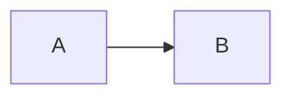
````

Контейнер вики Azure DevOps:

```md
::: mermaid
sequenceDiagram
    Christie->>Josh: Hello Josh, how are you?
    Josh-->>Christie: Great!
    Christie->>Josh: See you later!
:::
```

HTML: определение диаграммы — внутри `<pre class="mermaid">`, страница подключает Mermaid модулем. Каждой диаграмме — свой `<pre>`: «Every Mermaid chart/graph/diagram definition should have separate `<pre>` tags.»

```html
<pre class="mermaid">
    graph LR
    A --- B
    B-->C[fa:fa-ban forbidden]
    B-->D(fa:fa-spinner);
</pre>
```

```html
<script type="module">
  import mermaid from 'https://cdn.jsdelivr.net/npm/mermaid@12/dist/mermaid.esm.min.mjs';
</script>
```

В Confluence, Jira и Bitbucket своего рендера Mermaid нет: диаграммы отрисовывают только приложения Marketplace. Что умеет каждая площадка, какую версию Mermaid она называет и какие у неё ограничения — [mermaid-platforms.md](mermaid-platforms.md).

---

## Объявление диаграммы

- Первая строка — ключевое слово типа. Перед ним допустим только блок frontmatter: «all **Diagrams definitions begin** with a declaration of the **diagram type**, followed by the definitions of the diagram and its contents. … The only exception to this a Frontmatter configuration.» (https://mermaid.js.org/intro/syntax-reference.html)
- Ошибка в ключевом слове ломает диаграмму, ошибка в параметре молча игнорируется: «Unknown words and misspellings will break a diagram, while parameters silently fail.»
- Ключевое слово пишется ровно так, как в каталоге ниже, с тем же регистром. Страница git-графа в тексте называет ключевое слово `gitgraph`, но все её примеры и детектор используют `gitGraph`. По исходному коду Mermaid, на странице документации не описано: детекторы `gitGraph`, `treeView-beta`, `cynefin-beta`, `eventmodeling` и `agentflow-beta` регистрозависимы; без учёта регистра распознаются ключевые слова карты Уордли, railroad-диаграмм и диаграммы Исикавы (https://github.com/mermaid-js/mermaid/tree/develop/packages/mermaid/src/diagrams).

---

## Каталог типов

Таблица — единственное место, где тип сопоставлен с файлом группы. Статус — дословно по документации; «стабильный» — на странице нет пометок beta и experimental. Версия появления — по заголовку страницы, а если его нет — по журналу изменений. Пометка «принимается …» у старых форм ключевых слов — по исходному коду Mermaid, на странице документации не описано (детекторы и грамматики: https://github.com/mermaid-js/mermaid/tree/develop/packages/mermaid/src/diagrams и https://github.com/mermaid-js/mermaid/tree/develop/packages/parser/src/language).

| Тип | Ключевое слово | Статус | Версия появления | Документация | Файл группы |
|---|---|---|---|---|---|
| Блок-схема | `flowchart`; также `graph`; устаревшая форма `flowchart-elk` работает, но не нужна | стабильный | — | https://mermaid.js.org/syntax/flowchart.html | [mermaid-flowchart.md](mermaid-flowchart.md) |
| Диаграмма дорожек | `swimlane-beta` | beta: «This is a new diagram type in Mermaid. Its syntax may evolve in future versions.» | v11.16.0 | https://mermaid.js.org/syntax/swimlanes.html | [mermaid-flowchart.md](mermaid-flowchart.md) |
| Блочная диаграмма | `block`; принимается `block-beta` | стабильный; суффикс `-beta` снят в 11.10.0 | — | https://mermaid.js.org/syntax/block.html | [mermaid-flowchart.md](mermaid-flowchart.md) |
| Диаграмма последовательности | `sequenceDiagram` | стабильный | — | https://mermaid.js.org/syntax/sequenceDiagram.html | [mermaid-sequence.md](mermaid-sequence.md) |
| ZenUML | `zenuml` | внешняя диаграмма, нужен плагин: «Zenuml uses the experimental lazy loading & async rendering features which could change in the future.» | — | https://mermaid.js.org/syntax/zenuml.html | [mermaid-sequence.md](mermaid-sequence.md) |
| Диаграмма классов | `classDiagram` | стабильный | — | https://mermaid.js.org/syntax/classDiagram.html | [mermaid-uml.md](mermaid-uml.md) |
| Диаграмма состояний | `stateDiagram-v2`; также `stateDiagram` (на странице подписан «Older renderer:») | стабильный | — | https://mermaid.js.org/syntax/stateDiagram.html | [mermaid-uml.md](mermaid-uml.md) |
| ER-диаграмма | `erDiagram` | на странице пометок нет; во введении документации — «Entity Relationship Diagram - :exclamation: experimental» | — | https://mermaid.js.org/syntax/entityRelationshipDiagram.html | [mermaid-uml.md](mermaid-uml.md) |
| Диаграмма требований | `requirementDiagram` | стабильный | — | https://mermaid.js.org/syntax/requirementDiagram.html | [mermaid-uml.md](mermaid-uml.md) |
| Диаграмма вариантов использования | `usecase-beta` | beta (суффикс `-beta`) | 12.0.0 | https://mermaid.js.org/syntax/usecase.html | [mermaid-uml.md](mermaid-uml.md) |
| Диаграмма Ганта | `gantt` | стабильный | — | https://mermaid.js.org/syntax/gantt.html | [mermaid-timeline.md](mermaid-timeline.md) |
| Временная шкала | `timeline` | experimental: «This is an experimental diagram for now. … The syntax is stable except for the icon integration which is the experimental part.» | — | https://mermaid.js.org/syntax/timeline.html | [mermaid-timeline.md](mermaid-timeline.md) |
| Путь пользователя | `journey` | стабильный | — | https://mermaid.js.org/syntax/userJourney.html | [mermaid-timeline.md](mermaid-timeline.md) |
| Git-граф | `gitGraph` | стабильный | — | https://mermaid.js.org/syntax/gitgraph.html | [mermaid-timeline.md](mermaid-timeline.md) |
| Канбан | `kanban` | стабильный | 11.4.0 (журнал изменений) | https://mermaid.js.org/syntax/kanban.html | [mermaid-timeline.md](mermaid-timeline.md) |
| Круговая диаграмма | `pie` | стабильный | — | https://mermaid.js.org/syntax/pie.html | [mermaid-charts.md](mermaid-charts.md) |
| Квадрантная диаграмма | `quadrantChart` | стабильный | — | https://mermaid.js.org/syntax/quadrantChart.html | [mermaid-charts.md](mermaid-charts.md) |
| XY-диаграмма | `xychart`; принимается `xychart-beta` | стабильный; суффикс `-beta` снят в 11.10.0 | — | https://mermaid.js.org/syntax/xyChart.html | [mermaid-charts.md](mermaid-charts.md) |
| Диаграмма Санки | `sankey`; принимается `sankey-beta` | experimental: «This is an experimental diagram.» | v10.3.0 | https://mermaid.js.org/syntax/sankey.html | [mermaid-charts.md](mermaid-charts.md) |
| Радарная диаграмма | `radar-beta` | beta (суффикс `-beta`) | v11.6.0 | https://mermaid.js.org/syntax/radar.html | [mermaid-charts.md](mermaid-charts.md) |
| Древовидная карта | `treemap-beta`; принимается `treemap` | beta: «This is a new diagram type in Mermaid. Its syntax may evolve in future versions.» | 11.8.0 (журнал изменений) | https://mermaid.js.org/syntax/treemap.html | [mermaid-charts.md](mermaid-charts.md) |
| Диаграмма Венна | `venn-beta` | beta: «This is a new diagram type in Mermaid. Its syntax may evolve in future versions.» | v11.12.3 по странице, 11.13.0 по журналу изменений | https://mermaid.js.org/syntax/venn.html | [mermaid-charts.md](mermaid-charts.md) |
| Диаграмма архитектуры | `architecture-beta` | beta (суффикс `-beta`) | v11.1.0 | https://mermaid.js.org/syntax/architecture.html | [mermaid-systems.md](mermaid-systems.md) |
| Диаграммы C4 | `C4Context`, `C4Container`, `C4Component`, `C4Dynamic`, `C4Deployment` | experimental: «This is an experimental diagram for now.» | — | https://mermaid.js.org/syntax/c4.html | [mermaid-systems.md](mermaid-systems.md) |
| Диаграмма пакета | `packet`; принимается `packet-beta` | стабильный; из beta выведена в 11.9.0 | v11.0.0 | https://mermaid.js.org/syntax/packet.html | [mermaid-systems.md](mermaid-systems.md) |
| Интеллект-карта | `mindmap` | experimental: «This is an experimental diagram for now. … The syntax is stable except for the icon integration which is the experimental part.» | 9.4.0 | https://mermaid.js.org/syntax/mindmap.html | [mermaid-systems.md](mermaid-systems.md) |
| Дерево каталогов | `treeView-beta` | beta (суффикс `-beta`) | v11.14.0 | https://mermaid.js.org/syntax/treeView.html | [mermaid-systems.md](mermaid-systems.md) |
| Диаграмма Исикавы | `ishikawa-beta`; принимается `ishikawa` | beta: «This is a new diagram type in Mermaid. Its syntax may evolve in future versions.» | v11.12.3 по странице, 11.13.0 по журналу изменений | https://mermaid.js.org/syntax/ishikawa.html | [mermaid-systems.md](mermaid-systems.md) |
| Карта Уордли | `wardley-beta` | beta: «Required diagram type identifier (beta release)» | v11.14.0 | https://mermaid.js.org/syntax/wardley.html | [mermaid-frameworks.md](mermaid-frameworks.md) |
| Фреймворк Cynefin | `cynefin-beta` | beta (суффикс `-beta`) | v11.16.0 | https://mermaid.js.org/syntax/cynefin.html | [mermaid-frameworks.md](mermaid-frameworks.md) |
| Event Modeling | `eventmodeling` | стабильный | v11.15.0 | https://mermaid.js.org/syntax/eventmodeling.html | [mermaid-frameworks.md](mermaid-frameworks.md) |
| Railroad-диаграммы | `railroad-ebnf-beta`, `railroad-abnf-beta`, `railroad-peg-beta`, `railroad-beta` | beta (суффикс `-beta`); страница опубликована, но в меню сайта не входит | v11.16.0 | https://mermaid.js.org/syntax/railroad.html | [mermaid-frameworks.md](mermaid-frameworks.md) |
| Agentflow | `agentflow-beta` | beta: «Agentflow is in **beta**.»; страница опубликована, но в меню сайта не входит | v12.0.0 | https://mermaid.js.org/syntax/agentflow.html | [mermaid-frameworks.md](mermaid-frameworks.md) |

---

## Комментарии

- Строчный комментарий начинается с `%%` и стоит на отдельной строке: «Comments need to be on their own line, and must be prefaced with `%%` (double percent signs). Any text after the start of the comment to the next newline will be treated as a comment, including any flow syntax» (https://mermaid.js.org/syntax/flowchart.html#comments).
- Фигурные скобки в комментарии путаются с директивой. Решение по документации: «In comments using `%%`, avoid using "{}".» (https://mermaid.js.org/intro/syntax-reference.html)

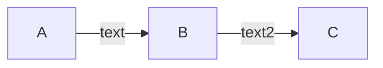

У отдельных типов комментарии устроены иначе: в ZenUML — `//`; в railroad-диаграммах — синтаксис комментариев своей нотации; в диаграмме вариантов использования `//` и `#` комментариями не являются; в диаграмме состояний `%%` допустим и в конце инструкции. Подробности — в файле группы типа по каталогу.

---

## Конфигурация в тексте диаграммы

Конфигурацию одной диаграммы задаёт frontmatter — YAML-блок между строками `---` перед ключевым словом, с ключом `config:` (https://mermaid.js.org/config/configuration.html).

- «This 'triple dash' MUST be the only character on the first line.»
- «Frontmatter uses YAML syntax. It requires any indentation to be consistent and settings are case sensitive. Mermaid will silently ignore misspelling, but badly formed parameters will break the diagram.»
- Ключ `title` во frontmatter задаёт заголовок диаграммы.

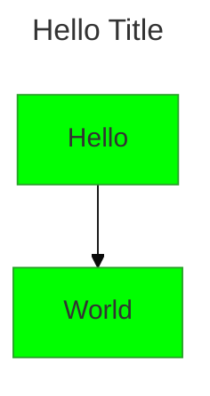

Директивы `%%{init: …}%%` устарели: «Directives are deprecated from v10.5.0. Please use the `config` key in frontmatter to pass configuration.» (https://mermaid.js.org/config/directives.html). В новом коде — только frontmatter; в старых диаграммах директива выглядит так:

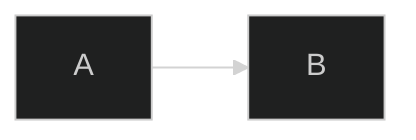

Ключи из массива `secure` диаграмма не меняет: «The entire mermaid configuration (except the secure configs) can be overridden by the diagram author in the frontmatter of the diagram.» По схеме конфигурации в массив входят `secure`, `securityLevel`, `startOnLoad`, `maxTextSize`, `suppressErrorRendering`, `maxEdges`; их задаёт только сайт. Темы, переменные темы, look, layout и ключи верхнего уровня — [mermaid-config.md](mermaid-config.md).

---

## Доступность

Заголовок и описание для экранных дикторов: «Support for accessible titles and descriptions is available for all diagrams/chart types.» (https://mermaid.js.org/config/accessibility.html)

- `accTitle: текст` — только одна строка.
- `accDescr: текст` — одна строка.
- Многострочное описание — `accDescr { … }`, без двоеточия:

```markdown
accDescr {
This is a multiple line accessible description.
It does not have a colon and is surrounded by curly brackets.
}
```

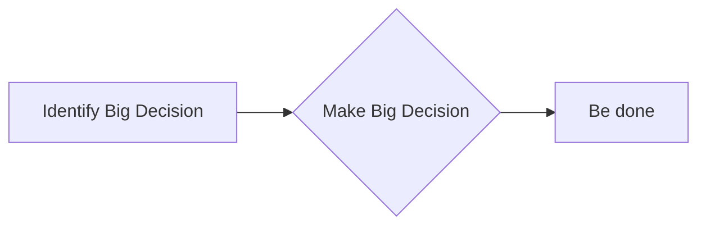


Исключения из правила «для всех типов» отмечены в файлах групп: у диаграммы Венна токенов `accTitle` и `accDescr` в грамматике нет.

---

## Подписи и экранирование

- Текст со «сложными» символами — в двойных кавычках:

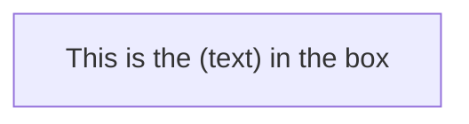

- Юникод — тоже в кавычках: «Use `"` to enclose the unicode text.»

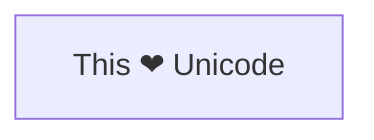

- Коды сущностей: `#quot;` — двойная кавычка, десятичные коды вида `#9829;`, HTML-имена символов. «Numbers given are base 10, so `#` can be encoded as `#35;`. It is also supported to use HTML character names.» Точка с запятой в тексте сообщения диаграммы последовательности — `#59;`.

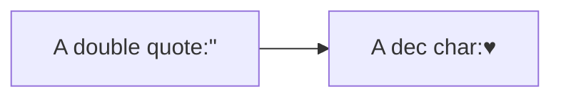

- Markdown-строка — текст в двойных кавычках и обратных апострофах: ``"`…`"``. Жирный — `**`, курсив — `*`; новая строка — физический перевод строки вместо `<br>`; длинный текст переносится автоматически. По документации Markdown-строки работают в блок-схеме и интеллект-карте («The "Markdown Strings" feature enhances flowcharts and mind maps …»); Markdown в подписях описан также на страницах ER-диаграммы, диаграммы требований и диаграммы вариантов использования. Все примеры Markdown-строк на странице блок-схемы заданы с `htmlLabels: false` во frontmatter.

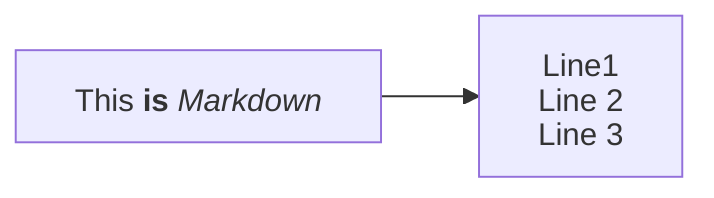

- Автоперенос Markdown-строк выключает `markdownAutoWrap: false`:

```
---
config:
  markdownAutoWrap: false
---
graph LR
```

---

## Стилизация, общее

Механизм описан на странице блок-схемы (https://mermaid.js.org/syntax/flowchart.html#styling-and-classes); у остальных типов поддержка разная — что работает у типа, сказано в файле его группы.

- Стиль одного узла — `style`:

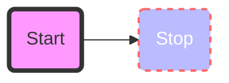

- Класс стилей — `classDef`; несколько классов одной строкой; назначение класса узлу или списку узлов — `class`:

```
    classDef className fill:#f9f,stroke:#333,stroke-width:4px;
```

```
    classDef firstClassName,secondClassName font-size:12pt;
```

```
    class nodeId1 className;
```

```
    class nodeId1,nodeId2 className;
```

- Короткая форма назначения класса — `:::`:

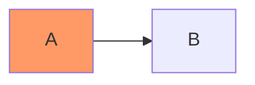

- Класс с именем `default` применяется ко всем узлам без собственного класса:

```
    classDef default fill:#f9f,stroke:#333,stroke-width:4px;
```

- В значении `stroke-dasharray` запятые экранируются: «When setting the `stroke-dasharray` property, remember to escape commas as `\,` since commas are used as delimiters in Mermaid’s style definitions.»
- Внешний CSS страницы встроенные стили не перекрывает: «Mermaid's internal styles are injected with `!important` and scoped to the SVG element ID, giving them higher specificity than external CSS rules. External CSS will be silently overridden.» Оформлять — через `classDef`.

---

## Умолчания Mermaid 12

С 12.0.0 часть типов по умолчанию рисуется темой `redux-color` и видом `neo`. Таблица «Per-diagram defaults» (https://mermaid.js.org/config/theming.html); слева — ключ конфигурации, справа — ключевое слово диаграммы:

| Config key    | Diagram              |
| ------------- | -------------------- |
| `agentflow`   | `agentflow-beta`     |
| `flowchart`   | `flowchart`          |
| `swimlane`    | `swimlane-beta`      |
| `class`       | `classDiagram`       |
| `er`          | `erDiagram`          |
| `requirement` | `requirementDiagram` |
| `sequence`    | `sequenceDiagram`    |
| `state`       | `stateDiagram`       |
| `usecase`     | `usecase-beta`       |
| `venn`        | `venn-beta`          |

«Every other diagram type defaults to the `default` theme and the `classic` look.»

Раскладка: «ELK is bundled and default from v12.0.0» — для блок-схемы, диаграмм состояний, классов, ER, требований, вариантов использования и Agentflow (https://mermaid.js.org/config/layouts.html); у диаграммы дорожек своя раскладка `swimlane`, у интеллект-карты — `cose-bilkent`.

Вернуть прежний вид одной диаграммы — задать во frontmatter `theme: default`, `look: classic`, `layout: dagre`. «Both are only defaults, so anything you set yourself wins.»

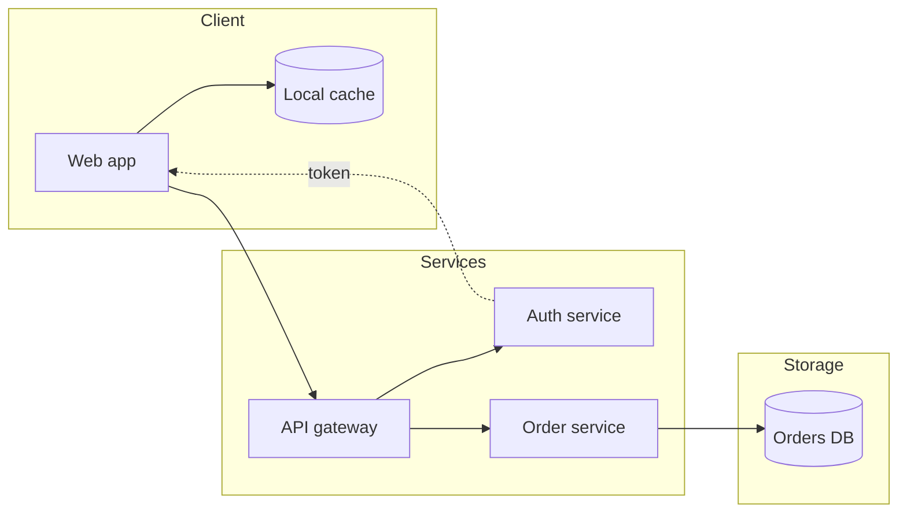

Блок один на весь раздел: в файлах групп примеры «The previous appearance» не повторяются. Для диаграмм последовательности, дорожек и Венна страницы документации возвращают прежний вид двумя ключами — `theme: default` и `look: classic`.

---

## Ловушки, общие для многих типов

- Слово `end` строчными. Блок-схема: «If you are using the word "end" in a Flowchart node, capitalize the entire word or any of the letters (e.g., "End" or "END"), or apply this [workaround](https://github.com/mermaid-js/mermaid/issues/1444#issuecomment-639528897). Typing "end" in all lowercase letters will break the Flowchart.» Диаграмма последовательности: «If unavoidable, one must use parentheses(), quotation marks "", or brackets {},\[], to enclose the word "end". i.e : (end), \[end], {end}.»
- Буквы `o` и `x` сразу после связи: «If you are using the letter "o" or "x" as the first letter in a connecting Flowchart node, add a space before the letter or capitalize the letter (e.g., "dev--- ops", "dev---Ops").» Иначе «Typing "A---oB" will create a circle edge.» и «Typing "A---xB" will create a cross edge.»
- Вложенные фигуры в подписи: «Mermaid gets confused with nested shapes»; решение по документации — «wrap them in quotation marks to prevent breaking».
- Шестнадцатеричный цвет в `box` диаграммы последовательности: «**Hex colors** (e.g., `#ff0000`) are currently **not supported** as the `#` character is interpreted as comment syntax.» Цвет `box` задают именем или `rgb()`, `rgba()`, `hsl()`, `hsla()`.

---

## Правила

- ЕСЛИ площадка рендера неизвестна -> писать стабильными типами без суффикса `-beta`, а если важен внешний вид — явно задать `layout`, `theme` и `look` во frontmatter
- ЕСЛИ площадка названа -> свериться с [mermaid-platforms.md](mermaid-platforms.md): своя ли у неё отрисовка, какую версию Mermaid она называет, какие конструкции не поддерживает
- ЕСЛИ диаграмму нужно проверить -> прогнать целевым рендером (mermaid.live или `mmdc -i файл.mmd -o файл.svg`), а не эвристикой — продолжение правила из [markdown.md](markdown.md) о целевом парсере
- ЕСЛИ в подписи нужна формула -> KaTeX поддерживается только в блок-схеме и диаграмме последовательности (https://mermaid.js.org/config/math.html): формула между `$$`, синтаксис формулы — [latex.md](latex.md)
- ЕСЛИ диаграмму нужно отрисовать в FigJam -> инструмент `generate_diagram` поддерживает не все типы, процедура — в скилле skill-figma-mcp
- ЕСЛИ раскладка или тема влияют на результат -> задать `layout`, `theme` и `look` явно: разные страницы документации 12.1.0 по-разному называют раскладку по умолчанию, а для git-графа и временной шкалы — тему по умолчанию
- ЕСЛИ тип или конструкция помечены версией -> сравнить её с версией Mermaid площадки; конструкцию новее версии площадки не использовать
- ЕСЛИ версия появления на странице и в журнале изменений расходится -> считать версией появления более позднюю: для диаграмм Венна и Исикавы, полустрелок и центральных соединений диаграммы последовательности — 11.13.0
- ЕСЛИ в коде встречается `%%{init: …}%%` -> переписать конфигурацию во frontmatter с ключом `config:`
- ЕСЛИ нужен ключ из массива `secure` (`securityLevel`, `maxTextSize`, `maxEdges` и другие) -> из текста диаграммы его не задать: это настройка сайта
- ВСЕГДА писать ключевое слово типа первой строкой (после frontmatter) и в точности по каталогу
- НИКОГДА не писать синтаксис типа по памяти — только по файлу его группы

---

## Изменения между версиями

Выжимка по журналу изменений (https://github.com/mermaid-js/mermaid/blob/develop/packages/mermaid/CHANGELOG.md) и странице релизов (https://github.com/mermaid-js/mermaid/releases).

**Устарело и чем заменено:**

- директивы `%%{init}%%` (с v10.5.0) -> ключ `config` во frontmatter;
- `flowchart.htmlLabels` -> корневой `htmlLabels`;
- ключевое слово `flowchart-elk` -> `flowchart`; ELK теперь раскладка по умолчанию, а старая форма по-прежнему работает;
- опция `defaultRenderer` в секциях `flowchart`, `class`, `state` удалена в 12.0.0: «Configuration that still sets `defaultRenderer` is ignored rather than rejected» — раскладку выбирает только `layout`.

**Переименовано:** суффикс `-beta` снят у `xychart`, `block`, `sankey` (11.10.0) и `packet` (11.9.0). Старые формы с `-beta` по-прежнему распознаются.

**Сменились умолчания:**

- 12.1.0 — `elk.orientFeedbackEdges` включён: «an edge from a node that a subgraph feeds back into that subgraph is now routed downstream instead of around the subgraph»;
- 12.0.0 — раскладка ELK вместо dagre и тема `redux-color` с видом `neo` для типов из таблицы «Per-diagram defaults» (раздел «Умолчания Mermaid 12»);
- 11.17.1 — текст элементов C4 переносится по умолчанию (`c4.wrap: true`);
- 11.17.0 — диаграмма классов рисуется единым рендерером;
- 11.15.0 — в диаграмме состояний комментарий только `%%`: «comments starting with one `%` are no longer treated as comments»;
- 11.14.0 — раскладка диаграммы архитектуры детерминирована (`randomize: false`);
- 11.13.0 — простые подписи блок-схемы снова простой текст, Markdown — только в ``"`…`"``; рёбра ELK по умолчанию с кривой `rounded`;
- 11.10.0 — направление `TD` в блок-схеме ведёт себя как `TB`.

**Появилось в 11.x и 12.x:** новые типы с версиями появления — в каталоге; новые конструкции существующих типов помечены версиями в файлах групп.
